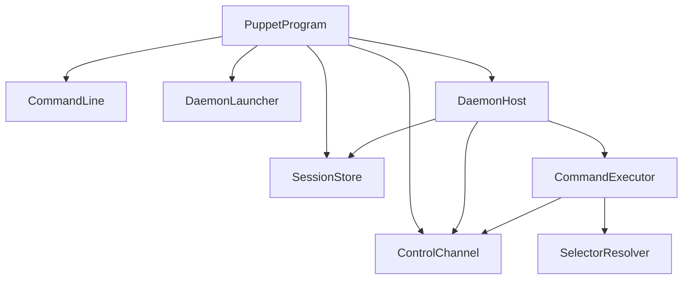

# ReviewCenterPuppet

## Architecture

ReviewCenterPuppet, called Puppet in this chapter, is a development tool that lets a developer or a coding
agent drive the real ReviewCenter web application in a browser from the command line. A session starts the
ReviewCenter server on a random local port, opens a headless Chromium browser, and then accepts the commands
`goto`, `click`, `fill`, `text`, `screenshot`, and `snapshot` until the session is stopped. The tool is a console
application on net10.0 and is built from `tools/puppet`.

### Separate System and Development Tool

Puppet is documented as a separate software system, not as a subsystem of ReviewCenter, for these reasons:

- It is development tooling. It is not part of the distributed ReviewCenter package, is not shipped to users, and
  is never loaded by the ReviewCenter server. The architecture records this as an architectural decision.
- Keeping it out of the ReviewCenter system keeps the ReviewCenter requirements, design, and structure view free of
  behavior that no end user can observe.
- It has its own requirement identifier prefix, `ReviewCenterPuppet-`, and its own review-sets, so a change to the
  tool is reviewed and traced on its own.
- It depends on ReviewCenter only at run time: it launches the built server assembly as a separate process and
  talks to it through a browser. The project reference in the solution exists only to order the build and does not
  reference the server assembly.

The system is flat: its eight units sit directly under the system and there are no subsystems, because the tool is
small and its units form a single layered chain.

### Units

- `PuppetProgram` is the entry point. It parses the arguments with `CommandLine`, orchestrates `start`, `stop`, and
  `list`, forwards every browser command to the daemon through the `ControlChannel` client, and maps every outcome
  to an exit code.
- `CommandLine` parses the verb, its positional arguments, and the global options strictly.
- `SelectorResolver` turns the selector text a user types into a Playwright selector.
- `SessionStore` persists session files and detects and cleans up stale sessions.
- `ControlChannel` is the loopback-only, token-authenticated JSON line protocol, with a client and a server side.
- `CommandExecutor` runs one browser command against an abstract page and returns a control response.
- `DaemonHost` is the body of the daemon process. It owns the server, the browser, and the control channel server.
  It also contains the production adapters for the server process and for the Playwright browser, which sit behind
  small interfaces so that the rest of the tool can be tested with fakes.
- `DaemonLauncher` starts the daemon as a detached background process.

### Daemon Design

Browser state must survive between the separate commands a caller runs, so each session has a long-lived daemon
process. `start` does not run the browser itself. It calls `DaemonLauncher`, which starts the same executable again
with a hidden `__daemon` verb as a detached process that outlives the calling command, its console, and, where the
operating system allows it, the job that contains it. The daemon runs `DaemonHost`, which:

1. binds the control channel on a loopback port, creates a random token, and writes the session file with the
   status `Starting`;
2. starts the ReviewCenter server on a free loopback port and waits until its health endpoint answers;
3. launches headless Chromium;
4. writes the session file with the status `Ready`, now including the server URL and the process identifiers of the
   daemon, the server, and the browser;
5. serves commands until `stop` is received, the idle period of 30 minutes passes, or the process is cancelled;
6. closes the browser, stops the server, and deletes the session file.

If step 2 or 3 fails, the daemon writes the session file with the status `Failed` and the reason and exits with
code 4. The parent `start` command polls the session file, reports the outcome, and deletes a failed file.

### Start Reservation and Abort

Two `start` commands for the same session id must not both launch a daemon. Before it launches anything, `start`
reserves the id by creating a lock file next to the session file with an exclusive create, so exactly one caller
wins. The loser fails at once with a clear error and a non-zero exit code. The reservation is released when `start`
ends, whatever the outcome, and a reservation whose owner has died is taken over by the next caller.

`start` knows the identity of the daemon it launched. When the start-up times out, is cancelled, or finds that the
daemon died, `start` terminates that daemon, and any server or browser already recorded in the session file, and
removes the partial session state, even if the daemon never wrote a session file. Every process is verified by its
id and its start time before it is ended, and no process is ever ended by name.

### Known Limitation: `stop` During a Slow `start`

`puppet stop` cannot interrupt a `start` that is still starting. The daemon runs control commands only after the
start-up has completed, so a `stop` sent earlier is answered with a "try again shortly" failure. The start-up is
bounded by a timeout, after which `start` aborts the session as described above, so the situation always ends by
itself. A caller that wants to give up early can end the `start` command, which terminates the daemon the same
way.

## External Interfaces

**Command-Line Interface**: The input interface used by developers and coding agents.

- *Type*: CLI.
- *Role*: Consumer (the caller runs one command per invocation).
- *Contract*: Accepts the verbs `start`, `goto <path>`, `click <selector>`, `fill <selector> <text>`,
  `text <selector>`, `screenshot`, `snapshot`, `stop`, and `list`, and the options `--session <id>`,
  `--timeout <seconds>`, `--out <file>` and `--full-page` (screenshot only), and `--server <path>` (start only).
  Results are written to standard output and problems to standard error.
- *Constraints*: Exit code 0 means success, 1 a failed command or invalid arguments, 2 an unknown session, 3 a stale
  session that was cleaned up, and 4 a session that could not be started. The command timeout is 10 seconds by
  default and may be set from 1 to 600 seconds. When `--session` is omitted, the session is taken from the
  `REVIEWCENTER_PUPPET_SESSION` environment variable or, failing that, from the only running session.

**Session Files**: The shared state between client commands and the daemon.

- *Type*: File.
- *Role*: Provider and consumer.
- *Contract*: One JSON file per session in the `reviewcenter-puppet` folder of the system temporary folder, holding
  the session id, status, control port and token, server URL, process identifiers and start times, and any error.
- *Constraints*: Files are written atomically. The control token is stored only in this file, so the file is the
  credential of the session and is readable by its owner only: on Unix platforms the folder is created with mode
  0700 and each file with mode 0600, set when they are created so that there is no moment of wider access. On
  Windows the system temporary folder is already private to the current user, so no extra permissions are set. A
  file whose daemon is gone is stale and is removed by the first command that notices, together with the server and
  browser processes it recorded.

**Control Channel**: The connection from a client command to the daemon.

- *Type*: TCP on the loopback interface, one JSON object per line.
- *Role*: Provider (the daemon) and consumer (the client commands).
- *Contract*: A request carries the session token, the command, and its arguments. A response carries a success
  flag, an exit code, and a message.
- *Constraints*: The listener binds only to the loopback interface on a port chosen by the operating system. Every
  request must carry the session token. One request is handled at a time.

**ReviewCenter Server Process**: The application being driven.

- *Type*: Child process serving HTTP.
- *Role*: Consumer.
- *Contract*: The daemon runs the server assembly with the `serve` verb on `http://127.0.0.1:<free port>` and waits
  for `/health`. The assembly is located with the `--server` option, the `REVIEWCENTER_SERVER_DLL` environment
  variable, or the path recorded in the build metadata of the tool, in that order.
- *Constraints*: A missing assembly is reported as a start failure with a hint to build the solution first.

**Headless Chromium**: The browser that renders the application.

- *Type*: Browser automation through Microsoft Playwright.
- *Role*: Consumer.
- *Contract*: One page of a headless browser with a 1280 by 720 viewport per session. After every navigation the
  tool waits until the page reports that the interactive connection is established.
- *Constraints*: Chromium must have been installed once with the Playwright installation script. When it is missing,
  the start failure message names the command that installs it.

**Screenshot Files**: Images written by the `screenshot` command.

- *Type*: File.
- *Role*: Provider.
- *Contract*: A PNG file at the `--out` path, or by default in the `reviewcenter-puppet` folder of the system
  temporary folder, named after the session and the time.
- *Constraints*: The path of the written file is printed so that the caller can open it.

## Dependencies

- **Microsoft.Playwright**: provides browser automation. It is used only inside the Playwright adapter of
  `DaemonHost`; every other unit works against the `IBrowserPage` interface.
- **ReviewCenter server executable**: the built ReviewCenter assembly that the daemon starts with the `serve` verb.
  Puppet has no compile-time dependency on it.
- **Chromium**: the browser installed once for Playwright. The tool does not install it.
- **.NET runtime services**: process management, loopback sockets, and JSON serialization from the .NET base class
  library. No other packages are used.

## Risk Control Measures

N/A - Puppet is a development tool and is not a safety-classified software item. Its security measures are
documented under Design Constraints.

## Data Flow

1. The caller runs `puppet start`. `PuppetProgram` parses the arguments, reserves the session id with `SessionStore`,
   checks the session, and asks `DaemonLauncher` to start the detached daemon.
2. The daemon runs `DaemonHost`, which binds the control channel, writes the session file, starts the server and the
   browser, and writes the session file as ready. `PuppetProgram` polls the file, and prints the session id and the
   server URL when the status becomes `Ready`. If the start-up times out or is cancelled, `PuppetProgram` ends the
   daemon it launched and removes the session state. The reservation is released at the end.
3. The caller runs a browser command such as `puppet click hello-button`. `PuppetProgram` looks the session up in
   `SessionStore`, builds a control request with the stored token, and sends it through the `ControlChannel` client
   to the stored port.
4. The control channel server checks the token and passes the request to `CommandExecutor`, which resolves the
   selector with `SelectorResolver`, performs the action on the browser page, and returns a control response.
5. `PuppetProgram` prints the message of the response and returns its exit code.
6. The caller runs `puppet stop`. The daemon receives the stop request, closes the browser, stops the server, and
   deletes the session file. `PuppetProgram` waits for the daemon to end and falls back to ending it by force.
7. If a daemon dies without cleaning up, the next command that looks the session up finds that the recorded process
   no longer exists, deletes the session file, stops a leftover server and browser, and reports exit code 3.

## Design Constraints

- Platform: targets net10.0 on Windows and Linux. Detaching the daemon uses operating system specific
  process creation on Windows and the standard process API elsewhere.
- Distribution: Puppet is not packed, published, or shipped with ReviewCenter and must not be referenced by it.
- Network exposure: the control channel and the server listen only on the loopback interface, on ports chosen by the
  operating system. Nothing is reachable from other machines.
- Authentication: every control request carries a random 256-bit session token that is compared in fixed time. The
  token exists only in the session file of the current user, which is created readable by its owner only on Unix
  platforms. On Windows the per-user system temporary folder provides that isolation.
- Navigation scope: `goto` accepts only a rooted path or an address inside the session's own server.
- Path safety: a session id is limited to 1 to 32 letters, digits, hyphens, and underscores before it is used in a
  file name.
- Process identity: a process counts as the recorded daemon only when both its id and its start time match, so a
  recycled process id is never mistaken for a daemon or killed. The same rule applies to the server and the browser,
  and no process is ever ended by name.
- Exclusive start: the session id is reserved with an exclusive file create before a daemon is launched, so two
  simultaneous `start` commands for one id cannot both launch.
- No orphans: a start that times out, is cancelled, or fails ends the daemon it launched, and a failed server stop is
  escalated and reported instead of being ignored.
- Bounded waiting: every browser wait and every control channel exchange has a timeout, and an unused session shuts
  itself down after 30 minutes.
- Testability: the server process, the browser, and the daemon launcher are used through interfaces so that the
  tool is verified with fakes on machines without Chromium. The production adapters are exercised by one real-browser
  end-to-end test.
