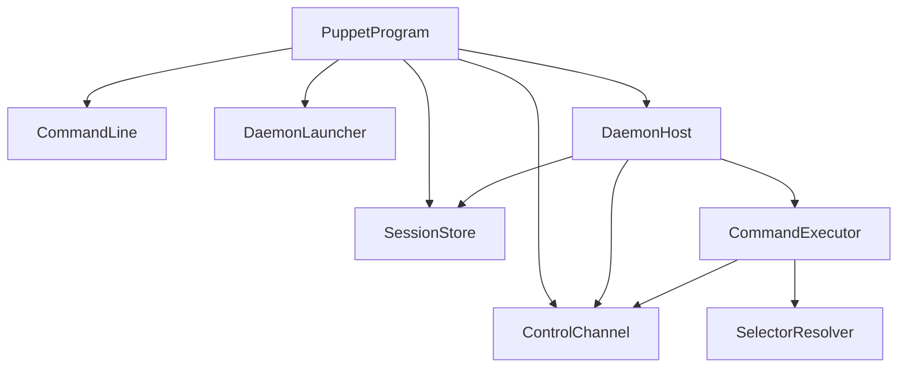

# ReviewCenterPuppet

## Architecture

ReviewCenterPuppet, called Puppet in this chapter, is a development tool that lets a developer or a coding
agent drive the real ReviewCenter web application in a browser from the command line. A session starts the
ReviewCenter server on a random local port, opens a headless Chromium browser, and then accepts the commands
`goto`, `click`, `fill`, `text`, `screenshot`, and `snapshot` until the session is stopped. The tool is a console
application on net10.0 and is built from `tools/puppet`.

### Separate System and Development Tool

Puppet is documented as a separate software system, not as a subsystem of ReviewCenter, for these reasons:

- It is development tooling. It is not part of the distributed ReviewCenter package, is not shipped to users, and
  is never loaded by the ReviewCenter server. The architecture records this as an architectural decision.
- Keeping it out of the ReviewCenter system keeps the ReviewCenter requirements, design, and structure view free of
  behavior that no end user can observe.
- It has its own requirement identifier prefix, `ReviewCenterPuppet-`, and its own review-sets, so a change to the
  tool is reviewed and traced on its own.
- It depends on ReviewCenter only at run time: it launches the built server assembly as a separate process and
  talks to it through a browser. The project reference in the solution exists only to order the build and does not
  reference the server assembly.

The system is flat: its eight units sit directly under the system and there are no subsystems, because the tool is
small and its units form a single layered chain.

### Units

- `PuppetProgram` is the entry point. It parses the arguments with `CommandLine`, orchestrates `start`, `stop`, and
  `list`, forwards every browser command to the daemon through the `ControlChannel` client, and maps every outcome
  to an exit code.
- `CommandLine` parses the verb, its positional arguments, and the global options strictly.
- `SelectorResolver` turns the selector text a user types into a Playwright selector.
- `SessionStore` persists session files and detects and cleans up stale sessions.
- `ControlChannel` is the loopback-only, token-authenticated JSON line protocol, with a client and a server side.
- `CommandExecutor` runs one browser command against an abstract page and returns a control response.
- `DaemonHost` is the body of the daemon process. It owns the server, the browser, and the control channel server.
  It also contains the production adapters for the server process and for the Playwright browser, which sit behind
  small interfaces so that the rest of the tool can be tested with fakes.
- `DaemonLauncher` starts the daemon as a detached background process.

### Daemon Design

Browser state must survive between the separate commands a caller runs, so each session has a long-lived daemon
process. `start` does not run the browser itself. It calls `DaemonLauncher`, which starts the same executable again
with a hidden `__daemon` verb as a detached process that outlives the calling command, its console, and, where the
operating system allows it, the job that contains it. The daemon runs `DaemonHost`, which:

1. binds the control channel on a loopback port, creates a random token, and writes the session file with the
   status `Starting`;
2. starts the ReviewCenter server on a free loopback port and waits until its health endpoint answers;
3. launches headless Chromium;
4. writes the session file with the status `Ready`, now including the server URL and the process identifiers of the
   daemon, the server, and the browser;
5. serves commands until `stop` is received, the idle period of 30 minutes passes, or the process is cancelled;
6. closes the browser, stops the server, and deletes the session file.

If step 2 or 3 fails, the daemon writes the session file with the status `Failed` and the reason and exits with
code 4. The parent `start` command polls the session file, reports the outcome, and deletes a failed file.

### Start Reservation and Abort

Two `start` commands for the same session id must not both launch a daemon. Before it launches anything, `start`
reserves the id by creating a lock file next to the session file with an exclusive create, so exactly one caller
wins. The loser fails at once with a clear error and a non-zero exit code. The reservation is released when `start`
ends, whatever the outcome, and a reservation whose owner has died is taken over by the next caller.

`start` knows the identity of the daemon it launched. When the start-up times out, is cancelled, or finds that the
daemon died, `start` terminates that daemon, and any server or browser already recorded in the session file, and
removes the partial session state, even if the daemon never wrote a session file. Every process is verified by its
id and its start time before it is ended, and no process is ever ended by name.

### Known Limitation: `stop` During a Slow `start`

`puppet stop` cannot interrupt a `start` that is still starting. The daemon runs control commands only after the
start-up has completed, so a `stop` sent earlier is answered with a "try again shortly" failure. The start-up is
bounded by a timeout, after which `start` aborts the session as described above, so the situation always ends by
itself. A caller that wants to give up early can end the `start` command, which terminates the daemon the same
way.

### Race Audit: Check-Then-Act Sites

Puppet is a set of short-lived commands and long-lived daemons that share session files, lock files, and process
identities, so every place that checks something and acts on the result later is a potential race. The code was audited
once, systematically, for every deletion of a session or lock file, every process kill or termination (including
every lookup of a process by id), every stale-session cleanup, every lock-file handling path, every file move or
replace, and every readiness or health probe. Each site is listed below with the *check*, the *act*, the *window*
between them, what happens when the record or process is replaced or reused in that window, and the *guard*. The
entries use a list instead of a table because five wide columns do not fit the 120-character documentation limit.

The guards that appear most often are:

- **Delete-if-same**: a record is deleted only while it still describes the session that was examined
  (`SessionStore.IsSameSession`: session id, daemon identity, and control token), under the start reservation. There is
  no unconditional delete of a session record: `SessionStore.Delete` is private.
- **Identity revalidation**: a process is ended only when its process id and its start time (within a two-second clock
  tolerance) match the recorded identity, never by name. On Windows the check and the kill use one process handle.
- **Lock held**: a decision that must not interleave with a `start` is taken while holding the start reservation.
- **Ownership check**: a daemon publishes only into a file that is missing, corrupt, or its own (`WriteIfOwner`).
- **Strict acceptance**: an answer from a loopback port is accepted only when it has the exact expected form.

#### SessionStore

1. **Write (replace the file)**. *Check*: none; the content is written to a temporary file first. *Act*: move the
   temporary file over the target. *Window*: another process has the target open (Windows sharing violation).
   *If replaced or reused*: the last complete write wins and readers see the old or the new file, never a partial one.
   *Guard*: the move is retried about twenty times for `IOException` and `UnauthorizedAccessException` alike; when it
   still fails, the temporary file (which holds the token) is deleted and the error propagates.
2. **WriteIfOwner (daemon publishes a record)**. *Check*: read the current file and compare the session with
   `IsSameSession`. *Act*: replace the file. *Window*: milliseconds between the read and the move. *If replaced or
   reused*: a record of another session is never overwritten once seen, so a force-stopped daemon cannot clobber a new
   session. *Guard*: ownership check; an unreadable file fails loudly instead of guessing. *Residual*: another session
   publishing inside the read-to-move window. It cannot happen while the invariant holds that every path that deletes
   or replaces a session record first confirms that the recorded daemon is gone (by identity), so a replacement
   session never exists while the old daemon can still write. Only a failed confirmation (a process that cannot be
   ended) keeps the record in place, and then no replacement is published. The check is therefore a second line of
   defense, not an atomic compare-and-swap (see residual risks).
3. **DeleteIfSame**. *Check*: take the start reservation, re-read the file, compare with the examined record. *Act*:
   delete the file. *Window*: none against a `start` (it needs the reservation to publish); a daemon's own
   `WriteIfOwner` of the same session may interleave, and deleting that file is the intent. *If replaced or reused*:
   a different session returns `Replaced` and is kept; a held reservation returns `Busy`. *Guard*: delete-if-same under
   the lock; a sharing or access error that outlasts the retries returns `Busy` instead of throwing, so the caller
   keeps the record and can retry.
4. **Delete (private; delete with retry)**. *Check*: after a failed delete, whether the file is gone. *Act*: delete.
   *Window*: another party deleting the same file at the same moment. *If replaced or reused*: a file that vanished
   counts as deleted. *Guard*: reachable only from `DeleteIfSame`; retries `IOException` and
   `UnauthorizedAccessException`; the last attempt is outside the loop and succeeds when the file is gone.
5. **Lookup (stale-session cleanup)**. *Check*: read the record and test its daemon. *Act*: end the recorded server and
   browser, then `DeleteIfSame`. *Window*: the liveness test and the kills (hundreds of milliseconds). *If replaced or
   reused*: the kills use the identities from the examined record, so a new session's processes are untouched; a
   replaced file is re-examined, at most three times, then reported as an error. *Guard*: identity revalidation plus
   delete-if-same. An unreadable file is never treated as stale. A `start` (which holds the reservation) whose stale
   record stays undeletable gets an error instead of launching a daemon into it.
6. **TryReserve (create the lock)**. *Check/act*: one exclusive create (`CreateNew`), so there is no separate check.
   *Window*: none. *Guard*: atomicity of the create; a create that fails because the file is pending deletion (Windows
   access denied) counts as held.
7. **TryReclaimStaleLock (take over a dead owner's lock)**. *Check*: read the owner's identity from the lock file.
   *Act*: delete the lock, then create it. *Window*: previously the path was checked and then renamed and deleted
   separately, so a second reclaimer could delete the first one's fresh lock. *If replaced or reused*: now the check
   and the delete use one open handle (Windows: delete sharing, so the path stays bound to the file; Unix: exclusive
   open, which is an advisory lock), so only the file that was judged is deleted. The one caller that deletes without taking
   part in that exclusion is `Release`, which unlinks without opening; it is called only by the process that owns the
   lock, and a reclaimer judges a lock stale only when its owner is gone, so the two cannot meet for one lock.
   *Guard*: lock held on the handle; a sharing or access error means "held", a missing file means "free"; no renamed
   leftover is created.
8. **Release (delete the own lock)**. *Check*: none (the owner deletes its own lock). *Act*: delete. *Window*: a
   reclaimer has the file open. *If replaced or reused*: another caller can reclaim the lock only after this process
   was judged dead, which identity makes impossible while it runs. *Guard*: retried for `IOException` and
   `UnauthorizedAccessException`; a delete that still fails is swallowed because the next caller reclaims a lock whose
   owner is gone, and an exception from `finally` must not hide the real result.
9. **IsProcessAlive and KillProcess (process lookup by id)**. *Check*: look up the process id and compare the start
   time. *Act*: kill the process tree. *Window*: between the comparison and the kill. *If replaced or reused*: on
   Windows the process object holds one handle, so the process that was compared is the one killed. On Unix there is no
   portable process descriptor in .NET, so the residual window below remains. *Guard*: identity revalidation on the same
   `Process` object; the kill goes through `TryKill`.
10. **TryKill (kill outcome)**. *Check*: none. *Act*: `Process.Kill(true)`. *Window*: the process or a descendant
    exits meanwhile. *If replaced or reused*: `InvalidOperationException`, `Win32Exception`, `NotSupportedException`,
    and the `AggregateException` of a partial tree kill mean "already gone or not accessible" and are absorbed; any
    other exception propagates. *Guard*: callers confirm by re-checking liveness, never by trusting the kill.
11. **Terminate, IsDaemonAlive, HasLiveProcesses**. These are advisory checks: they decide whether to keep waiting. The
    kill itself revalidates the identity, so a stale answer cannot cause a wrong kill.
12. **TryRead and the read retries**. *Check*: the file exists. *Act*: open and read it. *Window*: the file is deleted
    or replaced between the two. *If replaced or reused*: a missing file reads as unknown; a file that stays locked is
    "unavailable" and is never treated as stale. *Guard*: full sharing on read, bounded retries.
13. **Directory creation and listing**. `CreateDirectory` is idempotent, and `ListIds` is a snapshot that every caller
    re-validates through `Lookup`. A different user pre-creating the folder on Unix can only deny service.

#### PuppetProgram

1. **start**. *Check*: reserve the id, look the session up, launch. *Act*: launch the daemon and publish. *Window*: the
   whole start. *Guard*: the reservation is held until the end of the command, and a stale record found under it is
   deleted with `startLockHeld`.
2. **Start abort (time-out, cancellation, dead daemon, failed daemon)**. *Check*: read the record, kill what it names,
   confirm nothing is alive. *Act*: delete the record. *Window*: the daemon keeps running while it is killed and may
   record a server or browser the abort has not seen. *If replaced or reused*: the abort re-reads the record after each
   round and follows it (only the aborted daemon can have written it, because the abort holds the reservation); the
   launched daemon is also killed by its own identity when the record does not name it. *Guard*: delete-if-same with
   the last record examined, under the reservation; `Replaced` starts another round (at most three), `Busy` reports the
   cleanup as unconfirmed with the file kept. The former unconditional delete was removed.
3. **stop and ForceStop**. *Check*: the daemon accepted the stop and ended, or was killed, and all recorded processes are
   gone. *Act*: delete the record. *Window*: the daemon's teardown, and the forced kills. *If replaced or reused*: the
   record is re-read each round and followed only while it is the same session, so a server the same daemon recorded
   late is ended too, but a replacement session's processes and file are never touched. *Guard*: identity
   revalidation per process, delete-if-same with the original examined record, and a bounded confirmation: when a
   process survives the file is kept and the exit code is 1.
4. **List and session resolution**. *Check*: `Lookup` per id. *Act*: print, or clean up a stale session. *Window*: the
   session ends or is replaced while listing. *If replaced or reused*: the output is a snapshot; any cleanup goes
   through the guarded paths above. *Guard*: `Lookup` (entry 5 of SessionStore).
5. **Client command**. *Check*: `Lookup` says the session is live. *Act*: connect to the recorded port with the
   recorded token. *Window*: the daemon exits, or the session is replaced. *If replaced or reused*: the connection is
   refused or the token is rejected; a foreign listener on the reused port sees only a dead daemon's token, and its
   answer is rejected by the strict parser. A `stop` whose answer is rejected falls back to the forced stop by identity.
   *Guard*: token authentication and strict response parsing (see ControlChannel).
6. **Server assembly path check (`File.Exists`)**. Advisory: a missing file gives a clear message before launching, and
   a file that disappears later fails the start in the daemon.

#### DaemonHost and DaemonLauncher

1. **Daemon records (`Starting`, `Ready`, `Failed`)**. *Check/act*: `WriteIfOwner` (SessionStore entry 2). *If replaced
   or reused*: the daemon is superseded: it writes nothing more, tears down its own server and browser, leaves the other
   session's file, and exits with 4. A failure record that cannot be written is absorbed, so it cannot skip the
   teardown or hide the original failure.
2. **Final delete of the record**. *Check*: the record is still the one this daemon published. *Act*: delete it.
   *Guard*: `DeleteIfSame` under the reservation; if a `start` holds the reservation the record is left for it.
3. **Control port**. *Check/act*: the listener binds port 0 and keeps the socket for the life of the daemon, so no other
   process can take the port in between.
4. **Launch identity (DaemonLauncher)**. *Check*: none. *Act*: the identity (id and start time) is read from the creation
   handle (Windows) or from the `Process` object that started the child. *Window*: previously the id was looked up again
   after the launch, so a daemon that exited at once could have its id recycled and be recorded with another process's
   start time, which the abort would then trust. When the identity cannot be read at all, the created process is ended
   through the same handle before the failure propagates, so no daemon runs without a recorded identity. *Guard*: the
   identity belongs to the process that was created.

#### ServerProcessRunner and PlaywrightBrowser

1. **Free port selection**. *Check*: bind port 0 and read the port. *Act*: release it and start the server on it.
   *Window*: another process can take the port before the server binds. *If replaced or reused*: the server fails to
   bind and exits, while the other process may answer the probe. *Guard*: the probe accepts only status 200 with the
   exact body `Healthy`, does not follow redirects, and requires the server process to be running both before the
   probe and right after a healthy answer; otherwise the start fails with a clear message. The window cannot be
   closed, because the server process must bind the port itself.
2. **Readiness probe**. *Check*: the answer of `/health`. *Act*: treat the server as ready and drive the browser at it.
   *Guard*: strict answer plus the exit check above (this was already strict about status and body; the exit check is
   new). These narrow the race but cannot prove that the answering service is the server that was started: the server
   is an arbitrary application whose only contract is the health endpoint, so no authenticated handshake exists to
   verify (see residual risks).
3. **Server stop**. *Check*: the process exited after the first kill. *Act*: kill the tree again, then fail loudly.
   *Window*: none that matters: the runner holds its own `Process` object, so there is no pid reuse. *Guard*: `TryKill`
   absorbs the already-gone failures.
4. **Browser identity query (`QueryBrowserProcessAsync`)**. *Check*: the browser's process id from DevTools. *Act*:
   look the process up and read its start time. *Window*: microseconds after the answer. *If replaced or reused*: the
   browser would have to exit and its id be reused in that time; the recorded identity would then be of another process.
   *Guard*: none beyond the short window (see residual risks); every failure to find the process records no identity.

#### ControlChannel and CommandExecutor

1. **ControlClient (loopback exchange)**. *Check*: the port and token come from the session record. *Act*: connect and
   exchange one line. *Window*: the daemon dies and another listener takes the port. *If replaced or reused*: the
   channel is a raw line protocol over TCP, not HTTP, so there are no redirects to follow. The client now accepts only
   a JSON object with exactly `Ok` (boolean), `ExitCode` (integer), and `Message` (string), the same strictness as the
   readiness probe, so an answer such as `{}` is an error naming the port instead of a failed command with no message.
   The token that is sent belongs to the dead daemon.
2. **ControlServer**. The token is compared in fixed time on every request, and the listener is held for the life of the
   daemon (no check-then-bind).
3. **Screenshot file (`CommandExecutor`)**. *Check*: none (the directory is created idempotently). *Act*: write the file,
   replacing an existing one. *Window*: none that changes the outcome; the last writer wins, which is the documented
   behavior of an output path chosen by the caller.

#### Residual Risks

These cannot be closed completely and are accepted:

- **Process id reuse on Unix**. Between the start-time comparison and `kill()`, the operating system could in theory
  recycle the id. .NET offers no portable process file descriptor on Unix, so the check and the kill are
  adjacent operations on one `Process` object. The window is microseconds, the start time must also match within two
  seconds, and an id is not normally reused that quickly. On Windows the process handle pins the process and the
  window does not exist.
- **Access denied reads as "not alive"**. `IsProcessAlive` cannot read the start time of a process that belongs to
  another user or is elevated, so such a process is treated as not alive. This is the safe direction for kills (nothing
  is killed) but can make a stale cleanup delete the record of a session whose daemon runs elevated.
- **Browser identity from DevTools**. See the browser identity query above.
- **Port reuse after a daemon dies**. See ControlClient above. The strict response parser rejects a foreign service
  that answers in another shape, but a listener that copies the exact shape after reading the dead daemon's token could
  be believed for a single command. Binding responses to the request would need a challenge-response protocol (the
  token would have to stop being sent in the request); the exposure is a window of milliseconds after a daemon died, for
  a same-machine listener that must win the port, and the token it reads belongs to a session that no longer exists.
- **Free port selection**. See above; the strict probe and the exit check turn the outcome into a failed start.
- **Interval in `WriteIfOwner`**. See SessionStore entry 2; accepted because of the invariant stated there.
- **Release and the Unix advisory lock**. See SessionStore entry 7; the two paths are separated by lock ownership, not
  by the operating system.
- **Deletion that stays `Busy`**. A stop or abort whose processes are confirmed gone but whose record cannot be
  removed keeps the record; the next command finds the daemon gone, reports the session as stale, and removes it.
- **Leftover temporary files**. A writer killed between creating the temporary file and moving it leaves an owner-only
  `.tmp` file in the session folder. It is never read as a session.
- **A daemon recording after the final abort read**. The last read of an abort cannot be followed by another round
  if the daemon records a process in that exact moment; the kill of the daemon itself precedes the final read, so this
  needs the daemon to survive the kill, in which case the cleanup is reported as unconfirmed and the record is kept.

## External Interfaces

**Command-Line Interface**: The input interface used by developers and coding agents.

- *Type*: CLI.
- *Role*: Consumer (the caller runs one command per invocation).
- *Contract*: Accepts the verbs `start`, `goto <path>`, `click <selector>`, `fill <selector> <text>`,
  `text <selector>`, `screenshot`, `snapshot`, `stop`, and `list`, and the options `--session <id>`,
  `--timeout <seconds>`, `--out <file>` and `--full-page` (screenshot only), and `--server <path>` (start only).
  Results are written to standard output and problems to standard error.
- *Constraints*: Exit code 0 means success, 1 a failed command or invalid arguments, 2 an unknown session, 3 a stale
  session that was cleaned up, and 4 a session that could not be started. The command timeout is 10 seconds by
  default and may be set from 1 to 600 seconds. When `--session` is omitted, the session is taken from the
  `REVIEWCENTER_PUPPET_SESSION` environment variable or, failing that, from the only running session.

**Session Files**: The shared state between client commands and the daemon.

- *Type*: File.
- *Role*: Provider and consumer.
- *Contract*: One JSON file per session in the `reviewcenter-puppet` folder of the system temporary folder, holding
  the session id, status, control port and token, server URL, process identifiers and start times, and any error.
- *Constraints*: Files are written atomically. The control token is stored only in this file, so the file is the
  credential of the session and is readable by its owner only: on Unix platforms the folder is created with mode
  0700 and each file with mode 0600, set when they are created so that there is no moment of wider access. On
  Windows the system temporary folder is already private to the current user, so no extra permissions are set. A
  file whose daemon is gone is stale and is removed by the first command that notices, together with the server and
  browser processes it recorded.

**Control Channel**: The connection from a client command to the daemon.

- *Type*: TCP on the loopback interface, one JSON object per line.
- *Role*: Provider (the daemon) and consumer (the client commands).
- *Contract*: A request carries the session token, the command, and its arguments. A response carries a success
  flag, an exit code, and a message.
- *Constraints*: The listener binds only to the loopback interface on a port chosen by the operating system. Every
  request must carry the session token. One request is handled at a time.

**ReviewCenter Server Process**: The application being driven.

- *Type*: Child process serving HTTP.
- *Role*: Consumer.
- *Contract*: The daemon runs the server assembly with the `serve` verb on `http://127.0.0.1:<free port>` and waits
  for `/health`. The assembly is located with the `--server` option, the `REVIEWCENTER_SERVER_DLL` environment
  variable, or the path recorded in the build metadata of the tool, in that order.
- *Constraints*: A missing assembly is reported as a start failure with a hint to build the solution first.

**Headless Chromium**: The browser that renders the application.

- *Type*: Browser automation through Microsoft Playwright.
- *Role*: Consumer.
- *Contract*: One page of a headless browser with a 1280 by 720 viewport per session. After every navigation the
  tool waits until the page reports that the interactive connection is established.
- *Constraints*: Chromium must have been installed once with the Playwright installation script. When it is missing,
  the start failure message names the command that installs it.

**Screenshot Files**: Images written by the `screenshot` command.

- *Type*: File.
- *Role*: Provider.
- *Contract*: A PNG file at the `--out` path, or by default in the `reviewcenter-puppet` folder of the system
  temporary folder, named after the session and the time.
- *Constraints*: The path of the written file is printed so that the caller can open it.

## Dependencies

- **Microsoft.Playwright**: provides browser automation. It is used only inside the Playwright adapter of
  `DaemonHost`; every other unit works against the `IBrowserPage` interface.
- **ReviewCenter server executable**: the built ReviewCenter assembly that the daemon starts with the `serve` verb.
  Puppet has no compile-time dependency on it.
- **Chromium**: the browser installed once for Playwright. The tool does not install it.
- **.NET runtime services**: process management, loopback sockets, and JSON serialization from the .NET base class
  library. No other packages are used.

## Risk Control Measures

N/A - Puppet is a development tool and is not a safety-classified software item. Its security measures are
documented under Design Constraints.

## Data Flow

1. The caller runs `puppet start`. `PuppetProgram` parses the arguments, reserves the session id with `SessionStore`,
   checks the session, and asks `DaemonLauncher` to start the detached daemon.
2. The daemon runs `DaemonHost`, which binds the control channel, writes the session file, starts the server and the
   browser, and writes the session file as ready. `PuppetProgram` polls the file, and prints the session id and the
   server URL when the status becomes `Ready`. If the start-up times out or is cancelled, `PuppetProgram` ends the
   daemon it launched and removes the session state. The reservation is released at the end.
3. The caller runs a browser command such as `puppet click hello-button`. `PuppetProgram` looks the session up in
   `SessionStore`, builds a control request with the stored token, and sends it through the `ControlChannel` client
   to the stored port.
4. The control channel server checks the token and passes the request to `CommandExecutor`, which resolves the
   selector with `SelectorResolver`, performs the action on the browser page, and returns a control response.
5. `PuppetProgram` prints the message of the response and returns its exit code.
6. The caller runs `puppet stop`. The daemon receives the stop request, closes the browser, stops the server, and
   deletes the session file. `PuppetProgram` waits for the daemon to end and falls back to ending it by force.
7. If a daemon dies without cleaning up, the next command that looks the session up finds that the recorded process
   no longer exists, deletes the session file, stops a leftover server and browser, and reports exit code 3.

## Design Constraints

- Platform: targets net10.0 on Windows and Linux. Detaching the daemon uses operating system specific
  process creation on Windows and the standard process API elsewhere.
- Distribution: Puppet is not packed, published, or shipped with ReviewCenter and must not be referenced by it.
- Network exposure: the control channel and the server listen only on the loopback interface, on ports chosen by the
  operating system. Nothing is reachable from other machines.
- Authentication: every control request carries a random 256-bit session token that is compared in fixed time. The
  token exists only in the session file of the current user, which is created readable by its owner only on Unix
  platforms. On Windows the per-user system temporary folder provides that isolation.
- Navigation scope: `goto` accepts only a rooted path or an address inside the session's own server.
- Path safety: a session id is limited to 1 to 32 letters, digits, hyphens, and underscores before it is used in a
  file name.
- Process identity: a process counts as the recorded daemon only when both its id and its start time match, so a
  recycled process id is never mistaken for a daemon or killed. The same rule applies to the server and the browser,
  and no process is ever ended by name.
- Exclusive start: the session id is reserved with an exclusive file create before a daemon is launched, so two
  simultaneous `start` commands for one id cannot both launch.
- Conditional changes: a session record is deleted only when it still describes the session that was examined, and a
  daemon writes a record only when the file is missing, corrupt, or its own, so a replaced session is never harmed by a
  late cleanup. The checked sites and the accepted residual risks are listed in the race audit above.
- No orphans: a start that times out, is cancelled, or fails ends the daemon it launched, and a failed server stop is
  escalated and reported instead of being ignored.
- Bounded waiting: every browser wait and every control channel exchange has a timeout, and an unused session shuts
  itself down after 30 minutes.
- Testability: the server process, the browser, and the daemon launcher are used through interfaces so that the
  tool is verified with fakes on machines without Chromium. The production adapters are exercised by one real-browser
  end-to-end test, which CI runs with Chromium installed and which is linked to the system requirements.
