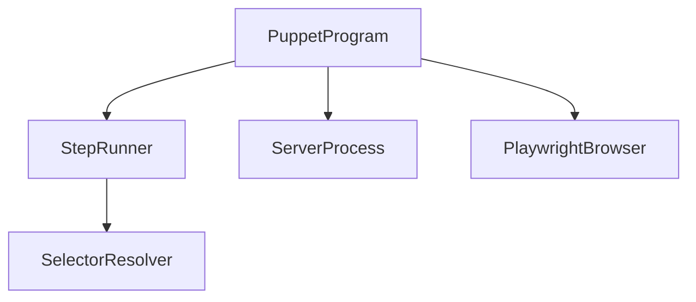

# ReviewCenterPuppet

## Architecture

> **Keep it small.** The Puppet is a minimal helper that lets an AI drive and screenshot the UI. Keep it as small
> and simple as possible: no production-grade hardening, no process-identity/race engineering, best-effort cleanup
> only, few tests. Do not grow it beyond what an agent needs to run steps and see screenshots.

ReviewCenterPuppet, called Puppet in this chapter, is a development tool that lets a developer or a coding agent
drive the real ReviewCenter web application in a browser. One command, `puppet run <steps.json>`, starts the
ReviewCenter server on a free local port, opens a headless Chromium browser, runs the steps of the file in order
(`goto`, `click`, `fill`, `text`, `screenshot`), prints one JSON result line per step, and then stops the browser and
the server again. The tool is a single-process console application on net10.0 built from `tools/puppet`.

### Separate System and Development Tool

Puppet is documented as a separate software system, not as a subsystem of ReviewCenter. It is development tooling:
it is not part of the distributed ReviewCenter package, is never loaded by the ReviewCenter server, and has its own
requirement identifier prefix, `ReviewCenterPuppet-`, and its own review-sets. It depends on ReviewCenter only at run
time: it launches the built server assembly as a separate process and talks to it through a browser. The project
reference in the solution exists only to order the build.

### Units

The system is flat: five units sit directly under the system.

- `PuppetProgram` is the entry point. It parses the arguments, starts the server and the browser, runs the steps,
  tears everything down in a `finally` block, and maps the outcome to an exit code.
- `StepRunner` reads and validates the steps file and executes the steps against an abstract page, so it is tested
  with a fake page.
- `SelectorResolver` turns the selector text of a step into a Playwright selector.
- `ServerProcess` starts the ReviewCenter server on a free loopback port, waits for `/health`, and stops it.
- `PlaywrightBrowser` is the only code that calls Playwright. It implements the page abstraction on headless Chromium.

### Run Lifecycle

1. `PuppetProgram` parses the arguments and reads the steps file. A bad file stops the run before anything starts.
2. Unless `--url` is given, `ServerProcess` starts the server and waits until it is healthy.
3. `PlaywrightBrowser` launches headless Chromium.
4. `StepRunner` runs the steps and prints one result line each. At the first failing step it stops and takes a
   failure screenshot if it can.
5. In a `finally` block the browser is closed and the server process tree is killed. Teardown is best effort: a
   failure to stop something is a warning on standard error and does not change the exit code.

### Known Limitation

If the Puppet process itself is hard-killed (for example by `Stop-Process` or a CI cancellation), the `finally`
block does not run and the server or Chromium may keep running. This is accepted and not engineered around.

## External Interfaces

**Command-Line Interface**: `puppet run <steps.json> [--server-dll <path> | --url <base-url>] [--out <dir>]
[--timeout <seconds>]`. Results go to standard output as JSON lines and problems to standard error. Exit code 0
means every step succeeded, 1 a step failed, and 2 the run could not start (bad arguments or steps file, missing
server assembly, Chromium or server that cannot start). The step time-out is 10 seconds by default, 1 to 600.

**Screenshot Files**: PNG files in the `--out` folder (default `artifacts/puppet`).

**ReviewCenter Server Process**: started with `serve --urls http://127.0.0.1:<free port>`. The assembly is the one
given with `--server-dll` or the path recorded in the build metadata of the tool.

**Headless Chromium**: one page with a 1280 by 720 viewport, driven through Microsoft Playwright. Chromium must be
installed once with the Playwright installation script; when it is missing, the error message names the command.

## Dependencies

- **Microsoft.Playwright**: browser automation, used only inside `PlaywrightBrowser`.
- **ReviewCenter server assembly**: started as a child process; no compile-time dependency.
- **Chromium**: installed once per machine by the developer; the tool does not install it.

## Risk Control Measures

N/A - Puppet is a development tool and is not a safety-classified software item.

## Data Flow

1. `PuppetProgram` parses the command line; `StepRunner` parses the steps file into a list of steps.
2. `ServerProcess` returns the server URL; `PlaywrightBrowser` returns a page.
3. `StepRunner` resolves each selector with `SelectorResolver`, performs the step on the page, and reports a result
   that `PuppetProgram` prints as a JSON line.
4. `PuppetProgram` disposes the page and the server and returns the exit code.

## Design Constraints

- Platform: targets net10.0 on Windows and Linux.
- Distribution: Puppet is not packed, published, or shipped with ReviewCenter and must not be referenced by it.
- Network exposure: the server listens only on the loopback interface, on a port chosen by the operating system.
- Navigation scope: `goto` accepts only a path that starts with `/`, so a steps file cannot leave the server.
- Testability: the server and the browser are used through interfaces so that the run is verified with fakes on
  machines without Chromium. One end-to-end test runs a steps file against the real server in real Chromium.
