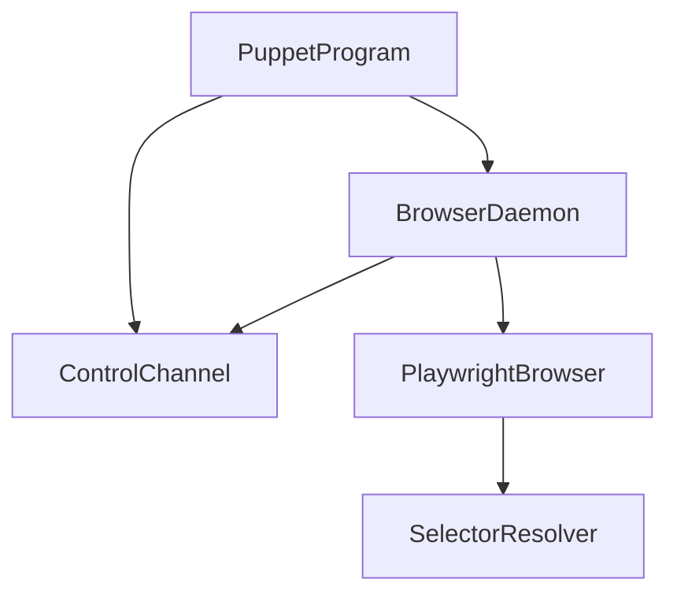

# ReviewCenterPuppet

## Architecture

> **Keep it small.** The Puppet is a minimal helper that lets an AI drive and screenshot the UI. Keep it as small
> and simple as possible: no production-grade hardening, no process-identity/race engineering, best-effort cleanup
> only, few tests. Do not grow it beyond what an agent needs for its look, decide, act loop.

ReviewCenterPuppet, called Puppet in this chapter, is a development tool that lets a developer or a coding agent
drive the real ReviewCenter web application in a browser. A coding agent works at a shell, one command per call,
and loops: act, look at a screenshot or at the page text, decide, act again. Puppet therefore keeps ONE persistent
headless Chromium open between commands. `puppet start` spawns a detached daemon process that owns the browser; every
other command, such as `puppet click projects-link` (the header tab), is a thin client that sends one request to the
daemon, prints the
answer, and exits. The ReviewCenter server is started separately by the caller (for example with `dotnet watch`).
The tool is a single console application on net10.0 built from `tools/puppet`; the same executable is the client and,
through the hidden verb `daemon`, the daemon.

### Separate System and Development Tool

Puppet is documented as a separate software system, not as a subsystem of ReviewCenter. It is development tooling:
it is not part of the distributed ReviewCenter package, is never loaded by the ReviewCenter server, and has its own
requirement identifier prefix, `ReviewCenterPuppet-`, and its own review-sets. It depends on ReviewCenter only at run
time: it talks to a running server through a browser. The tests project references the server project only to order
the build and to find the server assembly.

### Units

The system is flat: five units sit directly under the system.

- `PuppetProgram` is the entry point and the client. It parses and validates one command line, handles `start`
  (spawn the daemon and wait until it is ready), sends every other command to the daemon, and prints the result.
- `ControlChannel` is the control file and the loopback TCP protocol between the client and the daemon.
- `BrowserDaemon` is the long-lived process: it launches the browser, publishes the control file, serves commands,
  and shuts everything down on `stop`.
- `PlaywrightBrowser` is the only code that calls Playwright: one flat command switch of thin wrappers, plus the
  recording of new browser errors.
- `SelectorResolver` turns the selector text of a command into a Playwright selector.

### Lifecycle

1. `puppet start [--url <base>] [--viewport <WxH>] [--headed] [--control-file <path>]` reads the control file (the
   option, else the `REVIEWCENTER_PUPPET_CONTROL_FILE` variable, else the well-known file in the temporary folder).
   When it names a port that
   answers a ping, Puppet is already running and `start` fails with exit code 1. Otherwise a stale file is deleted.
2. `PuppetProgram` spawns the daemon: the same executable run by `dotnet` with the verb `daemon`. On Windows the
   process is started through the shell, hidden, with nothing redirected, so it inherits none of the caller's pipe
   handles and a caller that waits for the end of the output is not held up by the long-lived daemon. On Linux
   all three standard streams are redirected and the parent ends are closed, which has the same effect.
3. `BrowserDaemon` launches Chromium, opens a loopback listener on a free port, and only then writes the control
   file. `start` polls for the file (30 second limit), pings the port, and prints one line.
4. Each later command opens one connection, sends one JSON line, and reads one JSON line (see the control channel).
   A later command must use the same control file as its `start` (the same variable or option), or it does not find
   the daemon.
5. `puppet stop` closes the browser, deletes the control file, and ends the daemon.

### Known Limitation

If the daemon or Chromium is killed (a crash, `Stop-Process`, or a CI cancellation), a Chromium process or a stale
control file may be left behind. `puppet start` replaces a stale control file; a stray process is killed manually.
This is accepted and not engineered around.

## External Interfaces

**Command-Line Interface**: `puppet <command> [arguments]`, listed by `puppet --help`. Exit code 0 means the command
worked, 1 it failed (a missing element, a time-out, a failed navigation, `start` when Puppet is already running), and
2 a usage error or Puppet is not running. Every result prints the current URL and page title and any new console
errors, page errors, or failed requests since the previous command. A failed command prints one short line on
standard error, never a stack trace. Actions time out after 5 seconds so that a wrong selector fails fast; `wait`
takes `--timeout <ms>` and is the way to wait for an asynchronous Blazor update, because Puppet contains no fixed
sleeps.

**Control File**: `reviewcenter-puppet.json` in the temporary folder by default, or the path in the environment variable
`REVIEWCENTER_PUPPET_CONTROL_FILE` or given with `--control-file` (a blank value is a usage error). It holds the daemon
port and the base URL, or an error message when the daemon could not start. Its existence is the "Puppet is running"
signal for that session.

**Screenshot Files**: PNG files at the path given to `puppet screenshot`. Screenshots use CSS pixels so that images
stay modest in size.

**Headless Chromium**: one page driven through Microsoft Playwright, 1280 by 800 by default. Chromium must be
installed once with the Playwright installation script; when it is missing, the error message names the command.

## Dependencies

- **Microsoft.Playwright**: browser automation, used only inside `PlaywrightBrowser`.
- **ReviewCenter server**: a running instance given with `--url`; no compile-time dependency.
- **Chromium**: installed once per machine by the developer; the tool does not install it.

## Risk Control Measures

N/A - Puppet is a development tool and is not a safety-classified software item.

## Data Flow

1. `PuppetProgram` parses the command line into a request (command, positional arguments, options).
2. `ControlChannel` sends the request to the daemon and returns its response.
3. `BrowserDaemon` hands the request to `PlaywrightBrowser`, which resolves selectors with `SelectorResolver` and
   performs the command, and attaches the URL, title, and new browser errors to the response.
4. `PuppetProgram` prints the response and returns the exit code.

## Design Constraints

- Platform: targets net10.0 on Windows and Linux.
- Distribution: Puppet is not packed, published, or shipped with ReviewCenter and must not be referenced by it.
- Network exposure: the daemon listens only on the loopback interface, on a port chosen by the operating system,
  without authentication; it is a local development tool and any local process can send it commands.
- One daemon per control file: the control file allows one running Puppet for each file; `start` refuses a second one
  for the same file. By default every command of a user shares one file in the temporary folder, so one Puppet runs per
  user. Separate sessions (for example one agent each) set `REVIEWCENTER_PUPPET_CONTROL_FILE`, or pass `--control-file`,
  to a different path each, and then each session has its own daemon and browser.
- No hardening: no locks, process IDs, or race handling beyond the ping that tells a live daemon from a stale file.
- Hover persistence: the mouse position lives in the Playwright page, so a hover stays until the mouse moves again;
  `screenshot`, `viewport`, and `theme` do not move the mouse. Only `reset`, which creates a new browser context and
  clears cookies and storage, loses it.
- Testability: the units are tested directly; two end-to-end tests start the real daemon against the real server in
  real Chromium. The second one covers hover-then-click on a hover-revealed control of a real review diff (the **+**
  of a diff line).
