# ReviewCenter

## Architecture

The ReviewCenter is an ASP.NET Core web service with a companion command-line interface,
built on .NET. It is structured as one system containing one top-level unit (`Program`) and
eight subsystems (`Cli`, `SelfTest`, `Utilities`, `Hosting`, `Identity`, `Web`, `Core`, `Storage`):

```mermaid
flowchart TD
    Program
    subgraph Cli
        Context
    end
    subgraph SelfTest
        Validation
    end
    subgraph Utilities
        PathHelpers
    end
    subgraph Hosting
        ServerHost
        UserCommand
        AuditCommand
    end
    subgraph Identity
        PasswordHasher
        SignIn
        RevalidatingAuthenticationStateProvider
    end
    subgraph Web
        App
        HomePage
        ProjectsPage
        ProjectPage
        ReviewPage
        ChecklistPage
        LoginPage
        AccountPage
        UsersPage
        HistoryPage
        AuditPage
    end
    subgraph Core
        Fingerprint
        ProjectService
        ReviewService
        ThreadService
        ChecklistService
        UserService
        RecordDigest
        SigningService
        AuditChain
        AuditService
    end
    subgraph Storage
        ReviewCenterDbContext
        ReviewStore
        UserStore
        AuditStore
        DatabaseSetup
    end
    Program --> Context
    Program --> Validation
    Program --> ServerHost
    Program --> UserCommand
    Program --> AuditCommand
    Validation --> Program
    Validation --> PathHelpers
    Context --> UserService
    ServerHost --> Context
    ServerHost --> App
    ServerHost --> DatabaseSetup
    ServerHost --> ReviewStore
    ServerHost --> UserStore
    ServerHost --> AuditStore
    ServerHost --> PasswordHasher
    ServerHost --> SignIn
    ServerHost --> ProjectService
    ServerHost --> ReviewService
    ServerHost --> ThreadService
    ServerHost --> ChecklistService
    ServerHost --> UserService
    ServerHost --> SigningService
    ServerHost --> AuditService
    UserCommand --> Context
    UserCommand --> ServerHost
    UserCommand --> DatabaseSetup
    UserCommand --> UserService
    AuditCommand --> Context
    AuditCommand --> ServerHost
    AuditCommand --> DatabaseSetup
    AuditCommand --> AuditService
    SignIn --> UserService
    SignIn --> AuditService
    RevalidatingAuthenticationStateProvider --> SignIn
    RevalidatingAuthenticationStateProvider --> UserService
    PasswordHasher --> UserService
    App --> HomePage
    App --> ProjectsPage
    App --> ProjectPage
    App --> ReviewPage
    App --> ChecklistPage
    App --> LoginPage
    App --> AccountPage
    App --> UsersPage
    App --> HistoryPage
    App --> AuditPage
    App --> SignIn
    LoginPage --> SignIn
    AccountPage --> SignIn
    AccountPage --> UserService
    UsersPage --> UserService
    ProjectsPage --> ProjectService
    ProjectPage --> ProjectService
    ProjectPage --> ReviewService
    ProjectPage --> SigningService
    ReviewPage --> ReviewService
    ReviewPage --> ThreadService
    ReviewPage --> ChecklistService
    ReviewPage --> SigningService
    ReviewPage --> SignIn
    ReviewPage --> HistoryPage
    ChecklistPage --> ReviewService
    ChecklistPage --> ChecklistService
    ChecklistPage --> SignIn
    HistoryPage --> AuditService
    AuditPage --> AuditService
    AuditPage --> UserService
    ReviewService --> Fingerprint
    ProjectService --> ReviewStore
    ReviewService --> ReviewStore
    ThreadService --> ReviewStore
    ChecklistService --> ReviewStore
    UserService --> UserStore
    UserService --> AuditService
    SigningService --> ReviewStore
    SigningService --> UserService
    SigningService --> RecordDigest
    AuditService --> AuditChain
    AuditService --> AuditStore
    ReviewStore --> RecordDigest
    ReviewStore --> ReviewCenterDbContext
    UserStore --> ReviewCenterDbContext
    AuditStore --> AuditChain
    AuditStore --> ReviewCenterDbContext
    DatabaseSetup --> ReviewCenterDbContext
```

`Program` is the entry point. It creates a `Context` from the `Cli` subsystem, dispatches to
`Validation` when `--validate` is passed, dispatches to `ServerHost` from the `Hosting`
subsystem when the `serve` verb is passed, dispatches to `UserCommand` when the `user add` verb is passed, dispatches
to `AuditCommand` when the `audit verify` verb is passed, and
returns the exit code from `Context`.
`Validation` calls `Program.Run` recursively to exercise the tool during self-testing, and
uses `PathHelpers` to construct safe temporary file paths.

`ServerHost` builds and runs the ASP.NET Core web application: it reads the listen URL and
the silent option from `Context`, configures structured logging, registers the sign-in of the `Identity` subsystem,
maps the `/health` endpoint, maps the user interface defined by the `Web` subsystem, and connects the pages to the
database. `UserCommand` creates a user from the command line with the same configuration and registration, which is
how the first administrator is created. `AuditCommand` verifies the hash chain of the audit trail with the same
configuration and registration and reports the result as the exit code.
The `Web` subsystem is a Blazor Server user interface: `App` is the HTML shell and router,
`HomePage` is the interactive page served at the root URL, `ProjectsPage`, `ProjectPage`,
`ReviewPage`, and `ChecklistPage` are the pages for projects, reviews, and review checklists, `LoginPage`,
`AccountPage`, and `UsersPage` are the pages for signing in, changing one's own password, and managing users, and
`HistoryPage` and `AuditPage` show the audit trail of a review and of the whole system. A browser
connects to the server,
receives a server-rendered page, and then upgrades to a live connection over which user
actions are handled on the server.

The `Identity` subsystem is the web side of local accounts: `SignIn` configures cookie authentication and
authorization, checks a password through `UserService`, signs the user in and out, and tells the pages who is signed
in; `RevalidatingAuthenticationStateProvider` re-checks the user of every open page at a fixed interval with the same rule
as the cookie check and ends the sign-in state of the page when the user is no longer valid; `PasswordHasher` hashes and
verifies passwords with the password hasher of the ASP.NET Core shared framework.

The `Core` subsystem holds the domain: projects, reviews of uploaded files, users, the rules that
protect them, the content fingerprint of a review, the digest of a review record that signatures are bound to, and the
hash-chained audit trail. It
depends on no other subsystem and on
no library beyond the .NET runtime, and it defines the store interfaces and the password hasher interface that the
`Storage` and `Identity` subsystems implement. The `Storage` subsystem keeps projects, reviews, users, and the audit trail
in a
database through
Entity Framework Core. The pages call the Core services and never see the database; the
services reach it through the Core store interfaces, which `ReviewStore`, `UserStore`, and `AuditStore` implement, and
`ServerHost` wires the pieces together.

The system is a single process with one database; there is no separate service tier. Users are local accounts
with a user name, a display name, a role (Reviewer or Admin), and a password that is stored only as a hash. A user
signs in on the login page and stays signed in through a cookie; every page except the home page and the login page
requires a signed-in user, and the users page and the audit page require the Admin role. The first administrator is
created with the
`user add` verb. A review can only be created (in the Draft state) from uploaded files. Review comments are implemented
(threads anchored to a file or line range, with replies, resolve, and reopen), and every review has a checklist of
checks (Pass, Fail, or N/A, with a justification where required) that is frozen when the review is created. The author
of a comment and the person who saved a checklist answer are the signed-in user (user name and display name at
that time); the checklist has no thread links, and there is no diff view yet. Reviewers are named for a review in
slots (a primary reviewer and an optional alternate), and a named reviewer signs the review after confirming the
password again; a signature is bound to a digest of the review record, so it goes out of date when the record changes,
and a review is Approved only while every slot has a current signature. A review without a slot is In review.

Everything that changes data, and every sign-in, sign-out, failed sign-in, and lockout, is recorded in an append-only
audit trail. Each entry carries the hash of the entry before it, so the entries form a hash chain. The change and its
entry are stored in one transaction, so a change without an entry (or the reverse) cannot occur through the application.
Anyone who is signed in can read the history of a review; an administrator can read the whole trail and verify the
chain on the audit page or with the `audit verify` verb. The chain detects an edit, a deletion, an insertion, or a
reordering of entries in the middle of the history. It does not detect the removal of the newest entries, or a complete
rewrite of the chain by someone with write access to the database, unless the head hash, which the audit page and the
verification show, was recorded somewhere else. There is no external anchoring in this version. The design of the unit
`AuditChain` states this in full.

Author signatures, rejecting or withdrawing a signature, and a second
factor are deferred to later slices; a signed slot cannot be reassigned.
The limitations of the identity slice are deliberate: lockout after failed sign-ins is per user name, so anyone can
lock a known user name for a few minutes; a user who is disabled, removed, or changed can keep a page that is already
open for up to the revalidation interval (`Auth:RevalidationSeconds`, 30 seconds by default), after which the page is
replaced by a "Session ended" message, while the page header keeps the old name until the next navigation or reload; a
password change does not end other sessions of the user; and a database that was created
before the identity slice, before the signature slice (it has no reviewer slot and signature tables), or before the
audit trail (it has no audit table) must be
deleted and created again, because there are no migrations.
The limitations of the audit trail are also deliberate: a failed sign-in on an account that is already locked is not
recorded, and failed sign-ins for unknown user names are not throttled; a wrong current password when signing or on
the account page appears as `auth.sign-in-failed`; recording of
sign-in, sign-out, failed sign-in, and lockout is best effort and a failure is only logged; and there is no export,
retention, or archiving of the trail.

## External Interfaces

**Command-Line Interface**: The primary input interface for tool invocation.

- *Type*: CLI.
- *Role*: Consumer (the host environment invokes the system with command-line arguments).
- *Contract*: Accepts the `serve` verb, the `user add` verb with the options `--username <name>`,
  `--display-name <name>`, and `--role <Admin|Reviewer>`, the `audit verify` verb, and the arguments `-v`/`--version`,
  `-?`/`-h`/`--help`,
  `--silent`, `--validate`, `--results <file>`, `--result <file>` (legacy alias for
  `--results`), `--depth <n>`, `--log <file>`, and `--urls <url>`. Returns exit code 0 for
  success and 1 for failures.
- *Constraints*: Unknown arguments cause exit code 1 and an error message on stderr.
  `--urls` is only valid together with `serve`, and its value must be an absolute http or
  https URL. `--username`, `--display-name`, and `--role` are only valid together with `user add`, which
  requires `--username` and `--display-name`; the role is `Reviewer` unless given. `audit` must be followed by
  `verify`. `audit verify` reads the database of the `Database` settings, verifies the hash chain of the audit trail,
  prints `Audit chain intact: N entries` and exits with 0 when it is intact, and prints
  `Audit chain BROKEN at entry N` on standard error and exits with 1 when it is not; an unreadable database is also
  reported with exit code 1. It creates an empty database when none exists at the configured location. It does not
  show the head hash, so the head hash must be taken from the audit page. `user add` never takes the
  password from the command line: it is read from the environment variable `REVIEWCENTER_PASSWORD`, otherwise from the
  first line of standard input when that is redirected, otherwise from a masked prompt that asks twice. When `serve`
  is used, the process runs until it is stopped (Ctrl+C or a
  termination signal) and then exits with code 0; a server that cannot start, for example
  because the address is in use, causes exit code 1 and an error message.

**Web Endpoints**: The HTTP interface of the running web server, present only while `serve`
is running.

- *Type*: HTTP (and the Blazor live connection used by the interactive user interface).
- *Role*: Provider.
- *Contract*: `GET /` returns the home page, an HTML document titled "ReviewCenter" with a
  Hello button and a counter button. `GET /health` returns HTTP status 200 with the plain text
  `Healthy`. `GET /login` returns the sign-in page; `POST /auth/login` checks the submitted user name and password
  and, on success, sets the authentication cookie and redirects to the page the user wanted (a path on this
  site, otherwise `/`), and on failure redirects back to the login page with a generic message; `POST /auth/logout`
  ends the session and redirects to `/`. Both posts require the antiforgery token of the form. `GET /account`
  returns the page where the signed-in user changes their password, and `GET /users` the page where an administrator
  manages users. `GET /projects` returns the projects page, `GET /projects/{id}` the page of one project,
  and `GET /projects/{id}/reviews/{reviewId}` the page of one review, and
  `GET /projects/{id}/reviews/{reviewId}/history` the history of one review; these pages show a "does not exist"
  message when the project or review is unknown. `GET /audit` returns the whole audit trail with the button that
  verifies its hash chain (administrators only).
  Any other path returns the not-found message of the user interface. The client
  script for the live connection is served from `/_framework/blazor.web.js`.
- *Constraints*: The server listens on the URL given with `--urls`, by default
  `http://localhost:5000`, which is reachable only from the local machine. TLS termination is
  not performed by the server itself. Authentication is by cookie: the routes `/`, `/login`, and `/health` and the
  static assets are open to anonymous visitors, every other page requires a signed-in user (an anonymous request is
  redirected to `/login` with the wanted address), and `/users` and `/audit` require the Admin role (another user gets
  HTTP status
  403). The cookie is HTTP-only, belongs to the session of the browser, and expires after a sliding period of
  `Auth:SessionHours` hours (default 8). The cookie is marked secure when the request is HTTPS, so behind a proxy that
  terminates TLS the forwarded headers must be enabled (the environment variable
  `ASPNETCORE_FORWARDEDHEADERS_ENABLED` set to `true`). The server must still not be exposed to untrusted networks
  without TLS, because the password of a sign-in is sent in the request. An open page re-checks its user every
  `Auth:RevalidationSeconds` seconds (default 30, at least 5; a smaller value stops the start-up with an error).

**Database**: The persistent store of projects, reviews, and users.

- *Type*: File (SQLite) or database connection.
- *Role*: Consumer (the server reads and writes it).
- *Contract*: Selected by the `Database` configuration section (`Database:Provider`, with the
  environment variable `Database__Provider`, and `Database:ConnectionString`, with
  `Database__ConnectionString`) read from `appsettings.json` and the environment. The only
  supported provider is `Sqlite`. An empty connection string selects the default file
  `reviewcenter.db` in the `ReviewCenter` folder of the per-user application data folder (the
  `data` folder next to the executable if the operating system has no such folder); a value
  without `=` is taken as the file path; any other value is used as a complete connection
  string is used. The server creates the folder, file, and tables when it starts, and so does `user add`.
- *Constraints*: The location must be writable. An unsupported provider or an unusable
  location prevents the server from starting: an error is reported and the exit code is 1. The
  schema is created, never migrated; the database file of an older schema is not upgraded. A database that was
  created before the identity slice (it has no users and no user name columns), before the signature slice (it
  has no reviewer slot and signature tables), or before the audit trail (it has no audit table) must be deleted and
  created again. The audit table is append-only for the application, but anyone with write access to the database file
  can still change it; the hash chain makes such a change detectable only in the way the design of `AuditChain`
  describes.

**Standard Output**: Normal program output written to `Console.Out`.

- *Type*: Standard I/O.
- *Role*: Provider.
- *Contract*: Writes version, banner, help text, validation summary, or a usage hint depending
  on the flags provided. While the web server runs, its structured log entries, including a
  start-up entry that names the listen URL, are also written to the console. Suppressed when
  `--silent` is active; the log file still receives all output written through `Context`.
- *Constraints*: Human-readable text; no machine-parseable format contract.

**Standard Error**: Error message output written to `Console.Error`.

- *Type*: Standard I/O.
- *Role*: Provider.
- *Contract*: Writes error messages in red when a failure occurs. Suppressed when `--silent`
  is active but the exit code is still set to 1.
- *Constraints*: Color output requires a terminal that supports `ConsoleColor`.

**Log File**: Optional persistent output file.

- *Type*: File.
- *Role*: Provider.
- *Contract*: When `--log <file>` is supplied, all `Context.WriteLine` and `Context.WriteError`
  output is written to the file regardless of `--silent`. The file is truncated at open.
- *Constraints*: The path must be writable; failure to open the file raises an
  `InvalidOperationException` and causes exit code 1.

**Results File**: Optional self-validation results file.

- *Type*: File.
- *Role*: Provider.
- *Contract*: When `--results <file>` is supplied alongside `--validate`, self-validation results
  are serialized to the file. Extension `.trx` selects MSTest TRX format; `.xml` selects JUnit
  XML format.
- *Constraints*: Any other extension causes an error message and exit code 1; no file is written.

## Dependencies

- **DemaConsulting.TestResults**: provides `TestResults`, `TestResult`, and `TestOutcome` for
  accumulating self-validation results.
- **DemaConsulting.TestResults.IO**: provides `TrxSerializer` and `JUnitSerializer` for writing
  results files.
- **Microsoft.EntityFrameworkCore.Sqlite**: the object-relational mapper and SQLite provider used by the
  `Storage` subsystem; see the Entity Framework Core integration design in the OTS chapter.
- **ASP.NET Core shared framework**: provides the Kestrel web server, endpoint routing,
  Blazor Server components, cookie authentication and authorization, and `Microsoft.Extensions.Logging` used by the
  `Hosting`, `Identity`, and `Web` subsystems. It is supplied by the .NET runtime rather than as a package; see the
  ASP.NET Core integration design in the OTS chapter.
- **Microsoft.Extensions.Identity.Core**: provides the password hasher used by the `Identity` subsystem. It is part
  of the ASP.NET Core shared framework, so it needs no package reference.

## Risk Control Measures

N/A - not a safety-classified software item.

## Data Flow

1. The host environment starts the tool process and passes command-line arguments to
   `Program.Main`.
2. `Program.Main` calls `Context.Create(args)`, which parses the arguments and opens the log
   file if `--log` was specified. An `ArgumentException` or `InvalidOperationException` at
   this point is caught, written to stderr, and causes exit code 1.
3. `Program.Run(context)` inspects the parsed flags and dispatches to one handler:
   - `--version` flag → `context.WriteLine(Version)`, then return.
   - Otherwise, `PrintBanner` is called first; then:
     - `--help` flag → `PrintHelp(context)`, then return.
     - `--validate` flag → `Validation.Run(context)`.
     - `serve` verb → `ServerHost.RunAsync(context, cancellationToken)`, which blocks until the
       server stops (see below).
     - `user add` verb → `UserCommand.Run(context)`, which creates the user (see below).
     - No flags → `RunToolLogic(context)`.
4. `Program.Main` returns `context.ExitCode` (0 if no errors were reported, 1 otherwise).

For the `serve` verb, `ServerHost` builds the web application from the `Context` (listen URL and
silent option), registers the database, the Core services, and the sign-in, creates the database, starts the
server, and writes the start-up log entry. A browser request for `/` is
routed by `App` to `HomePage`, which is rendered on the server into an HTML document and
returned. The client script in that document opens a live connection back to the server, after
which button clicks are sent to the server, handled by `HomePage`, and the changed page parts
are sent back. A request for `/health` is answered directly by `ServerHost`. A request for any other page
passes the authorization of the `Identity` subsystem: an anonymous visitor is redirected to `/login`; the
form of `LoginPage` is posted to `/auth/login`, where `SignIn` asks `UserService` to check the password and, on
success, sets the authentication cookie. On every later request `SignIn` validates the cookie against the stored user,
so a disabled or changed user is signed out. A page that stays open makes no request, so the scoped
`RevalidatingAuthenticationStateProvider` of that page re-reads the user at the configured interval and, when the user
is no longer valid or cannot be read, makes the state anonymous, and the `SessionGate` of the page replaces the page
content with the "Session ended" message. The project pages
work the same way but call `ProjectService` and `ReviewService` in the handlers: a submitted
review form carries its files to `ReviewService`, which validates them, computes the
fingerprint with `Fingerprint`, and stores the review through `ReviewStore`. `ReviewPage` calls `ThreadService`
to start, answer, resolve, and reopen comment threads on a file, passing the signed-in user as the author;
`ThreadService` applies the comment rules and
stores the threads through `ReviewStore`. `ReviewPage` and `ChecklistPage` call `ChecklistService`, which applies
the checklist rules and stores answers, saved on behalf of the signed-in user, through `ReviewStore`. `ReviewPage`
calls `SigningService` to add, change, and remove reviewer slots and to sign: the service checks the rules, asks
`UserService` to check the password again, takes the digest of the record from `RecordDigest`, and stores the
signature through `ReviewStore`, which checks the digest once more inside the database transaction. `ProjectPage`
calls `SigningService` to show whether each review is Approved. `AccountPage` and
`UsersPage` call `UserService`, which stores users through `UserStore`. When the server is
stopped, `ServerHost.RunAsync` returns 0; if the server cannot start, including because the
database cannot be used, it reports the reason
through `Context.WriteError` and returns 1, which makes `Context.ExitCode` 1.

For the `user add` verb, `UserCommand` reads the password (never from the command line), builds the same
configuration and services as the server, creates the database if needed, and calls `UserService.CreateAsync`; the
result or the reason of a failure is reported through `Context`.

## Design Constraints

- Platform: targets net10.0 only, on Windows and Linux. It is distributed as a self-contained single-file
  executable for win-x64 and linux-x64 that bundles the .NET runtime, so operators need no installed runtime.
- Threading: the command-line actions are single-threaded. The web server handles requests on
  the ASP.NET Core thread pool; each browser connection has its own page state, and all
  handlers of one connection run on a single synchronization context, so no shared mutable
  state exists between connections.
- Network exposure: by default the server listens on the loopback interface only; exposing it
  on other interfaces requires an explicit `--urls` value. The server does not terminate TLS itself, so beyond a
  trusted network it must be put behind a proxy that does (with the forwarded headers enabled), because passwords
  are sent in sign-in requests.
- Persistence: the database provider is selected by configuration, and only SQLite is supported. The schema is
  created at start-up and not migrated (see the Storage subsystem design); a database created before the identity
  slice or before the signature slice must be deleted and created again.
- Authentication: passwords are stored only as salted hashes and never logged or shown; five consecutive wrong
  passwords lock a user name for 5 minutes (per user name, not per source); the last enabled administrator cannot be
  disabled or demoted. A signature asks for the password again through the same check, so wrong passwords at a
  signature count toward the same lockout.
- Signatures: a signature is bound to the digest of the review record and is never changed or removed; the approval
  of a review is computed from the record and the signatures each time and is never stored.
- Upload limits: a review accepts at most 200 files, each at most 2 MiB, and 20 MiB in total, with the limits
  defined once in the Core subsystem.
- Immutability: `Context` properties are set once at construction via `init` accessors and are
  read-only thereafter.
- Resource lifecycle: `Context` implements `IDisposable`; callers must dispose it to flush and
  close any open log file handle.
- Path safety: all caller-supplied path components are validated by `PathHelpers.SafePathCombine`
  before file-system use.
