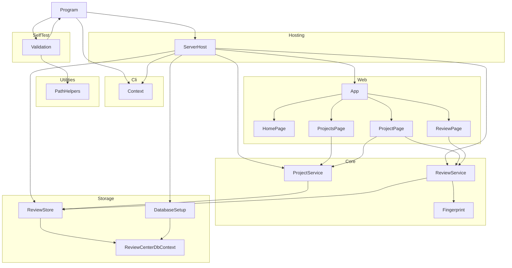

# ReviewCenter

## Architecture

The ReviewCenter is an ASP.NET Core web service with a companion command-line interface,
built on .NET. It is structured as one system containing one top-level unit (`Program`) and
seven subsystems (`Cli`, `SelfTest`, `Utilities`, `Hosting`, `Web`, `Core`, `Storage`):

`Program` is the entry point. It creates a `Context` from the `Cli` subsystem, dispatches to
`Validation` when `--validate` is passed, dispatches to `ServerHost` from the `Hosting`
subsystem when the `serve` verb is passed, and returns the exit code from `Context`.
`Validation` calls `Program.Run` recursively to exercise the tool during self-testing, and
uses `PathHelpers` to construct safe temporary file paths.

`ServerHost` builds and runs the ASP.NET Core web application: it reads the listen URL and
the silent option from `Context`, configures structured logging, maps the `/health` endpoint,
maps the user interface defined by the `Web` subsystem, and connects the pages to the database.
The `Web` subsystem is a Blazor Server user interface: `App` is the HTML shell and router,
`HomePage` is the interactive page served at the root URL, and `ProjectsPage`, `ProjectPage`,
and `ReviewPage` are the pages for projects and reviews. A browser connects to the server,
receives a server-rendered page, and then upgrades to a live connection over which user
actions are handled on the server.

The `Core` subsystem holds the domain: projects, reviews of uploaded files, the rules that
protect them, and the content fingerprint of a review. It depends on no other subsystem and on
no library beyond the .NET runtime, and it defines the store interface that the `Storage`
subsystem implements. The `Storage` subsystem keeps projects and reviews in a database through
Entity Framework Core. The pages call the Core services and never see the database; the
services reach it through the Core store interface, which `ReviewStore` implements, and
`ServerHost` wires the pieces together.

The system is a single process with one database; there is no separate service tier. The
limitations of the current slice are deliberate and temporary: there is no authentication, so
every visitor acts as the same single anonymous operator, and a review can only be created (in
the Draft state) from uploaded files; there is no comment or sign-off workflow yet.

## External Interfaces

**Command-Line Interface**: The primary input interface for tool invocation.

- *Type*: CLI.
- *Role*: Consumer (the host environment invokes the system with command-line arguments).
- *Contract*: Accepts the `serve` verb and the arguments `-v`/`--version`, `-?`/`-h`/`--help`,
  `--silent`, `--validate`, `--results <file>`, `--result <file>` (legacy alias for
  `--results`), `--depth <n>`, `--log <file>`, and `--urls <url>`. Returns exit code 0 for
  success and 1 for failures.
- *Constraints*: Unknown arguments cause exit code 1 and an error message on stderr.
  `--urls` is only valid together with `serve`, and its value must be an absolute http or
  https URL. When `serve` is used, the process runs until it is stopped (Ctrl+C or a
  termination signal) and then exits with code 0; a server that cannot start, for example
  because the address is in use, causes exit code 1 and an error message.

**Web Endpoints**: The HTTP interface of the running web server, present only while `serve`
is running.

- *Type*: HTTP (and the Blazor live connection used by the interactive user interface).
- *Role*: Provider.
- *Contract*: `GET /` returns the home page, an HTML document titled "ReviewCenter" with a
  Hello button and a counter button. `GET /health` returns HTTP status 200 with the plain text
  `Healthy`. `GET /projects` returns the projects page, `GET /projects/{id}` the page of one project,
  and `GET /projects/{id}/reviews/{reviewId}` the page of one review; these pages show a "does not exist"
  message when the project or review is unknown.
  Any other path returns the not-found message of the user interface. The client
  script for the live connection is served from `/_framework/blazor.web.js`.
- *Constraints*: The server listens on the URL given with `--urls`, by default
  `http://localhost:5000`, which is reachable only from the local machine. TLS termination is
  not performed by the server itself. There is no authentication: every visitor is the same
  single anonymous operator, so the server must not be exposed to untrusted networks. This is a
  temporary limitation until the Identity subsystem exists.

**Database**: The persistent store of projects and reviews.

- *Type*: File (SQLite) or database connection.
- *Role*: Consumer (the server reads and writes it).
- *Contract*: Selected by the `Database` configuration section (`Database:Provider`, with the
  environment variable `Database__Provider`, and `Database:ConnectionString`, with
  `Database__ConnectionString`) read from `appsettings.json` and the environment. The only
  supported provider is `Sqlite`. An empty connection string selects the default file
  `reviewcenter.db` in the `ReviewCenter` folder of the per-user application data folder (the
  `data` folder next to the executable if the operating system has no such folder); a value
  without `=` is taken as the file path; any other value is used as a complete connection
  string. The server creates the folder, file, and tables when it starts.
- *Constraints*: The location must be writable. An unsupported provider or an unusable
  location prevents the server from starting: an error is reported and the exit code is 1. The
  schema is created, never migrated; the database file of an older schema is not upgraded.

**Standard Output**: Normal program output written to `Console.Out`.

- *Type*: Standard I/O.
- *Role*: Provider.
- *Contract*: Writes version, banner, help text, validation summary, or a usage hint depending
  on the flags provided. While the web server runs, its structured log entries, including a
  start-up entry that names the listen URL, are also written to the console. Suppressed when
  `--silent` is active; the log file still receives all output written through `Context`.
- *Constraints*: Human-readable text; no machine-parseable format contract.

**Standard Error**: Error message output written to `Console.Error`.

- *Type*: Standard I/O.
- *Role*: Provider.
- *Contract*: Writes error messages in red when a failure occurs. Suppressed when `--silent`
  is active but the exit code is still set to 1.
- *Constraints*: Color output requires a terminal that supports `ConsoleColor`.

**Log File**: Optional persistent output file.

- *Type*: File.
- *Role*: Provider.
- *Contract*: When `--log <file>` is supplied, all `Context.WriteLine` and `Context.WriteError`
  output is written to the file regardless of `--silent`. The file is truncated at open.
- *Constraints*: The path must be writable; failure to open the file raises an
  `InvalidOperationException` and causes exit code 1.

**Results File**: Optional self-validation results file.

- *Type*: File.
- *Role*: Provider.
- *Contract*: When `--results <file>` is supplied alongside `--validate`, self-validation results
  are serialized to the file. Extension `.trx` selects MSTest TRX format; `.xml` selects JUnit
  XML format.
- *Constraints*: Any other extension causes an error message and exit code 1; no file is written.

## Dependencies

- **DemaConsulting.TestResults**: provides `TestResults`, `TestResult`, and `TestOutcome` for
  accumulating self-validation results.
- **DemaConsulting.TestResults.IO**: provides `TrxSerializer` and `JUnitSerializer` for writing
  results files.
- **Microsoft.EntityFrameworkCore.Sqlite**: the object-relational mapper and SQLite provider used by the
  `Storage` subsystem; see the Entity Framework Core integration design in the OTS chapter.
- **ASP.NET Core shared framework**: provides the Kestrel web server, endpoint routing,
  Blazor Server components, and `Microsoft.Extensions.Logging` used by the `Hosting` and `Web`
  subsystems. It is supplied by the .NET runtime rather than as a package; see the ASP.NET Core
  integration design in the OTS chapter.

## Risk Control Measures

N/A - not a safety-classified software item.

## Data Flow

1. The host environment starts the tool process and passes command-line arguments to
   `Program.Main`.
2. `Program.Main` calls `Context.Create(args)`, which parses the arguments and opens the log
   file if `--log` was specified. An `ArgumentException` or `InvalidOperationException` at
   this point is caught, written to stderr, and causes exit code 1.
3. `Program.Run(context)` inspects the parsed flags and dispatches to one handler:
   - `--version` flag → `context.WriteLine(Version)`, then return.
   - Otherwise, `PrintBanner` is called first; then:
     - `--help` flag → `PrintHelp(context)`, then return.
     - `--validate` flag → `Validation.Run(context)`.
     - `serve` verb → `ServerHost.RunAsync(context, cancellationToken)`, which blocks until the
       server stops (see below).
     - No flags → `RunToolLogic(context)`.
4. `Program.Main` returns `context.ExitCode` (0 if no errors were reported, 1 otherwise).

For the `serve` verb, `ServerHost` builds the web application from the `Context` (listen URL and
silent option), registers the database and the Core services, creates the database, starts the
server, and writes the start-up log entry. A browser request for `/` is
routed by `App` to `HomePage`, which is rendered on the server into an HTML document and
returned. The client script in that document opens a live connection back to the server, after
which button clicks are sent to the server, handled by `HomePage`, and the changed page parts
are sent back. A request for `/health` is answered directly by `ServerHost`. The project pages
work the same way but call `ProjectService` and `ReviewService` in the handlers: a submitted
review form carries its files to `ReviewService`, which validates them, computes the
fingerprint with `Fingerprint`, and stores the review through `ReviewStore`. When the server is
stopped, `ServerHost.RunAsync` returns 0; if the server cannot start, including because the
database cannot be used, it reports the reason
through `Context.WriteError` and returns 1, which makes `Context.ExitCode` 1.

## Design Constraints

- Platform: targets net10.0 only, on Windows and Linux. It is distributed as a self-contained single-file
  executable for win-x64 and linux-x64 that bundles the .NET runtime, so operators need no installed runtime.
- Threading: the command-line actions are single-threaded. The web server handles requests on
  the ASP.NET Core thread pool; each browser connection has its own page state, and all
  handlers of one connection run on a single synchronization context, so no shared mutable
  state exists between connections.
- Network exposure: by default the server listens on the loopback interface only; exposing it
  on other interfaces requires an explicit `--urls` value. Because the system has no authentication yet
  (single anonymous operator), exposing it beyond a trusted network is unsafe.
- Persistence: the database provider is selected by configuration, and only SQLite is supported. The schema is
  created at start-up and not migrated (see the Storage subsystem design).
- Upload limits: a review accepts at most 200 files, each at most 2 MiB, and 20 MiB in total, with the limits
  defined once in the Core subsystem.
- Immutability: `Context` properties are set once at construction via `init` accessors and are
  read-only thereafter.
- Resource lifecycle: `Context` implements `IDisposable`; callers must dispose it to flush and
  close any open log file handle.
- Path safety: all caller-supplied path components are validated by `PathHelpers.SafePathCombine`
  before file-system use.
