# ReviewCenter

## Architecture

The ReviewCenter is an ASP.NET Core web service with a companion command-line interface,
built on .NET. It is structured as one system containing one top-level unit (`Program`) and
eleven subsystems (`Cli`, `SelfTest`, `Utilities`, `Hosting`, `Identity`, `Web`, `Core`, `Storage`, `ContentSources`,
`Evidence`, `Api`):

```mermaid
flowchart TD
    Program
    subgraph Cli
        Context
    end
    subgraph SelfTest
        Validation
        ValidationChecks
    end
    subgraph Utilities
        PathHelpers
        TemporaryDirectory
        SecretSource
    end
    subgraph Hosting
        ServerHost
        KeyRingProtection
        SecretScan
        UserCommand
        AuditCommand
        KeysCommand
    end
    subgraph Identity
        PasswordHasher
        SignIn
        SignInThrottle
        OidcSignIn
        RevalidatingAuthenticationStateProvider
        TotpAlgorithm
        TotpSecretProtector
        TotpSignIn
    end
    subgraph Web
        App
        HomePage
        AboutPage
        HelpPage
        ProjectsPage
        ProjectPage
        PlanPage
        ReviewPage
        ChecklistPage
        LoginPage
        TotpLoginPage
        AccountPage
        UsersPage
        HistoryPage
        AuditPage
        RepositoriesPage
        InboxPage
    end
    subgraph Core
        Fingerprint
        ProjectService
        EvidenceSettingsService
        ProjectChecklistService
        ReviewProgressService
        ReviewService
        ThreadService
        ChecklistService
        UserService
        PersonalAccessTokenService
        RecordDigest
        SigningService
        InboxService
        UserImpactService
        BallotConsolidation
        BallotVisibility
        ReauthProofStore
        TotpService
        TotpChallengeStore
        AuditChain
        AuditService
        RepositoryService
        SelectionMatcher
        RevisionValidator
        ReviewPlanner
    end
    subgraph Storage
        ReviewCenterDbContext
        ReviewStore
        UserStore
        PersonalAccessTokenStore
        AuditStore
        RepositoryStore
        InboxStore
        TotpStore
        DatabaseSetup
    end
    subgraph ContentSources
        GitRunner
        GitSource
        CredentialProtector
    end
    subgraph Evidence
        PdfDocumentWriter
        AttestationRenderer
        AttestationSigner
        AttestationKeyProvider
        AttestationService
        AttestationEndpoint
        EvidenceIndexService
    end
    subgraph Api
        ApiTokenAuthentication
        ApiEndpoints
        ApiDocument
    end
    Program --> Context
    Program --> Validation
    Program --> ServerHost
    Program --> UserCommand
    Program --> AuditCommand
    Program --> KeysCommand
    Validation --> ValidationChecks
    ValidationChecks --> TemporaryDirectory
    ValidationChecks --> ServerHost
    ValidationChecks --> TotpAlgorithm
    TemporaryDirectory --> PathHelpers
    Context --> UserService
    ServerHost --> Context
    ServerHost --> App
    ServerHost --> DatabaseSetup
    ServerHost --> ReviewStore
    ServerHost --> UserStore
    ServerHost --> AuditStore
    ServerHost --> PasswordHasher
    ServerHost --> SignIn
    ServerHost --> OidcSignIn
    ServerHost --> TotpSignIn
    ServerHost --> TotpAlgorithm
    ServerHost --> TotpSecretProtector
    ServerHost --> TotpStore
    ServerHost --> TotpService
    ServerHost --> TotpChallengeStore
    ServerHost --> ReauthProofStore
    ServerHost --> ProjectService
    ServerHost --> EvidenceSettingsService
    ServerHost --> ProjectChecklistService
    ServerHost --> ReviewProgressService
    ServerHost --> ReviewService
    ServerHost --> ThreadService
    ServerHost --> InboxStore
    ServerHost --> InboxService
    ServerHost --> UserImpactService
    ServerHost --> ChecklistService
    ServerHost --> UserService
    ServerHost --> SigningService
    ServerHost --> AuditService
    ServerHost --> RepositoryStore
    ServerHost --> RepositoryService
    ServerHost --> GitSource
    ServerHost --> CredentialProtector
    ServerHost --> KeyRingProtection
    ServerHost --> SecretScan
    SecretScan --> KeyRingProtection
    KeyRingProtection --> SecretSource
    ServerHost --> AttestationKeyProvider
    ServerHost --> AttestationEndpoint
    ServerHost --> PersonalAccessTokenStore
    ServerHost --> PersonalAccessTokenService
    ServerHost --> ApiTokenAuthentication
    ServerHost --> ApiEndpoints
    ServerHost --> ApiDocument
    UserCommand --> Context
    UserCommand --> ServerHost
    UserCommand --> DatabaseSetup
    UserCommand --> UserService
    AuditCommand --> Context
    AuditCommand --> ServerHost
    AuditCommand --> DatabaseSetup
    AuditCommand --> AuditService
    KeysCommand --> Context
    KeysCommand --> ServerHost
    KeysCommand --> KeyRingProtection
    KeysCommand --> SecretScan
    KeysCommand --> DatabaseSetup
    SignIn --> UserService
    SignIn --> SignInThrottle
    SignIn --> AuditService
    SignIn --> TotpService
    SignIn --> TotpSignIn
    TotpSignIn --> SignIn
    TotpSignIn --> SignInThrottle
    TotpSignIn --> TotpService
    TotpSignIn --> AuditService
    TotpAlgorithm --> TotpService
    TotpSecretProtector --> TotpService
    OidcSignIn --> SignIn
    OidcSignIn --> SignInThrottle
    OidcSignIn --> UserService
    OidcSignIn --> SigningService
    OidcSignIn --> ReauthProofStore
    OidcSignIn --> SecretSource
    RevalidatingAuthenticationStateProvider --> SignIn
    RevalidatingAuthenticationStateProvider --> UserService
    PasswordHasher --> UserService
    App --> HomePage
    App --> AboutPage
    App --> HelpPage
    App --> ProjectsPage
    App --> ProjectPage
    App --> PlanPage
    App --> ReviewPage
    App --> ChecklistPage
    App --> LoginPage
    App --> TotpLoginPage
    App --> AccountPage
    App --> UsersPage
    App --> HistoryPage
    App --> AuditPage
    App --> RepositoriesPage
    App --> InboxPage
    App --> SignIn
    LoginPage --> SignIn
    LoginPage --> OidcSignIn
    LoginPage --> TotpSignIn
    TotpLoginPage --> TotpService
    TotpLoginPage --> TotpSignIn
    AccountPage --> SignIn
    AccountPage --> OidcSignIn
    AccountPage --> UserService
    AccountPage --> PersonalAccessTokenService
    AccountPage --> TotpService
    UsersPage --> UserService
    UsersPage --> OidcSignIn
    UsersPage --> TotpService
    ProjectsPage --> ProjectService
    ProjectPage --> ProjectService
    ProjectPage --> ReviewProgressService
    PlanPage --> ProjectService
    PlanPage --> RepositoryService
    PlanPage --> ReviewPlanner
    ReviewPlanner --> ReviewService
    ReviewProgressService --> ReviewService
    ReviewProgressService --> SigningService
    ReviewProgressService --> AuditStore
    ReviewPlanner --> RepositoryService
    ReviewPlanner --> SigningService
    ReviewPage --> ReviewService
    ReviewPage --> ThreadService
    ReviewPage --> ChecklistService
    ReviewPage --> SigningService
    ReviewPage --> SignIn
    ReviewPage --> OidcSignIn
    ReviewPage --> UserService
    ReviewPage --> TotpService
    ReviewPage --> AttestationKeyProvider
    ReviewPage --> HistoryPage
    ChecklistPage --> ReviewService
    ChecklistPage --> ChecklistService
    ChecklistPage --> SignIn
    HistoryPage --> AuditService
    AuditPage --> AuditService
    AuditPage --> UserService
    RepositoriesPage --> RepositoryService
    RepositoriesPage --> UserService
    InboxPage --> InboxService
    ReviewPage --> InboxService
    App --> InboxService
    InboxService --> InboxStore
    InboxService --> ReviewStore
    InboxService --> UserStore
    InboxService --> RecordDigest
    UserImpactService --> ReviewStore
    UserImpactService --> UserStore
    UserImpactService --> RecordDigest
    InboxStore --> ReviewCenterDbContext
    ReviewService --> Fingerprint
    ProjectService --> ReviewStore
    ReviewService --> ReviewStore
    ThreadService --> ReviewStore
    ChecklistService --> ReviewStore
    UserService --> UserStore
    UserService --> TotpStore
    UserService --> AuditService
    TotpService --> TotpStore
    TotpService --> TotpChallengeStore
    TotpService --> UserService
    PersonalAccessTokenService --> PersonalAccessTokenStore
    PersonalAccessTokenService --> UserService
    SigningService --> ReviewStore
    SigningService --> UserService
    SigningService --> RecordDigest
    SigningService --> ReauthProofStore
    SigningService --> TotpService
    AuditService --> AuditChain
    AuditService --> AuditStore
    ReviewStore --> RecordDigest
    ReviewStore --> ReviewCenterDbContext
    UserStore --> ReviewCenterDbContext
    PersonalAccessTokenStore --> ReviewCenterDbContext
    TotpStore --> ReviewCenterDbContext
    AuditStore --> AuditChain
    AuditStore --> ReviewCenterDbContext
    RepositoryService --> RepositoryStore
    RepositoryService --> CredentialProtector
    RepositoryService --> UserService
    RepositoryStore --> ReviewCenterDbContext
    GitSource --> GitRunner
    GitSource --> RevisionValidator
    AttestationEndpoint --> AttestationService
    AttestationEndpoint --> SignIn
    AttestationService --> AttestationKeyProvider
    AttestationService --> AttestationRenderer
    AttestationService --> AttestationSigner
    AttestationService --> SigningService
    AttestationService --> AuditService
    AttestationRenderer --> PdfDocumentWriter
    ApiTokenAuthentication --> PersonalAccessTokenService
    ApiTokenAuthentication --> SignInThrottle
    ApiTokenAuthentication --> SignIn
    ApiTokenAuthentication --> AuditService
    ApiEndpoints --> ProjectService
    ApiEndpoints --> ReviewService
    ApiEndpoints --> ReviewProgressService
    ApiEndpoints --> SigningService
    ApiEndpoints --> ThreadService
    ApiEndpoints --> ChecklistService
    ApiEndpoints --> AttestationService
    ApiEndpoints --> AttestationEndpoint
    ApiEndpoints --> EvidenceIndexService
    EvidenceIndexService --> ReviewService
    EvidenceIndexService --> SigningService
    DatabaseSetup --> ReviewCenterDbContext
```

`Program` is the entry point. It creates a `Context` from the `Cli` subsystem, dispatches to
`Validation` when `--validate` is passed, dispatches to `ServerHost` from the `Hosting`
subsystem when the `serve` verb is passed, dispatches to `UserCommand` when the `user add` verb is passed, dispatches
to `AuditCommand` when the `audit verify` verb is passed, dispatches to `KeysCommand` when the `keys reprotect` verb is
passed, and
returns the exit code from `Context`.
`Validation` lists and runs the `ValidationChecks`, which call the production services (git, the review workflow,
the fingerprint, the audit chain, the attestation signer and the web host through `ServerHost`) over temporary
data, and each check keeps its files in a `TemporaryDirectory`, which uses `PathHelpers` to construct safe paths.

`ServerHost` builds and runs the ASP.NET Core web application: it reads the listen URL and
the silent option from `Context`, configures structured logging, registers the sign-in of the `Identity` subsystem,
maps the `/health` endpoint, maps the user interface defined by the `Web` subsystem, and connects the pages to the
database. `UserCommand` creates a user from the command line with the same configuration and registration, which is
how the first system administrator is created. `AuditCommand` verifies the hash chain of the audit trail with the same
configuration and registration and reports the result as the exit code. `KeysCommand` rotates the Data Protection key
and protects every stored secret again with it, after `SecretScan` has shown that every secret can be read; it is the
only verb that writes the key ring and the stored repository token and second-factor secret columns.
`KeyRingProtection` decides how the key ring of
the Data Protection system is protected at rest (Windows DPAPI, a certificate, or the permissions of its folder),
applies it for `ServerHost`, and refuses a ring that the certificate does not open; the root of trust of the stored
tokens is therefore the key ring and its certificate or account, not the database. `SecretScan` reads the database and
the key folder without changing either and tells how many protected secrets the key ring can still decrypt; `ServerHost`
uses it to refuse a start with an empty key ring next to a database that holds secrets, and the `ConfiguredKeys` check
of `ValidationChecks` (opt-in with `--check-config`) uses it to tell an operator, before a start, whether keys and
database belong together.
The `Web` subsystem is a Blazor Server user interface: `App` is the HTML shell and router,
`HomePage` is the landing page served at the root URL, `AboutPage` and `HelpPage` describe the product and explain how
to use it, `ProjectsPage`, `ProjectPage`, `PlanPage`,
`ReviewPage`, and `ChecklistPage` are the pages for projects, the planning of reviews, reviews, and review
checklists, `LoginPage`,
`AccountPage`, and `UsersPage` are the pages for signing in, changing one's own password and creating personal access
tokens, and managing users, and
`HistoryPage`, `AuditPage`, and `ProjectAuditPage` show the audit trail of a review, of the whole system, and of one
project (through the shared `AuditEntryTable`), `InboxPage` lists the reviews that wait for the signed-in user,
`RepositoriesPage` lets an
administrator of a project register git repositories with it, and `NewMemberPage` and `NewMemberAccountPage` let an
administrator of a project add an existing user or create a new account for it. A browser
connects to the server,
receives a server-rendered page, and then upgrades to a live connection over which user
actions are handled on the server.

The `Identity` subsystem is the web side of local accounts: `SignIn` configures cookie authentication and
authorization, checks a password through `UserService`, signs the user in and out, and tells the pages who is signed
in; `SignInThrottle` limits the failed sign-in attempts per client address and typed name, in memory;
`OidcSignIn` is the optional sign-in with an OpenID Connect provider and the confirmation of identity for a signature;
`TotpSignIn` is the second step of a sign-in with a one-time code, `TotpAlgorithm` computes and checks the codes with
the Otp.NET package, and `TotpSecretProtector` encrypts the stored secrets with Data Protection;
`RevalidatingAuthenticationStateProvider` re-checks the user of every open page at a fixed interval with the same rule
as the cookie check and ends the sign-in state of the page when the user is no longer valid; `PasswordHasher` hashes and
verifies passwords with the password hasher of the ASP.NET Core shared framework. The cookie carries the user name, the
display name, and, only for a system administrator, the role claim `SystemAdmin`; it never carries a project role,
because which projects a user may see is decided by the `Core` rule `ProjectAccess` at every request. A user whose
account still has a temporary password gets the claim `must_change_password` instead of the role: the layout confines
such a user to the account page, and the `Core` rules refuse everything else.

The `Core` subsystem holds the domain: projects, reviews of uploaded files or of the changes in a git repository,
users, the rules that
protect them, the content fingerprint of a review, the digest of a review record that signatures are bound to, and the
hash-chained audit trail. It
depends on no other subsystem and on
no library beyond the .NET runtime, and it defines the store interfaces and the password hasher interface that the
`Storage` and `Identity` subsystems implement. The `Storage` subsystem keeps projects, project memberships, reviews,
users, and the audit
trail
in a
database through
Entity Framework Core. The pages call the Core services and never see the database; the
services reach it through the Core store interfaces, which `ReviewStore`, `UserStore`, and `AuditStore` implement, and
`ServerHost` wires the pieces together.

The `ContentSources` subsystem reads content from outside the system. Its units run the git command-line tool
(`GitRunner`), maintain a local mirror of each registered repository and answer the questions the Core contract asks
(`GitSource`), and encrypt the access tokens of private repositories with the Data Protection system
(`CredentialProtector`). It implements Core interfaces and nothing depends on it but `ServerHost`. The repositories of
each project belong to `Core` (`RepositoryService`, with `SelectionMatcher` and `RevisionValidator`) and `Storage`
(`RepositoryStore`); only the administrators of the project can change them. A review can be created from a
repository: the server reads
the changed files between an optional baseline and a head revision through `GitSource`, filtered by a selection, and
freezes them in the review.

The `Evidence` subsystem turns a complete review into evidence that can be kept outside the system: a signed PDF
attestation. `AttestationEndpoint` serves the download to a signed-in user who may see the project (anyone else gets an
empty 404, as for a project that does not exist); `AttestationService` checks that the user may view the project and
that the review
is approved, builds the document description from the record, has `AttestationRenderer` lay it out (with
`PdfDocumentWriter` as the PDF writer), has `AttestationSigner` add a detached CMS signature that covers the document
with the key from `AttestationKeyProvider`, and records the generation in the audit trail. The key is a self-signed key
of the server by default, a certificate of a certificate store whose private key is never exported, or a certificate
file. The signature
proves that the document is unchanged and was produced by the holder of the key; it does not prove who the reviewers
are (the sign-offs of the record do that) and carries no trusted time. Nothing is stored: the document is made when it
is asked for. `ServerHost` wires it and checks the key at the start, and `ReviewPage` offers the download.
`EvidenceIndexService` also lists the completed reviews of a project that were planned from a review-set, in the form of
the
`index.json` that ReviewMark reads as an evidence source, for a user who may see the project; `ApiEndpoints` serves it.

The `Api` subsystem lets scripts and pipelines work with the same data without a browser. Every request under `/api`
is authenticated by `ApiTokenAuthentication`, an authentication scheme that accepts only a personal access token in
the `Authorization` header, as a bearer token or as the password of HTTP Basic credentials (ReviewMark sends only the
latter); a session cookie is not accepted there, and a token is not accepted
anywhere else. `PersonalAccessTokenService` (in `Core`) creates, lists, revokes, and validates the tokens, which
`PersonalAccessTokenStore` (in `Storage`) keeps as hashes only; a user creates and revokes tokens on `AccountPage`
and sees the value once. `ApiEndpoints` maps the endpoints, which read projects and reviews, create a draft review
from uploaded files or from a repository, download the attestation of a complete review, and read the evidence index of
a project; every one of them calls
the same Core services as the pages and acts as the owner of the token. Every route of a project first asks
`ProjectService.GetAsync` with the owner of the token, so a project that the owner may not see answers 404 with the
same body as a project that does not exist, and the list of projects holds only the visible ones; a token never grants
more than its owner has, and it follows a change of the memberships of its owner at once. Reviewer slots and
signatures cannot be
changed through the API: there is no route for them, and `SigningService` refuses an actor that came in with a token
as a second line of defense. `ApiDocument` serves the OpenAPI description of the API at `/api/openapi.json`, which
`Microsoft.AspNetCore.OpenApi` generates and a test compares with the snapshot `docs/api/openapi.json`.

The system is a single process with one database; there is no separate service tier. Users are local accounts
with a user name, a display name, a system administrator flag, and a password that is stored only as a hash. When an
administrator turns it on (settings `Identity:Oidc`, off by default), a user can instead sign in with a generic OpenID
Connect provider: the account is matched only by the issuer and the subject of the provider, created on the first
sign-in without any project membership or administrator right, and has no password at all. Such a user confirms their
identity for a signature by signing in again at the provider, and `SigningService` accepts one such proof (kept in
memory by `ReauthProofStore`, bound to the user, the slot, and a short time, and spent once) for one signature. A user
with a local password can also turn on an optional second factor, a time-based one-time code from an authenticator app
(`TotpService`, with its secret encrypted and its state in `TotpStore`): the sign-in then takes a second step and every
signature needs a current code in addition to the password; ten single-use recovery codes cover a lost phone, and a
system administrator can reset the factor of a user. A user
signs in on the login page and stays signed in through a cookie; every page except the home page and the login page
requires a signed-in user, and the users page, the new project page, and the audit page require a system
administrator. Project access is by membership: a user sees a project only as a member (with the project role `User`
or `ProjectAdmin`), a system administrator sees every project, and a project that a user may not see does not exist for
that user. The repositories of a project are registered by its administrators (project administrators and system
administrators) on the repositories page of the project, and the members of a project are managed on the project page by
the same administrators. A project administrator adds an existing user by typing the exact user name (there is no list
of users to browse, one generic failure message, and failed attempts are throttled in memory and audited), or creates a
local account only as part of adding it to the project: the application generates a temporary password that is shown
once, and the new user must choose a new password at the first sign-in before anything else is allowed (no project
access, no API token, no signature). A project always keeps at least one project administrator: removing or demoting
the last one is refused for a project administrator, themselves included, and allowed for a system administrator. The
first system administrator is created with the `user add --system-admin` verb. A review can be created (in
the Draft state) from uploaded files or from a registered git repository; a review from a repository covers the files
that changed between a baseline and a head revision that match a selection,
with their baseline and head content frozen, and its record digest binds to the repository, both commits, the
selection, and every change. Review comments are implemented
(threads anchored to a file or line range, with replies, resolve, and reopen), and every review has a checklist of
checks (Pass, Fail, or N/A, with a justification where required) that is frozen when the review is created. The author
of a comment and the person who saved a checklist answer are the signed-in user (user name and display name at
that time); the checklist has no thread links, and the review page shows a file of a review with a baseline as a diff
against its baseline (a Diff / Head / Baseline choice where the file has those versions, with the baseline and the
head side by side in the Diff, the unchanged lines collapsed, and comments on lines of either
version), and gives every file, line and thread a stable link (the address bar always holds one). Reviewers are named
for a review in
slots (a primary reviewer and an optional alternate), and a named reviewer signs the review after confirming the
password again; a signature is bound to a digest of the review record, so it goes out of date when the record changes,
and a review is concluded only while every slot has handed in its ballot, the ballots agree, and every slot has a
current signature of the agreed outcome: Approved, or Rejected when the ballots agree on a Fail answer (a Fail
answer does not block signing, but a rejection is signed only with a review conclusion text that states the reasons).
A review without a slot is In review. An
Approved or Rejected review is locked: its comments, checklist, and reviewer slots can no longer change, and only a project
administrator or a system administrator can reopen it, with a recorded reason; the earlier signatures then stay as
history, are out of date, and the review needs new signatures. While the project rule "Require independent reviewers"
is on (the default), the person who created the review in ReviewCenter cannot be one of its reviewers and cannot sign
it; the authors of git commits are not matched. Two further project rules, on by default and switched by the same
administrators, keep the review author from answering the checklist of the review and the person who reopened a review
from signing it again; both are enforced by the services for every project, also a project that existed before they
were, and an administrator of the project can switch each off with an audited change. The author of a review cannot
answer a check or change the applicability of a section of it, and the person who reopened a review cannot sign it
again, and an administrator cannot reopen a review in a way that leaves a slot with nobody who may sign it. A review
can have an optional due date, a UTC
calendar day that cannot
be before today (UTC) or more than 2 years ahead when the review is created (the planner can give a default date). A
review that is not concluded and whose due date has passed is shown as Overdue. The date can be set or cleared later,
also to a past day, by a project administrator, a system administrator, or the creator of the review, never with an API
token, and not while the review is concluded (locked). The change is audited, and the date is not part of the record
digest, so it does not make a signature out of date. A review can be created as a follow-up of an earlier review of the
same project (typically after a review had a Fail): the Pass and N/A answers of checks whose wording is unchanged, the
not-applicable sections with the same title, and the open threads on files that are in the new review are carried over
and marked with the review they came from, while Fail answers, resolved threads, reviewer slots, signatures and reopenings
are not (only what the submitted ballots of the earlier review agree on is carried, never a draft or a disputed check);
the person who creates the follow-up does not become the answerer of what was carried over, so the
independence rules are unchanged, a carried answer only seeds the draft ballot of each reviewer slot (it counts when a
reviewer hands in the ballot), and a carried open thread blocks approval until it is resolved. The record digest
binds to which review is followed and to which threads were carried (and is unchanged for every review that is not a
follow-up). The form for a new review offers the choice of the earlier review with a preview of what is carried, and the
checklist and review pages mark what was carried and from which review. An Approved review
can be downloaded as a digitally signed PDF attestation; the signature is made with a key of the server
(a self-signed key by default, a certificate from a certificate store, or a certificate file), proves that the
document is unchanged and
comes from the holder of that key, and does not prove who the reviewers are or when it was signed (the reviewers are
identified by the signatures in the record, and there is no time stamp authority in this version).

Everything that changes data, and every sign-in, sign-out, failed sign-in, and lockout, is recorded in an append-only
audit trail. Each entry carries the hash of the entry before it, so the entries form a hash chain. The change and its
entry are stored in one transaction, so a change without an entry (or the reverse) cannot occur through the application.
Anyone who is signed in can read the history of a review of a project that the user may see; a system administrator can
read the whole trail and verify the
chain on the audit page or with the `audit verify` verb; an administrator of a project can read everything recorded for
that project (a filtered view of the same chain, which still verifies as a whole) on the project audit page. The chain
detects an edit, a deletion, an insertion, or a
reordering of entries in the middle of the history. It does not detect the removal of the newest entries, or a complete
rewrite of the chain by someone with write access to the database, unless the head hash, which the audit page and the
verification show, was recorded somewhere else. There is no external anchoring in this version. The design of the unit
`AuditChain` states this in full.

Rejecting or withdrawing a signature and a second
factor are deferred to later slices; a signed slot cannot be reassigned.
The limitations of the identity slice are deliberate: lockout after failed sign-ins is per user name, so anyone who
knows a user name can lock that account for a few minutes at a time, also from an address that the sign-in throttle
allows; the response time of a failed sign-in can differ slightly between a known and an unknown user, so timing can
in principle reveal which user names exist; the client address that the throttle sees comes from `X-Forwarded-For`
when the forwarded headers are enabled, and the server does not restrict which proxies it trusts, so keeping that
header trustworthy is the responsibility of the deployment; a user who is disabled, removed, or changed can keep a
page that is already
open for up to the revalidation interval (`Auth:RevalidationSeconds`, 30 seconds by default), after which the page is
replaced by a "Session ended" message, while the page header keeps the old name until the next navigation or reload; a
password change does not end other sessions of the user; and a database that was created
before the identity slice, before the signature slice (it has no reviewer slot and signature tables), before the
audit trail (it has no audit table), before the repository registry (it has no `Repositories` table), before reviews
from a repository (its reviews have no source columns), before personal access tokens (it has no token table and
its reviews have no creator columns), or before project access control (it has no `ProjectMemberships` table, its
users have no system administrator flag, and its repositories have no project), or before project members management (its
users have no `MustChangePassword` column), or before the approval lock (its projects have no
`RequireIndependentReviewers` column and it has no `ReviewReopens` table), or before the review rule switches (its projects
have no `RequireNonAuthorChecklistAnswers` and `RequireNonReopenerSigning` columns), or before the review due date (its
reviews have no `DueDate` column), or before the follow-up review (its reviews, answers, section states and threads lack
the follow-up columns) must be
deleted and created again, because there are no migrations (the schema is created with `EnsureCreated`, so a
development database must be deleted and recreated whenever the schema changes).
The limitations of the audit trail are also deliberate: the throttle and the coalescing of repeated failure entries
(one entry per key and minute, with a count of the suppressed repeats) are kept in memory, so they are per process and
start again at a restart, and the count of the last window of a key is lost when the key does not recur; when the
coalescing table (500 keys) is full of live keys, events of new keys are not recorded and the trail shows one
`audit.events-suppressed` entry per minute instead; the typed
name of an unknown user is recorded, cleaned and cut to 50 characters, but the address of the client is not recorded
in the trail (only the web server log has it); a wrong current password on the account page appears as
`auth.sign-in-failed`, and an attempt there on a locked account is not recorded; recording of
sign-in, sign-out, failed sign-in, and lockout is best effort and a failure is only logged; and there is no
retention or archiving of the trail (an export is available, see the AuditService unit).

## External Interfaces

**Command-Line Interface**: The primary input interface for tool invocation.

- *Type*: CLI.
- *Role*: Consumer (the host environment invokes the system with command-line arguments).
- *Contract*: Accepts the `serve` verb, the `user add` verb with the options `--username <name>`,
  `--display-name <name>`, and the switch `--system-admin`, the `audit verify` verb, the `keys reprotect` verb, and the
  arguments `-v`/`--version`,
  `-?`/`-h`/`--help`,
  `--silent`, `--validate`, `--results <file>`, `--result <file>` (legacy alias for
  `--results`), `--depth <n>`, `--log <file>`, and `--urls <url>`. Returns exit code 0 for
  success and 1 for failures.
- *Constraints*: Unknown arguments cause exit code 1 and an error message on stderr.
  `--urls` is only valid together with `serve`, and its value must be an absolute http or
  https URL. `--username`, `--display-name`, and `--system-admin` are only valid together with `user add`, which
  requires `--username` and `--display-name`; the user is an ordinary user unless `--system-admin` is given (the first
  user must be a system administrator, because only a system administrator can create projects and users). `audit` must
  be followed by
  `verify`. `audit verify` reads the database of the `Database` settings, verifies the hash chain of the audit trail,
  prints `Audit chain intact: N entries` and exits with 0 when it is intact, and prints
  `Audit chain BROKEN at entry N` on standard error and exits with 1 when it is not; an unreadable database is also
  reported with exit code 1, and so is a database file that does not exist at the configured location (the command
  never creates a database). It does not
  show the head hash, so the head hash must be taken from the audit page. `keys` must be followed by `reprotect`.
  `keys reprotect` is run with the server stopped; it refuses with exit code 1 and without any change when a protected
  secret cannot be read, and otherwise creates a new Data Protection key, protects every stored repository token and
  second-factor secret again with it, prints the counts, the keys that are still referenced and the next steps, and
  exits with 0. `user add` never takes the
  password from the command line: it is read from the environment variable `REVIEWCENTER_PASSWORD`, otherwise from the
  first line of standard input when that is redirected, otherwise from a masked prompt that asks twice. When `serve`
  is used, the process runs until it is stopped (Ctrl+C or a
  termination signal) and then exits with code 0; a server that cannot start, for example
  because the address is in use, causes exit code 1 and an error message.

**Web Endpoints**: The HTTP interface of the running web server, present only while `serve`
is running.

- *Type*: HTTP (and the Blazor live connection used by the interactive user interface).
- *Role*: Provider.
- *Contract*: `GET /` returns the home page, an HTML document titled "ReviewCenter" with a
  tagline. `GET /health` returns HTTP status 200 with the plain text
  `Healthy`. `GET /login` returns the sign-in page; `POST /auth/login` checks the submitted user name and password
  and, on success, sets the authentication cookie and redirects to the page the user wanted (a path on this
  site, otherwise `/`), and on failure redirects back to the login page with a generic message (or, when the
  sign-in throttle refuses the attempt, with a "too many attempts" message that is the same for known and unknown
  user names); `POST /auth/logout`
  ends the session and redirects to `/`. Both posts require the antiforgery token of the form. With sign-in with a
  provider enabled, `POST /auth/oidc/login` starts the sign-in at the provider and `POST /auth/oidc/reauth` the
  confirmation for a signature (`GET /auth/oidc/complete` and the reserved `/signin-oidc` finish them); with it off
  these addresses do not exist. `GET /account`
  returns the page where the signed-in user changes their password, and `GET /users` the page where a system
  administrator
  manages users. `GET /projects` returns the projects page (it lists the projects that the user may see),
  `GET /projects/{id}` the page of one project,
  `GET /projects/{id}/members/new` the page where an administrator of the project adds an existing user,
  `GET /projects/{id}/members/account` the page where that administrator creates a local account for the project, and
  `GET /projects/{id}/audit` the audit trail of the project (administrators of the project only),
  and `GET /projects/{id}/reviews/{reviewId}` the page of one review, and
  `GET /projects/{id}/reviews/{reviewId}/history` the history of one review; these pages show a "does not exist"
  message when the project or review is unknown, and the same message when the user may not see the project.
  `GET /projects/{id}/repositories` returns the page where an administrator of the project registers
  git repositories. `GET /audit` returns the whole audit trail with the button that
  verifies its hash chain (system administrators only). `GET /projects/{projectId}/reviews/{reviewId}/attestation.pdf`
  returns
  the signed PDF attestation of a complete review as a download (HTTP status 200 with `application/pdf`; an empty 404
  when the review does not exist or the user may not see the project, 409 when it is not complete, 500 when the signing
  key cannot be used; a signed-out request is
  redirected to `/login`).
  Any other page request returns HTTP status 404 with the not-found page of the user interface, an HTML document with
  the
  header and the footer; a method other than GET and a path that ends in a file extension get a
  plain, empty 404, and an unknown address under `/api` gets a JSON problem 404. The client
  script for the live connection is served from `/_framework/blazor.web.js`.
- *Constraints*: The server listens on the URL given with `--urls`, by default
  `http://localhost:5000`, which is reachable only from the local machine. TLS termination is
  not performed by the server itself. Authentication of the pages is by cookie: the routes `/`, `/login`, and `/health`
  and the
  static assets are open to anonymous visitors, every other page requires a signed-in user (an anonymous request is
  redirected to `/login` with the wanted address), and `/users`, `/projects/new`, and `/audit` require the system
  administrator role
  (another user gets HTTP status
  403). The cookie is HTTP-only, belongs to the session of the browser, and expires after a sliding period of
  `Auth:SessionHours` hours (default 8). The cookie is marked secure when the request is HTTPS, so behind a proxy that
  terminates TLS the forwarded headers must be enabled (the environment variable
  `ASPNETCORE_FORWARDEDHEADERS_ENABLED` set to `true`). That setting makes the application take the client address
  from `X-Forwarded-For` of any sender; the server does not restrict which proxies it trusts, so keeping the header
  trustworthy is the responsibility of the deployment: the proxy must overwrite that header and be the only route to
  the server. The sign-in throttle uses the client address: without the setting behind a proxy, every user
  shares the address of the proxy, and with it but without a proxy that overwrites the header, a client can choose its
  own address and avoid the per-address and per-name limits (the lockout of the account still applies). The throttle
  is set with `Identity:Throttle:MaxFailuresPerName` (default 5), `Identity:Throttle:MaxFailuresPerAddress` (default
  20),
  and `Identity:Throttle:WindowSeconds` (default 300); an invalid value stops the start-up with an error. The server
  must still not be exposed to untrusted networks
  without TLS, because the password of a sign-in is sent in the request. An open page re-checks its user every
  `Auth:RevalidationSeconds` seconds (default 30, at least 5; a smaller value stops the start-up with an error).

**Web API**: The JSON interface under `/api` of the running web server, for scripts and pipelines.

- *Type*: HTTP with JSON bodies (and the PDF of an attestation).
- *Role*: Provider.
- *Contract*: Every request except the OpenAPI document carries `Authorization: Bearer <token>`, where the token is a
  personal access token (`rcpat_` and 43 characters) that a user created on the account page. `GET /api/projects`
  lists the projects, `GET /api/projects/{projectId}/reviews` the reviews of a project, and
  `GET /api/projects/{projectId}/reviews/{reviewId}` one review with its reviewer slots, counts, and approval state.
  `POST /api/projects/{projectId}/reviews` creates a draft review from either a list of files (Base64 contents) or a
  repository (name, revisions, selection) and answers 201 with a `Location` header and the review.
  `GET /api/projects/{projectId}/reviews/{reviewId}/attestation.pdf` returns the signed PDF attestation of a complete
  review
  (200 with `application/pdf`). `GET /api/openapi.json` returns the OpenAPI description of these endpoints and needs no
  token. Errors are `application/problem+json` documents: 400 for a rejected request (with the field that is wrong), 401
  for a missing or refused token (always the same answer, with `WWW-Authenticate` headers for `Bearer` and `Basic`),
  403 for an action that is not allowed (including any token action of an owner who still has to change a temporary
  password), 404 for an unknown project, review, or address (a project that the owner of the
  token may not see answers exactly like an unknown project), 409 for a conflict (including the removal or demotion of
  the last administrator of a project) or an
  attestation of a review that is not complete (a request without a token gets the 404 of a missing review instead),
  429 when too many tokens were refused from one address (with a `Retry-After` header) or too many
  member additions failed, and 5xx for
  repository or key failures.
- *Constraints*: A token acts with the current memberships and system administrator flag of its owner, read again at
  every request, and stops working when it expires, is revoked, or its
  owner is disabled or locked out, or when its owner still has to change a temporary password (the answer is the same
  generic 401). A token cannot sign, change reviewer slots, or reach any page, and a session cookie
  cannot reach the API. The token is only a bearer secret: the server must not be exposed to untrusted networks
  without TLS, because it is sent in every request. A request is counted by the sign-in throttle with the client
  address (the same limits and the same forwarded-headers caveat as the sign-in). The limit of one request body is
  30 MiB.

**Database**: The persistent store of projects, memberships, reviews, and users.

- *Type*: File (SQLite) or database connection.
- *Role*: Consumer (the server reads and writes it).
- *Contract*: Selected by the `Database` configuration section (`Database:Provider`, with the
  environment variable `Database__Provider`, and `Database:ConnectionString`, with
  `Database__ConnectionString`) read from `appsettings.json` and the environment. The only
  supported provider is `Sqlite`. An empty connection string selects the default file
  `reviewcenter.db` in the `ReviewCenter` folder of the per-user application data folder (the
  `data` folder next to the executable if the operating system has no such folder); a value
  without `=` is taken as the file path; any other value is used as a complete connection
  string is used. The server creates the folder, file, and tables when it starts, and so does `user add`.
- *Constraints*: The location must be writable. An unsupported provider or an unusable
  location prevents the server from starting: an error is reported and the exit code is 1. The
  schema is created, never migrated; the database file of an older schema is not upgraded. A database that was
  created before the identity slice (it has no users and no user name columns), before the signature slice (it
  has no reviewer slot and signature tables), before the audit trail (it has no audit table), before the repository
  registry (it has no `Repositories` table), before reviews from a repository (its reviews and files lack the
  source and change columns), before personal access tokens (it has no token table and its reviews lack the
  creator columns), before project access control (it has no `ProjectMemberships` table, its users lack the system
  administrator flag, and its repositories lack the project), or before project members management (its users lack the
  `MustChangePassword` column), or before the approval lock (its projects lack the `RequireIndependentReviewers`
  column and it has no `ReviewReopens` table), or before the review rule switches (its projects lack the
  `RequireNonAuthorChecklistAnswers` and `RequireNonReopenerSigning` columns), or before the review due date (its
  reviews lack the `DueDate` column), or before the follow-up review (its reviews, answers, section states and threads
  lack the follow-up columns) must be deleted and
  created again; development databases are simply deleted and recreated. The audit table is append-only for the
  application, but anyone with write access to the database file
  can still change it; the hash chain makes such a change detectable only in the way the design of `AuditChain`
  describes.

**Git repositories and the key ring**: The sources and the secrets of the git repositories of the projects.

- *Type*: Git command-line tool, file system, and configuration.
- *Role*: Consumer (the server runs git and reads and writes the folders).
- *Contract*: The server runs the installed `git` tool to read registered repositories into a local mirror folder
  (`Git:CachePath`, by default `git-cache` beside the database; `Git:TimeoutSeconds`, 120 by default, 1 to 3600). The
  access
  token of a private repository is stored encrypted with the Data Protection system, whose key ring is kept in a folder
  (`DataProtection:KeysPath`, by default `keys` beside the database).
- *Constraints*: A usable git must be installed, or reading a repository fails with an error that says so. The key ring
  folder must be writable (otherwise `serve` does not start) and must be kept: losing it makes the stored tokens
  unreadable. The keys are encrypted at rest with Windows DPAPI or with a certificate that the operator supplies;
  without either (Linux and macOS) they are protected only by the permissions of the folder, which is logged as a
  warning at every start, so the folder must also be backed up with the database.

**Attestation signing key**: The key that signs the PDF attestations.

- *Type*: File system or certificate store, selected by configuration.
- *Role*: Consumer (the server reads the key and signs with it).
- *Contract*: Selected by the `Attestation` configuration section (`Attestation:Provider`, with the environment
  variable `Attestation__Provider`: `SelfSigned`, the default, `CertificateStore` with
  `Attestation:CertificateThumbprint`,
  `Attestation:StoreLocation`, and `Attestation:StoreName`, or `File` with `Attestation:CertificatePath`,
  `Attestation:PrivateKeyPath`, `Attestation:CertificatePassword` (a secret) or `Attestation:CertificatePasswordFile`;
  `Attestation:ExpiryWarningDays`, `Attestation:RequireTrustedKey` and
  `Attestation:SelfSignedFolder`). The default self-signed key is created on first use in an `attestation-selfsigned`
  folder inside the key ring folder. The private key of a certificate is never exported: the signature is made through
  the store, smart card, or hardware module, or with a key that was loaded into memory from the file.
- *Constraints*: The key must be usable at the start, or `serve` does not start. The self-signed key is for development
  and test; its file (`attestation-selfsigned.pfx.protected`) is protected with the Data Protection key ring of the
  server, so it must be backed up and restored with the key ring, and its loss changes the signing key. The File
  provider needs its certificate file and its password source to be backed up by the operator, and refuses a key
  without a password when `DataProtection:RequireEncryptedKeys` is set.
  `Attestation:RequireTrustedKey` only refuses a self-signed key and a certificate that
  is not suited to document signing or not valid; it does not validate a chain or check revocation. The server warns
  when the certificate ends within `Attestation:ExpiryWarningDays`. The Azure Key Vault
  provider and an RFC 3161 time stamp authority are planned and not implemented.

**Standard Output**: Normal program output written to `Console.Out`.

- *Type*: Standard I/O.
- *Role*: Provider.
- *Contract*: Writes version, banner, help text, validation summary, or a usage hint depending
  on the flags provided. While the web server runs, its structured log entries, including a
  start-up entry that names the listen URL, are also written to the console. Suppressed when
  `--silent` is active; the log file still receives all output written through `Context`.
- *Constraints*: Human-readable text; no machine-parseable format contract.

**Standard Error**: Error message output written to `Console.Error`.

- *Type*: Standard I/O.
- *Role*: Provider.
- *Contract*: Writes error messages in red when a failure occurs. Suppressed when `--silent`
  is active but the exit code is still set to 1.
- *Constraints*: Color output requires a terminal that supports `ConsoleColor`.

**Log File**: Optional persistent output file.

- *Type*: File.
- *Role*: Provider.
- *Contract*: When `--log <file>` is supplied, all `Context.WriteLine` and `Context.WriteError`
  output is written to the file regardless of `--silent`. The file is truncated at open.
- *Constraints*: The path must be writable; failure to open the file raises an
  `InvalidOperationException` and causes exit code 1.

**Results File**: Optional self-validation results file.

- *Type*: File.
- *Role*: Provider.
- *Contract*: When `--results <file>` is supplied alongside `--validate`, self-validation results
  are serialized to the file. Extension `.trx` selects MSTest TRX format; `.xml` selects JUnit
  XML format.
- *Constraints*: Any other extension causes an error message and exit code 1; no file is written.

## Dependencies

- **DemaConsulting.TestResults**: provides `TestResults`, `TestResult`, and `TestOutcome` for
  accumulating self-validation results.
- **DemaConsulting.TestResults.IO**: provides `TrxSerializer` and `JUnitSerializer` for writing
  results files.
- **Microsoft.EntityFrameworkCore.Sqlite**: the object-relational mapper and SQLite provider used by the
  `Storage` subsystem; see the Entity Framework Core integration design in the OTS chapter.
- **ASP.NET Core shared framework**: provides the Kestrel web server, endpoint routing,
  Blazor Server components, cookie authentication and authorization, and `Microsoft.Extensions.Logging` used by the
  `Hosting`, `Identity`, and `Web` subsystems. It is supplied by the .NET runtime rather than as a package; see the
  ASP.NET Core integration design in the OTS chapter.
- **Microsoft.Extensions.Identity.Core**: provides the password hasher used by the `Identity` subsystem. It is part
  of the ASP.NET Core shared framework, so it needs no package reference.
- **System.Security.Cryptography.Pkcs**: provides the CMS (PKCS #7) detached signature of the PDF attestation in the
  `Evidence` subsystem; see the PKCS integration design in the OTS chapter.
- **Microsoft.AspNetCore.OpenApi**: generates the OpenAPI document of the `Api` subsystem. It is a package of its own,
  not part of the ASP.NET Core shared framework; see the OpenAPI integration design in the OTS chapter.
- **Microsoft.AspNetCore.Authentication.OpenIdConnect**: the protocol handler of the optional sign-in with an OpenID
  Connect provider in the `Identity` subsystem. It is a package of its own; see the OpenIdConnect integration design in
  the OTS chapter.
- **Otp.NET**: computes and checks the time-based one-time codes of the second factor and codes the Base32 secret; it
  is used only by `TotpAlgorithm` in the `Identity` subsystem, so `Core` stays free of libraries; see the Otp.NET
  integration design in the OTS chapter.
- **OpenIddict** (test only): provides a fake identity provider for the tests of the sign-in with a provider; it is
  not part of the shipped product.

## Risk Control Measures

N/A - not a safety-classified software item.

## Data Flow

1. The host environment starts the tool process and passes command-line arguments to
   `Program.Main`.
2. `Program.Main` calls `Context.Create(args)`, which parses the arguments and opens the log
   file if `--log` was specified. An `ArgumentException` or `InvalidOperationException` at
   this point is caught, written to stderr, and causes exit code 1.
3. `Program.Run(context)` inspects the parsed flags and dispatches to one handler:
   - `--version` flag → `context.WriteLine(Version)`, then return.
   - Otherwise, `PrintBanner` is called first; then:
     - `--help` flag → `PrintHelp(context)`, then return.
     - `--validate` flag → `Validation.Run(context)`.
     - `serve` verb → `ServerHost.RunAsync(context, cancellationToken)`, which blocks until the
       server stops (see below).
     - `user add` verb → `UserCommand.Run(context)`, which creates the user (see below).
     - No flags → `RunToolLogic(context)`.
4. `Program.Main` returns `context.ExitCode` (0 if no errors were reported, 1 otherwise).

For the `serve` verb, `ServerHost` builds the web application from the `Context` (listen URL and
silent option), registers the database, the Core services, and the sign-in, creates the database, starts the
server, and writes the start-up log entry. A browser request for `/` is
routed by `App` to `HomePage`, which is rendered on the server into an HTML document and
returned. The interactive pages, such as `ProjectsPage`, add a client script to their document that opens a live
connection back to the server, after which clicks are sent to the server, handled by the page, and the changed page
parts are sent back. A request for `/health` is answered directly by `ServerHost`. A request for any other page
passes the authorization of the `Identity` subsystem: an anonymous visitor is redirected to `/login`; the
form of `LoginPage` is posted to `/auth/login`, where `SignIn` asks `UserService` to check the password and, on
success, sets the authentication cookie; for a user with a second factor `SignIn` instead sets a short-lived challenge
cookie through `TotpService` and redirects to `TotpLoginPage` (`/login/totp`), whose form is posted to
`/auth/login-totp`, where `TotpSignIn` asks `TotpService` to check the code or a recovery code and, on success, sets
the authentication cookie. With sign-in with a provider enabled, `OidcSignIn` instead sends the user to the
provider and, on the return, asks `UserService` to match or create the account by issuer and subject. On every later
request `SignIn` validates the cookie against the stored user,
so a disabled or changed user is signed out. A page that stays open makes no request, so the scoped
`RevalidatingAuthenticationStateProvider` of that page re-reads the user at the configured interval and, when the user
is no longer valid or cannot be read, makes the state anonymous, and the `SessionGate` of the page replaces the page
content with the "Session ended" message. The project pages
work the same way but call `ProjectService` and `ReviewService` in the handlers: a submitted
review form carries its files to `ReviewService`, which validates them, computes the
fingerprint with `Fingerprint`, and stores the review through `ReviewStore`; a form for a review from a repository
carries the repository, the revisions, and the selection instead, and `ReviewService` reads the changes through
`IGitRepositoryProvider` (`GitSource`), freezes them in the review, and stores it the same way. `ReviewPage` calls
`ThreadService`
to start, answer, resolve, and reopen comment threads on a file, passing the signed-in user as the author;
`ThreadService` applies the comment rules and
stores the threads through `ReviewStore`. `ReviewPage` and `ChecklistPage` call `ChecklistService`, which applies
the checklist rules and stores answers, saved on behalf of the signed-in user, through `ReviewStore`. `ReviewPage`
calls `SigningService` to add, change, and remove reviewer slots, to sign, and (for an administrator) to
reopen a locked review: the service checks the rules, including the approval lock and the independence of the
reviewer, asks
`UserService` to check the password again (for a user of a provider, `OidcSignIn` puts a proof of a new sign-in at the
provider into `ReauthProofStore`, and `SigningService` spends it; for a user with a second factor `SigningService` also
checks the code through `TotpService`), takes the digest of the record from `RecordDigest`,
and stores the
signature through `ReviewStore`, which checks the digest once more inside the database transaction. `ProjectPage`
calls `SigningService` to show whether each review is Approved. `AccountPage` and
`UsersPage` call `UserService`, which stores users through `UserStore`; they also call `TotpService`, which keeps the
second factor of a user through `TotpStore`. `InboxPage` and `HomePage` call `InboxService`, which builds the inbox of
the signed-in user from the reviews, threads, answers, and signatures that `ReviewStore` reads, from the projects the
user may see, and from the read state that `InboxStore` keeps (the inbox is also the notification list, so there is no
separate notification record); `ReviewPage` reads and stores the same state to mark new comments. A request for the
attestation of a review is
answered by `AttestationEndpoint` after the same authorization: `AttestationService` checks through `SigningService`
that the review is approved, reads the record, has `AttestationRenderer` and `PdfDocumentWriter` produce the PDF, has
`AttestationSigner` sign it with the key from `AttestationKeyProvider`, records the generation through `AuditService`,
and the endpoint returns the signed bytes. A request under `/api` takes another way: the `ReviewCenterToken`
scheme of `ApiTokenAuthentication` reads the token (a bearer token, or the password of HTTP Basic credentials),
counts the attempt with `SignInThrottle` (the address limit only), asks `PersonalAccessTokenService` to validate the
token (a hash lookup in
`PersonalAccessTokenStore`, then the checks of
expiry, revocation, and the owner), and on success builds a principal with the owner's name and, for a system
administrator, the `SystemAdmin` role, and a token
claim; a refusal is audited through `AuditService` without the value and answered with a generic 401. `ApiEndpoints`
then calls the same services as the pages (`ProjectService`, `ReviewService`, `SigningService` for the approval,
`ThreadService` and `ChecklistService` for the counts, `AttestationService`, and `EvidenceIndexService` for the evidence
index) and maps the result or the rule that
was broken to a JSON answer. When the server is
stopped, `ServerHost.RunAsync` returns 0; if the server cannot start, including because the
database cannot be used, it reports the reason
through `Context.WriteError` and returns 1, which makes `Context.ExitCode` 1.

For the `user add` verb, `UserCommand` reads the password (never from the command line), builds the same
configuration and services as the server, creates the database if needed, and calls `UserService.CreateAsync`; the
result or the reason of a failure is reported through `Context`.

## Design Constraints

- Platform: targets net10.0 only, on Windows and Linux. It is distributed as a self-contained single-file
  executable for win-x64 and linux-x64 that bundles the .NET runtime, so operators need no installed runtime.
- Threading: the command-line actions are single-threaded. The web server handles requests on
  the ASP.NET Core thread pool; each browser connection has its own page state, and all
  handlers of one connection run on a single synchronization context, so no shared mutable
  state exists between connections.
- Network exposure: by default the server listens on the loopback interface only; exposing it
  on other interfaces requires an explicit `--urls` value. The server does not terminate TLS itself, so beyond a
  trusted network it must be put behind a proxy that does (with the forwarded headers enabled and the header
  overwritten by the proxy), because passwords
  are sent in sign-in requests.
- Persistence: the database provider is selected by configuration, and only SQLite is supported. The schema is
  created at start-up and not migrated (see the Storage subsystem design); a database created before the identity
  slice, the signature slice, or the sign-in with an identity provider must be deleted and created again.
- Authentication: passwords are stored only as salted hashes and never logged or shown; five consecutive wrong
  passwords lock a user name for 5 minutes (per user name, not per source); the last enabled system administrator
  cannot be disabled or demoted. A signature asks for the password again through the same check, so wrong passwords at a
  signature count toward the same lockout. Users of an OpenID Connect provider have no password; they are matched only
  by issuer and subject, a name of a local account never links to them, and their signature needs a fresh, single-use
  sign-in at the provider instead.
- Signatures: a signature is bound to the digest of the review record and is never changed or removed; the approval
  of a review is computed from the record and the signatures each time and is never stored. The lock of a concluded
  (approved or rejected) review is that computed conclusion, so it is not stored either; a reopen is stored as a row of
  its own and changes the
  digest, which retires the signatures without deleting them. The service checks the lock before each change and the
  store checks it again inside its write transactions.
- Access tokens: only the SHA-256 hash of a token is stored and the value is shown once, when it is created; a token
  is accepted only on `/api`, never makes a user signed in on a page, and can never sign, reopen a review, or change
  reviewer slots or project settings.
  A user has at most 20 active tokens, each valid for 30, 90, or 365 days.
- Upload limits: a review accepts at most 200 files, each at most 2 MiB, and 20 MiB in total, with the limits
  defined once in the Core subsystem; a review from a repository honors the same limits for the files it freezes
  (counting both the baseline and the head content).
- Immutability: `Context` properties are set once at construction via `init` accessors and are
  read-only thereafter.
- Resource lifecycle: `Context` implements `IDisposable`; callers must dispose it to flush and
  close any open log file handle.
- Path safety: all caller-supplied path components are validated by `PathHelpers.SafePathCombine`
  before file-system use.
