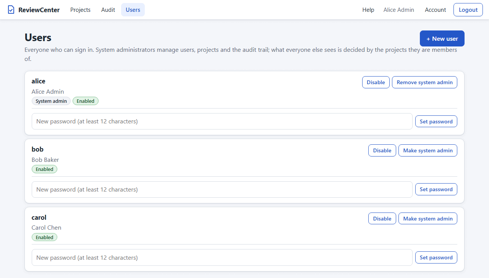
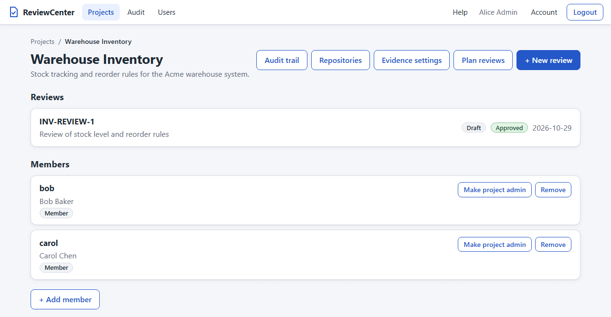
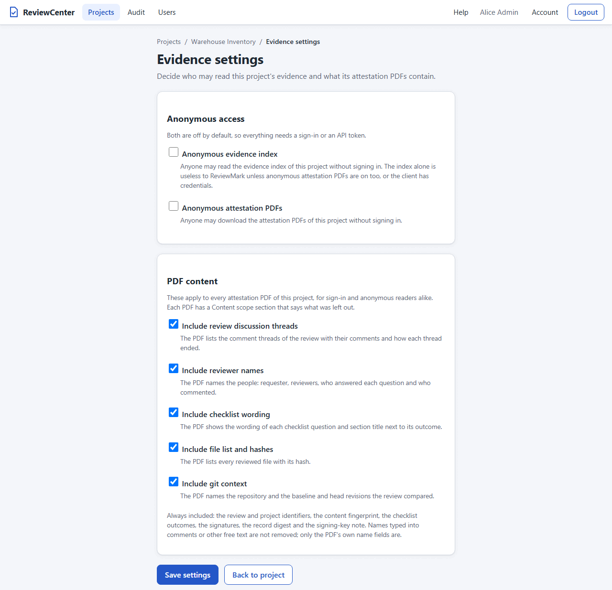
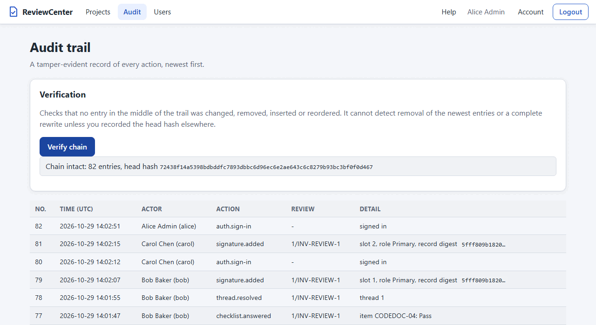

# Administration

This chapter is for the people who run ReviewCenter and manage its projects: system administrators and project
administrators. It covers the user accounts, who can see which project, the evidence settings and the review rules of a
project, the reopening of approved reviews, the audit
trail, the database, and the git repositories of a project.

## Manage Users (System Administrators)

Open `/users` (the Users link in the header); a user who is not a system administrator is refused with an "Access
denied" page that links back to the projects. The page lists the users with their user name, display name, state, and
a **System admin** badge for system administrators. A system administrator can:



1. Create a user: press **+ New user**, which opens the form at `/users/new`, enter a user name (3 to 50 letters,
   digits, `.`, `_`, or `-`; unique regardless of letter case), display name, and
   password, tick **System administrator** if the user is to be one, and create the user. **Cancel** goes back to the
   list, and so does a successful creation. A new user is a member of no project until a project administrator or a
   system administrator adds the user to one (see [Access and Visibility](#access-and-visibility)).
2. Disable a user, which stops the user from signing in without deleting the record of what the user did, and enable
   the user again.
3. Make a user a system administrator (**Make system admin**) or take that away (**Remove system admin**).
4. Set a new password for a user, for example when the user has forgotten it. This also ends a lockout, but it does
   not turn off the second factor of the user. An account
   of an identity provider (marked **OIDC**) has no password, so there is no such action for it.
5. Reset the second factor of a user who lost the phone and the recovery codes (**Reset two-factor**; see
   Two-Factor Sign-in in the Users and Sign-in chapter).

The last enabled system administrator cannot be disabled or demoted; the page shows an error instead. If you are no
longer an enabled system administrator, the page shows an error for every action.

## Access and Visibility

ReviewCenter controls access by project. There are three roles:

- **System administrator**: a flag on a user account. A system administrator creates projects, manages users and
  project membership, reads the audit trail, and can see and manage every project.
- **Project administrator**: a member of one project who also manages the members, the git repositories, the
  evidence settings, and the review rules of that project, and who can reopen an approved review of it.
- **Member**: a user who belongs to a project (a project member, role "Member" on the project page). A member works on
  the reviews of that project.

A user who is neither a member of a project nor a system administrator has no access to it. A new project has no
members; a project administrator or a system administrator adds them (see
[Managing Project Members](#managing-project-members)). Every account is a record in the ReviewCenter database. A
person who signs in with an OpenID Connect provider also has such a record: ReviewCenter creates it at the first
sign-in and finds it again by the issuer and the subject that the provider gives. It has no password, and it gets
roles and project membership in ReviewCenter like any other account (see Sign In with an OpenID Connect Provider in
the Users and Sign-in chapter).

| Action                                               | Member | Project admin | System admin |
| ---------------------------------------------------- | ------ | ------------- | ------------ |
| See the project, its reviews, history, and evidence  | yes    | yes           | yes          |
| Create reviews, comment, edit checklists             | yes    | yes           | yes          |
| Edit unsigned reviewer slots (not on a locked review)| yes    | yes           | yes          |
| Sign a review as the assigned reviewer               | yes    | yes           | if a member  |
| Download the attestation PDF of an approved review   | yes    | yes           | yes          |
| Manage the repositories and credentials of a project | no     | yes           | yes          |
| Add and remove members, change member roles          | no     | yes           | yes          |
| Create projects                                      | no     | no            | yes          |
| Manage users; read the audit page                    | no     | no            | yes          |
| Read the audit trail of the project                  | no     | yes           | yes          |
| Change evidence settings of a project                | no     | yes           | yes          |
| Change the review rules of a project                 | no     | yes           | yes          |
| Reopen an approved (locked) review                   | no     | yes           | yes          |

**Hidden means missing.** A project you cannot see looks exactly like a project that does not exist. The project
pages say "Project N does not exist.", and the API and the PDF routes answer **404**, never 403, so a refused request
does not reveal that the project exists. The **Projects** list shows only the projects you are a member of, with an
explanatory text when there are none (a system administrator sees all projects), and `GET /api/projects` returns the
same list.

**Reviewers must be members.** Both the primary and the alternate reviewer of a slot must be members of the project.
Signing needs two things: you are a member of the project, and you are the assigned reviewer of the slot. A system
administrator who is not a member of the project cannot sign it; add yourself as a member first, and then be assigned.
While the project requires independent reviewers (see [Review Rules](#review-rules)), the person who created a review
cannot be one of its reviewers and cannot sign it.

**Tokens.** A personal access token acts as its owner and carries the owner's memberships, so it reads and creates
reviews only in the projects the owner can see, and the API lists only those projects (see
the Automation and API Tokens chapter). A token never signs, so a token user can never sign a
review. A token cannot reopen a review or change the review rules either. A review created with a token has the
owner of the token as its author.

**Evidence.** By default the signed attestation PDF of a review and the evidence index of a project are visible only to
project members and system administrators. A project administrator or a system administrator can open the evidence
index, the attestation PDFs, or both of one project to readers who are not signed in; see
[Evidence Settings](#evidence-settings). Nothing else becomes visible to them.

This release lets a project administrator manage the members of that project (see
[Managing Project Members](#managing-project-members)); a system administrator manages the members of every project.

### Managing Project Members

A project administrator or a system administrator manages the members on the project page, in the **Members**
section. It lists each member with a role badge (**Member** or **Project admin**), a role button (**Make project
admin** or **Make member**), and a **Remove** button. Ordinary members do not see the section.



**Add someone who has an account.** Press **+ Add member**, which opens `/projects/{id}/members/new`. Type the exact
user name, tick **Project admin** if the person is to manage the members and repositories of the project, and press
**Add member** (or **Cancel**). There is no list of users to choose from, so nobody can browse the accounts of other
projects: ask the person for the user name. If the name cannot be added you get one message, whatever the reason (a
misspelled name, an account that does not exist, or a disabled account). Every such failure is recorded in the audit
trail as `project.member-add-failed`, and after 10 failures in 10 minutes the page refuses further attempts until time
has passed. System administrators are not limited, and the count is kept in memory, so it starts again at a restart.
Each attempt is counted when it starts, so many attempts made at the same time cannot get past the limit.

**Create an account for someone new.** On the same page, **Create a new account** opens
`/projects/{id}/members/account`. Enter a user name (3 to 50 letters, digits, `.`, `_`, or `-`) and a display name,
choose whether the person is a project admin,
and press **Create account**. The account exists only together with its membership in this project (recorded as
`project.account-created`). ReviewCenter generates a **temporary password** and shows it **once**, with a **Copy**
button; nobody types or chooses it, and it is never written to the audit trail or a log. Give it to the person right
away: it cannot be shown again. **Done** removes it from the page.

**First sign-in with a temporary password.** The person signs in with the temporary password and is taken to the
Account page, which asks for a new password. Until the password is changed, the account can only use the Account,
Help, and About pages: it has no access to any project, cannot sign a review (the password confirmation is refused),
and cannot create, list, or use API tokens (an existing token of that user is refused like an unknown token). The new
password must differ from the temporary one. After the change the person signs in again with the new password.
Accounts made by a system administrator on the Users page do not have this rule.

**Change a role or remove a member.** Use **Make project admin**, **Make member**, or **Remove** on a member. A
project always keeps at least one project administrator: a project administrator cannot remove or demote the last
one, not even themselves, and the page explains why. A system administrator can. The rule holds even when two people
act at the same moment.

**Reviewers who are removed.** A reviewer slot keeps its reviewer when the person is removed from the project. The
review page marks the reviewer as **No longer a project member**, and that reviewer cannot sign until added again.

**Limits of member management.**

- The rights of the person who changes the members are checked just before the change is stored, and not again inside
  it. If someone takes away a project administrator's right (removes, demotes, or disables the person) in the same few
  milliseconds in which that administrator changes a member, that one change can still go through; the next one is
  refused. This is the same kind of limit as the access rules in general (see
  [Access and Visibility](#access-and-visibility)).
- Adding a person by the exact user name necessarily tells a project administrator whether an enabled account with
  that name exists, because the add then works. This is accepted: every successful add is visible in the member list,
  is recorded in the audit trail, and can be undone by removing the member; failed attempts are limited and recorded
  as described above; and system administrators and project administrators can already create accounts, which also
  shows whether a name is taken. There is still no list or search of users.

Every member change is recorded in the audit trail (see [Recorded Actions](#recorded-actions)).

## Evidence Settings

**Where you are.** The **Evidence settings** page of one project, at `/projects/{id}/evidence-settings`. Open it with
the **Evidence settings** button on the project page. The button is shown, and the page opens, only for a project
administrator of the project and for a system administrator. Everybody else sees the button missing, and the address
answers as a project that does not exist.

**What you can do.** Choose who may read the evidence of the project without signing in, and what its attestation PDFs
contain. All choices are saved together with the one **Save settings** button; **Back to project** leaves the page
without saving. The warnings and the summary notice at the top follow your choices at once, before you save.



### Anonymous Access

Both switches are **off by default**, so by default everything needs a sign-in or a personal access token. They are
independent of each other.

| Switch                         | When on, anyone who can reach the server can...                       |
| ------------------------------ | --------------------------------------------------------------------- |
| **Anonymous evidence index**   | read `/api/projects/{id}/evidence/index.json`                         |
| **Anonymous attestation PDFs** | download `/api/projects/{id}/reviews/{reviewId}/attestation.pdf`      |

Both work without signing in.

- The evidence index alone is useless to ReviewMark unless anonymous attestation PDFs are on too, or the client has
  credentials: ReviewMark needs the PDFs that the index points to.
- Only these two `GET` routes can ever be anonymous. Every other route under `/api` needs a token, and no web page is
  open to visitors who are not signed in.
- A request that sends no `Authorization` header is anonymous. A request with a wrong or expired token is refused, not
  treated as anonymous.
- With a switch off, the route behaves as before: a request without a token is answered 401, and a signed-in caller who
  is not a member of the project is answered 404. A project that does not exist and a project with the switch off are
  answered alike, so nothing tells a stranger which projects exist.
- Answers have `Cache-Control: no-store`.
- Requests without a token are limited to 30 a minute for each client address, and a caller over the limit is answered
  429 with a `Retry-After` header. Behind a reverse proxy the proxy settings described in Secure Cookie Behind a Reverse
  Proxy (in the Deployment chapter) are needed, or all clients share one address and one limit. The server tracks at
  most 4096 addresses; under a
  flood of addresses the counters of the oldest ones are dropped first, so those clients start again with a full
  allowance, but nobody is refused because of it.
- An anonymous download is recorded in the audit trail as `attestation.generated` with the actor `anonymous`.

**Exposure warning.** While an anonymous switch is on, the page shows a warning that anyone who can reach the server can
read what you opened. It is stronger when the PDFs still contain review discussion threads or reviewer names: anonymous
readers then see the comments and the names of your people. Turn those content switches off, or keep the switches off,
if that is not acceptable.

### What the PDFs Contain

Five content switches apply to **every** attestation PDF of the project, for signed-in and anonymous readers alike.
All are **on by default**, so a PDF is complete unless a project administrator reduces it.

| Switch                        | When off, the PDF...                                                      |
| ----------------------------- | ------------------------------------------------------------------------- |
| **Review discussion threads** | leaves out the comment threads                                            |
| **Reviewer names**            | shows neutral labels (*Reviewer 1 (primary)*, *Participant 1*) for people |
| **Checklist wording**         | shows the checklist outcomes only, without questions and section titles   |
| **File list and hashes**      | leaves out the files and their hashes (the fingerprint still covers them) |
| **Git context**               | leaves out the repository and the baseline and head revisions             |

Always included, whatever the settings: the review and project identifiers, the content fingerprint, the checklist
outcomes, the sign-offs and signatures, the record digest, and the note about the signing key. Names that somebody
typed into a comment or another free-text field are not removed; only the name fields of the PDF are.

**Regulatory warnings.** Under every content switch that is off, the page shows a warning that is specific to it, for
example "Omitting reviewer names may not satisfy your regulatory regime. Confirm with your quality or compliance lead."
When anything is left out, a summary notice at the top of the page lists everything that is left out of the PDFs. ReviewCenter
cannot know your regulatory regime; the decision to reduce a PDF is yours.

**Content scope.** Every attestation PDF has a **Content scope** section, also when nothing is left out. It states
whether the request was anonymous, the state of each switch (*Included* or *Omitted*), and which parts were left out of
the document. It also says that the record digest covers the complete record, including what the PDF leaves out.

### Saving, Conflicts, and the Audit Event

**What happened.** After **Save settings** the page says "Evidence settings saved." When you changed nothing, it says
"Nothing to save: the settings are unchanged." and records nothing.

- If somebody else changed the settings while your page was open, nothing is saved: the page shows a message and the
  current settings, and you decide again.
- If you lose the right to administer the project while the page is open, nothing is saved and the page closes as a
  project that does not exist.
- Every change is recorded in the audit trail as `project.evidence-settings-changed` with the project. The detail lists
  each setting that changed, with the old and the new state (for example
  `AnonymousAttestations off->on; IncludeReviewerNames on->off`). The entries are on the audit page of the project,
  `/projects/{id}/audit` (see [The Audit Trail of a Project](#the-audit-trail-of-a-project-project-administrators)).

Changing a setting does not change reviews, signatures, or the record digest. It changes what the next PDF contains and
who can read the index and the PDFs.

## Checklist Template

**Where you are.** The **Checklist** button of the project page leads to `/projects/{id}/checklist`. The page is shown
only to a project administrator of the project and to a system administrator; for anybody else it is the same message as
for a project that does not exist. The **Review rules** card of the project page also shows one line with the checklist
that new reviews start with, for example "default-1 (14 sections, 58 checks), built-in default".

**What it is.** The checklist template is the list of sections and checks that a new review of the project starts with.
A project uses the built-in default (version label `default-1`, 14 sections, 58 checks) until an administrator replaces
it. The template is a JSON document with a version label and a list of sections, each with an identifier, a title, an
optional hint, and a list of checks, each with an identifier and the wording of the question. An identifier consists of
letters, digits, dots, underscores, and hyphens, starts with a letter or digit, and is unique across the whole template
(sections and checks together, without regard to case).

**Reviews keep their copy.** A review stores the checklist it was created with. Replacing or resetting the template
changes only the reviews that are created afterwards; existing reviews, their answers, and their signatures are not
touched.

**The page.**

- **Export current checklist** and **Export built-in default** download the definition as a JSON file named after its
  version label. Export the built-in default to start a template of your own.
- **Import.** Paste the JSON into the text area or choose a file of up to 256 KiB, then press **Validate**. Every
  error is listed with the path of the place that is wrong (for example `sections[0].items[1].id`), and nothing is
  changed while the definition is not valid.
- **Preview and differences.** A valid definition is shown with every section and check, and with a short comparison
  with the current checklist: the version label, and the sections and checks that were added, removed, or changed by
  identifier.
- **Replace checklist** is available for a valid definition that differs from the current one. It asks for a
  confirmation that says that existing reviews keep their checklist and only later reviews use the new one. A definition
  whose wording differs from the current one must also have **another version label**; the page refuses a changed
  definition that keeps the label, because the label is what a review records about its checklist.
- **Reset to built-in default** returns the project to the built-in default after a confirmation. It is not offered
  while the project already uses it.

If somebody else changed the template while your page was open, nothing is saved: the page shows the message that it
was changed by someone else and the template that is stored now, and you decide again. If you lose the right to
administer the project while the page is open, nothing is saved and the page closes as a project that does not exist.
A personal access token cannot change the template; the API can only read it (see [Automation](automation.md)).

**Audit.** Every replace and every reset is recorded in the audit trail as `project.checklist-changed` with the project
and the new version label (or "reset to default"). The entries are on the audit page of the project.

**Sample.** The repository contains an example template,
[`samples/iec62304-checklist.json`](samples/iec62304-checklist.json), with six sections (requirements and risk, design
and architecture including software of unknown provenance, implementation, verification, configuration management, and
documentation). It is an example structure inspired by the lifecycle activities of IEC 62304. It does not make a review
record compliant with that or any other standard: adapt it and have it reviewed by your quality or regulatory lead
before you use it.

## Review Rules

**Where you are.** The **Review rules** card on the project page (`/projects/{id}`), above the members. It is shown
only to a project administrator of the project and to a system administrator; other members do not see it. It holds three
switches, saved together with **Save review rules**: **Require independent reviewers**, which ReviewCenter applies, and
two further switches that ReviewCenter only stores and records for now (see below).

**Require independent reviewers.** The setting is **on by default**, for every project of a newly created database (a
database made before this setting existed must be recreated, because the schema has no migrations). While it is on,
the person who created a review (the ReviewCenter user who made it, or the owner of the API token that made it)
cannot be the primary or the alternate reviewer of a slot of that review and cannot sign it. This holds for a slot that
was filled while the setting was off, too: the signature of the author is refused. The review page leaves the author
out of the lists of reviewers to choose from and tells the author that a different project member has to review and sign
the review. Switch the setting off for a project where one person has to do both; then nothing is refused for that
reason. The change is not retroactive: the rule is applied when a reviewer is chosen and when a review is signed, and
signatures that exist stay valid.

**Limit: only the ReviewCenter author is known.** The rule compares the user who created the review in ReviewCenter with
the reviewer. It does not know who wrote the reviewed files and does not match the authors of git commits, so someone who
wrote the code but did not create the review is not excluded. A review created from the command line has no recorded
author, so the rule excludes nobody from it.

**Saving.** The page says "Independent reviewers are now required." or "Independent reviewers are no longer required."
after a change, and "The review rules were already set this way." when nothing changed (nothing is recorded then). If
somebody else changed the setting while your page was open, nothing is saved, the message is "The setting was changed by
someone else. Reload the page and try again.", and the page shows the stored value. A personal access token cannot change
the setting ("Project settings cannot be changed with an API token; sign in to the web pages."). Every change is recorded
in the audit trail as `project.independent-reviewers-changed` with the project and the detail
`RequireIndependentReviewers on->off` (or `off->on`).

**Two further switches: not applied yet.** The card also holds **Authors cannot answer the checklist of their own
review** and **The person who reopened a review cannot sign it again**. Both are **on by default** and are marked "Not
applied yet." on the page: ReviewCenter stores each setting and records every change in the audit trail, but it does not
apply either setting yet, so nothing is refused for these reasons today. A later version will apply them, and because
they are on by default they will then affect every project that still has them on; if your team must not be affected,
switch them off beforehand. Saving works as described above; the page says, for example, "Authors cannot answer the
checklist: now off (stored; not applied yet)." or "The person who reopened a review cannot sign it again: now on
(stored; not applied yet).", and each change is a separate change, so a refusal of a later switch does not undo an
earlier one. Each change is recorded in the audit trail as `project.review-rule-changed` with the project and the detail
`RequireNonAuthorChecklistAnswers on->off` or `RequireNonReopenerSigning on->off` (or `off->on`). The same rules apply
as for the first switch: only a project administrator or a system administrator changes them, and a personal access
token cannot.

## Reopening an Approved Review

An approved review is locked: ReviewCenter refuses every change of its threads, checklist, and reviewer slots (see
Locked Reviews and Reopening in the Reviewing chapter). A project administrator or a system administrator can reopen it.
Open the review; in the locked notice, enter a **Reason for reopening** (required, 1 to 250 characters) and press
**Reopen review**. Ordinary members do not see the form, and a personal access token cannot reopen a review.

- The review is In review again, and its signatures stay as history but are out of date; they cannot become current
  again, so the reviewers must sign again.
- The audit trail records `review.reopened` with the administrator as the actor and the detail
  `previous digest <digest>; reason: <reason>`. The review page lists the reopens in its **Reopen history**, and the
  attestation PDF of a review that was reopened and approved again has a **Reopen history** section.
- A reopen of a review that is not locked is refused: "The review is not locked, so there is nothing to reopen.".
- Reopen only when the approval must really be undone: it makes every signature of the review worthless for the
  current record, and nothing takes the reopen back.

## Inbox and Read State

Every user has an inbox of the reviews that wait for them (see Your Inbox in the Reviewing chapter). It is built from
the reviews in which the user is named in a slot or is the author, and from what is stored about what the user has
seen. Nothing needs to be set up, and no setting turns it off.

- The read state (when a user last saw a review, and the highest comment seen) is stored for each user and review. It
  is not an entry of the audit trail and it is not part of the record that a signature binds to, so reading a review
  never makes a signature out of date and never adds an audit entry.
- Administrators cannot read the inbox of another user, and a system administrator who is no member of a project sees
  in the inbox only the reviews in which that person is named as a reviewer or the author.
- Deleting a user or a review deletes the read state that belongs to it.

## Audit Trail

ReviewCenter records every change that the application makes to projects, reviews, comments, checklists, reviewer
slots, signatures, and users, and every sign-in, sign-out, failed sign-in, and lockout. An entry shows the time (UTC),
the person, the action, and a short detail. A change and its entry are stored in one database transaction, so the
application never leaves a change without its entry. A password is never recorded. The text of a comment or of a
justification is not recorded either; the detail holds only a digest prefix (eight hexadecimal characters of its
SHA-256 hash), which lets you match an entry with a text without copying the text. Entries cannot be edited or
deleted through the application.

### History of a Review

The review page has a **History** link. It opens the history page of the review, which any member of the project (or
system administrator) can read.
The page lists the entries about that review, newest first, 50 at a time, with **Older** and **Newer** links. The
text of every entry is shown as plain text.

### The Audit Page (System Administrators)

A system administrator sees an **Audit** link in the page header. It opens `/audit`, which lists the whole trail (for
all projects and reviews, sign-ins, and user administration), newest first, 50 entries at a time. Other users are
refused. Events of a project carry the project.
The page has a **Verify chain** button. It reads the whole trail once and shows either that the chain is intact, with
the number of entries and the **head hash**, or the first entry at which the chain is broken.



### The Audit Trail of a Project (Project Administrators)

A project administrator (and a system administrator) sees an **Audit trail** button on the project page. It opens
`/projects/{id}/audit`, a read-only list of the entries recorded for that project only: its reviews, members, evidence
settings, review rules, and account creations, and nothing of other projects, sign-ins, or user administration. The
list is newest
first, 50 at a
time, with **Older** and **Newer** buttons. It has no **Verify chain** button; verification covers the whole trail
and stays with the system administrator. Ordinary members do not get the button, and the page looks like a missing
project to them.

### The Chain

Each entry stores the SHA-256 hash of the entry before it and its own hash, which is calculated from the previous hash
and from every field of the entry. A change to an old entry, the removal of an entry from the middle, an inserted
entry, or a changed order makes a hash or a link no longer match, and verification reports the first entry where this
happens.

### Verify from the Command Line

```bash
reviewcenter audit verify
```

The command reads the configured database (the same settings as `serve`) and checks the chain. For an intact chain it
prints `Audit chain intact: N entries` and exits with code 0. For a broken chain it prints
`Audit chain BROKEN at entry N` to the error output and exits with code 1. If the database file does not exist (for
example, because the path or the environment is wrong), the command refuses with `The database file does not exist`
and exits with code 1; it never creates a database. If the audit trail cannot be read it prints an error and exits
with code 1. This makes the command usable in a scheduled job. The command does not print the head hash; use the Audit
page to see it.

### What the Chain Proves, and What It Does Not

The chain **detects** edits, deletions, insertions, and reordering of entries in the middle of the history.

The chain does **not** detect the removal of the newest entries, because the remaining entries are still a valid
chain. It also does **not** detect a complete rewrite by someone who can write to the database and who recalculates
all hashes, because the hashes use no secret key. To detect either, record the **head hash and the entry count**
shown on the Audit page outside the database, for example in a ticket, a signed email, or a write-once log, and
compare them with the values shown later: the entry count must not be lower, and while no new entries have been
added the head hash must be the same. This release has no external anchoring of its own; recording the
head hash is a manual step, and it is most useful after important events such as the approval of a review.

### Recorded Actions

| Group     | Action codes                                                                         |
| --------- | ------------------------------------------------------------------------------------ |
| Projects  | `project.created`, `review.created`                                                  |
| Members   | `project.member-added`, `project.member-role-changed`, `project.member-removed`      |
| Members   | `project.account-created`, `project.member-add-failed`                               |
| Slots     | `slot.added`, `slot.updated`, `slot.removed`, `signature.added`                      |
| Threads   | `thread.started`, `thread.replied`, `thread.resolved`, `thread.reopened`             |
| Checklist | `checklist.answered`, `checklist.applicability-changed`                              |
| Users     | `user.created`, `user.enabled`, `user.disabled`, `user.admin-changed`                |
| Passwords | `user.password-set-by-admin`, `user.password-changed`                                |
| Sign-in   | `auth.sign-in`, `auth.sign-out`, `auth.sign-in-failed`, `auth.locked-out`            |
| Sign-in   | `auth.sign-in-locked`, `auth.sign-in-throttled`                                      |
| Sign-in   | `auth.oidc-sign-in`, `auth.oidc-sign-in-failed` (with a short class of the reason)   |
| TOTP      | `auth.totp-enrolled`, `auth.totp-disabled`, `auth.totp-reset`                        |
| TOTP      | `auth.totp-recovery-used`, `auth.totp-recovery-regenerated`, `auth.totp-failed`      |
| Users     | `account.oidc-created` (an account was created at the first sign-in at a provider)   |
| Auditing  | `audit.events-suppressed` (events of new keys were not recorded; the table was full) |
| Signing   | `signature.reauth-failed` (a wrong password, or a missing confirmation at a provider)|
| Evidence  | `attestation.generated` (a signed attestation PDF was downloaded)                    |
| Project   | `project.evidence-settings-changed` (the evidence settings of a project were saved)  |
| Project   | `project.checklist-changed` (the checklist of a project was replaced or reset)       |
| Project   | `project.independent-reviewers-changed` (the independence rule was switched)         |
| Project   | `project.review-rule-changed` (a further review rule was switched)                   |
| Reopening | `review.reopened` (an administrator reopened an approved review)                     |
| Due date  | `review.due-date-changed` (the due date of a review was set, changed, or cleared)    |
| Tokens    | `token.created`, `token.revoked`                                                     |
| Tokens    | `token.use-failed`, `token.use-throttled` (a refused or throttled use of a token)    |

### Limitations of the Audit Trail

- Sign-in, sign-out, failed sign-in, and lockout entries are recorded on a best-effort basis, in their own
  transaction. If an entry cannot be stored, the sign-in is still decided as usual and the failure is logged.
- Failed sign-ins for unknown user names are recorded with the actor `unknown user` and the typed name, made one line
  and cut to 50 characters; a password is never recorded. Attempts on a locked or disabled account
  (`auth.sign-in-locked`, and `auth.sign-in-failed` with the detail `account disabled`) and
  attempts refused by the sign-in throttle (`auth.sign-in-throttled`) are recorded too. So that guessing cannot flood
  the trail, repeats of the same kind for the same name are recorded once per minute, and the next entry says how many
  were left out ("; N more in the minute after the previous entry"). The count of the last minute of a name that does
  not come back is not recorded, and this state is kept in memory, so it starts again at a restart. At most 500 keys
  are tracked at once; while that table is full of keys from the last minute, an event for a new key is not recorded.
  The trail then shows one `audit.events-suppressed` entry per minute (and the server log one warning). The first
  entry only says that events were left out; each next one says how many were left out in the minute before it.
- The trail holds no address of a client, with one exception: the entries `token.use-failed` and `token.use-throttled`
  name the address from which a token was refused. Everything else about addresses is only in the log of the web server.
- A wrong current password on the account page is recorded as `auth.sign-in-failed`, because it is checked in the same
  way as a sign-in and counts toward the same lockout; an attempt there on a locked account is not recorded. A wrong
  password at a signature is recorded as `signature.reauth-failed`. A wrong code at the second step of a sign-in is
  recorded as `auth.totp-failed`, as is a missing or wrong code when a person with a second factor changes the own
  password; the codes themselves, the secrets, and the recovery codes are never recorded.
- Comments, justifications, and the reason for marking a checklist section not applicable are recorded only as a short
  digest, never as text. The reason for reopening a review is the exception: it is recorded as text (at most 250
  characters, so that it fits the entry), together with the digest of the record that was reopened.
- There is no export and no retention or archiving of the trail, and no external anchoring.
- The audit trail is a new table. A development database created before it existed must be recreated (see the next
  section).

## Database

ReviewCenter keeps users, projects, reviews, file contents, comment threads, checklists, reviewer slots and
signatures, and the audit trail in a SQLite database
file. On first start
it creates the
folder, the file, and the tables. The default file is `reviewcenter.db` in the `ReviewCenter` folder of the
per-user application data folder (`%LOCALAPPDATA%\ReviewCenter` on Windows, `~/.local/share/ReviewCenter` on
Linux); when the account has no such folder, the file is `data/reviewcenter.db` beside the executable. To back up
the data, stop the server and copy the file.

Configure the database in the `Database` section of the `appsettings.json` file that sits beside the executable, or
with environment variables (which take precedence):

| Setting                     | Environment variable         | Meaning                                                 |
| --------------------------- | ---------------------------- | ------------------------------------------------------- |
| `Database:Provider`         | `Database__Provider`         | Database provider; only `Sqlite` is supported           |
| `Database:ConnectionString` | `Database__ConnectionString` | Database file path or SQLite connection string          |

A value without an `=` sign is treated as a file path; an empty value selects the default file. An in-memory
SQLite database (`:memory:`) is not supported and is refused at startup. For example:

```bash
# Linux: keep the data in another file
Database__ConnectionString=/srv/reviewcenter/reviews.db reviewcenter serve
```

If the database cannot be prepared (for example the provider is not supported or the location cannot be used), the
server writes an error message and exits with a non-zero exit code. Database migrations are not provided in this
release: the tables are created only when the database is new. **A database file created by an earlier build, before
user accounts, reviewer signatures, or the audit trail existed, does not have the tables and columns that are
needed, and the pages cannot work with it: delete the file (or point `Database:ConnectionString` at a new one) and
start again, then create the first system administrator.** Do this only with development data. The repository registry and
the reviews from a repository add tables and columns, and the record digest of a review is calculated in the
format `ReviewCenter record v1` that includes the review-set and the side of every line comment, so a development
database created before them must be recreated in the same way. The personal access tokens add a table, and every
review has new columns that tell who created it and whether it was created with an API token, so a development database
created before them must be recreated as well. Project-based access control adds the project memberships, replaces the
role of a user with a system administrator flag, and ties every repository to one project, so a development database
created before it must be recreated too. Project member management adds the must-change-password flag of a user
(`Users.MustChangePassword`), so a development database created before it must be recreated as well. The evidence
settings add seven columns to the projects (`EvidenceAnonymousIndex`, `EvidenceAnonymousAttestations`,
`EvidenceIncludeThreads`, `EvidenceIncludeReviewerNames`, `EvidenceIncludeChecklistWording`, `EvidenceIncludeFiles`,
and `EvidenceIncludeGitContext`), and the record digest is now labeled `ReviewCenter record v1`, a format private to
ReviewCenter that also covers the wording of the checklist questions and who answered them. The sign-in with an
OpenID Connect provider adds two columns to the users (`Users.ExternalIssuer` and `Users.ExternalSubject`) with a unique
index on the pair. The two-factor sign-in adds two tables (`UserTotps` and `TotpRecoveryCodes`). There is no migration:
recreate development databases created before them. The approval lock and the independent reviewers add the table
`ReviewReopens` (the history of reopened reviews) and the column `Projects.RequireIndependentReviewers`, again with no
migration: the server creates them only when the database is new, so a development database created before them must
be deleted and created again, like the earlier ones. A new project, and a review that was never reopened, keep their
record digests (the number of reopens is added to the digest only when it is more than zero). The review rule switches
add the columns `Projects.RequireNonAuthorChecklistAnswers` and `Projects.RequireNonReopenerSigning`, again with no
migration: a development database created before them must be deleted and created again. The optional due date of a
review adds the column `Reviews.DueDate`, which the server also creates only when the database is new (no migration).
The follow-up review adds the columns `Reviews.FollowsReviewId`, `Reviews.CarriedAnswerCount`, and
`Reviews.CarriedThreadCount`, and the carried-from columns of the checklist answers, the section states, and the
threads, again with no migration. A review that follows nothing keeps its record digest, because the lines for a
followed review and for carried rows are added to the digest only when they exist.

## Repositories and Credentials

Every git repository belongs to exactly one project, and the repositories are managed per project. Project
administrators of a project and system administrators add them (see
Reviews from a Repository in the Reviewing chapter). There is no global repository list.

### Prerequisite

ReviewCenter reads repositories with the installed `git` program, which must be on the `PATH` of the account that runs
the server (git 2.31 or later). If git is missing or too old, an operation that needs it fails with a message that says
so; the rest of the server works.

### The Repositories Page (Project Administrators)

On a project page, a project administrator or a system administrator sees a **Repositories** button. It opens
`/projects/{id}/repositories`, the repositories of that project. Other users, including ordinary members, do not get the
page; for a user who cannot see the project at all it says "Project N does not exist."

- **Add repository**: press **+ Add repository** on `/projects/{id}/repositories`, which opens the form at
  `/projects/{id}/repositories/new`, and
  enter a name (letters, digits, dot, underscore, and hyphen, up to 40 characters, unique without
  regard to case), a location, and for a private repository a user name and an access token. The token must not be
  contained in (a part of, compared with case) the repository name, the user name, or the location (or its URL-escaped
  form), because those appear
  in messages and in the audit trail; the same applies when you edit a repository and replace the token, or change the
  name, the user, or the location while keeping a stored token. The location is an
  `https://` or `file://` URL, an `http://` URL for the local machine only (`localhost`, `127.0.0.1`, or `[::1]`;
  plain `http://` to any other host is refused because it can be tampered with), or an absolute local path. A user name
  or token is accepted only with an `https://` location, because the token must not travel in clear text; so a
  loopback `http://` repository is always anonymous. The location must not contain a user name or
  password, a query string, or a fragment; enter the credentials in their own fields.
- **List**: shows each repository with its location, user name, enabled state, and "token set" or "no token". The
  token itself is never shown.
- **Edit**: change the name, location, or user name, and choose what happens to the token: keep the stored token,
  replace it (type the new one), or clear it. Keeping the token sends it to the new location, so choose replace or clear
  when you point a repository at a different host.
- **Disable and enable**: a disabled repository cannot be read and is not offered to users. A repository cannot be
  deleted.

Every change is recorded in the audit trail without the token. Ordinary members of the project are only offered the
names of its enabled repositories (on the new review form and the Plan reviews page), never the location or the
credentials.

### How the Token Is Protected

The token is encrypted with ASP.NET Core Data Protection before it is stored in the database, so a copy of the database
alone does not expose it. The key ring that decrypts it is kept in a separate folder. When git runs, the token is passed
only in the environment of the git process (never on the command line and never in a file), and the token and its
encoded forms are removed from every error message and log line. Git never asks for a password interactively.

- **Back up the key ring** (the `DataProtection:KeysPath` folder) separately from the database. If it is lost, the
  stored tokens become unreadable, and a project or system administrator must enter them again. When the key files are
  encrypted with a certificate, also back up the certificate and its password (see Key Ring Protection below).
- **The keys are encrypted at rest only when the platform or you provide a protection.** On Windows they are encrypted
  with DPAPI by default; with a certificate (`DataProtection:CertificatePath`) on any system; and otherwise (Linux and
  macOS without a certificate, or `PermissionsOnly` chosen explicitly) only the permissions of the folder (owner only)
  and of the key files protect them, and the server logs a warning at every start. Anyone who can read both the key
  folder and the database can then read the tokens.
- **The first start of this version signs every user out once**, because the cookie keys now persist in the key folder.
- The server checks at start that the key folder can be written; if it cannot, it refuses to start and names the
  folder.

| Setting                   | Environment variable       | Meaning                                                 |
| ------------------------- | -------------------------- | ------------------------------------------------------- |
| `DataProtection:KeysPath` | `DataProtection__KeysPath` | Key ring folder (default `keys` beside the database)    |
| `Git:CachePath`           | `Git__CachePath`           | Mirror folder (default `git-cache` beside the database) |
| `Git:TimeoutSeconds`      | `Git__TimeoutSeconds`      | Git call time limit in seconds (default 120; 1 to 3600) |

### Key Ring Protection

The key ring decrypts every stored token, so the server protects its key files at rest. `DataProtection:Protection`
chooses how (the names are not case sensitive):

| Value             | Meaning                                                                                     |
| ----------------- | ------------------------------------------------------------------------------------------- |
| `Auto` (default)  | The certificate if `CertificatePath` is set; else DPAPI on Windows, permissions elsewhere   |
| `Dpapi`           | Windows DPAPI for the account (`CurrentUser`) or the machine (`LocalMachine`); Windows only |
| `Certificate`     | The key files are encrypted with the public key of an RSA certificate that you supply       |
| `PermissionsOnly` | No encryption: owner-only permissions on the folder and the key files (see below)           |

| Setting                                   | Meaning                                                            |
| ----------------------------------------- | ------------------------------------------------------------------ |
| `DataProtection:Protection`               | `Auto`, `Dpapi`, `Certificate`, or `PermissionsOnly`               |
| `DataProtection:DpapiScope`               | `CurrentUser` (default) or `LocalMachine`; DPAPI on Windows only   |
| `DataProtection:CertificatePath`          | A PFX, PKCS#12, or PEM file with the certificate and an RSA key    |
| `DataProtection:CertificateKeyPath`       | A PEM file with the private key, if not in the certificate file    |
| `DataProtection:CertificatePassword`      | Password of the certificate or key file (prefer the file setting)  |
| `DataProtection:CertificatePasswordFile`  | A file that holds the password; set only one of the two            |
| `DataProtection:PreviousCertificatePaths` | A list of earlier certificates that can still decrypt the ring     |
| `DataProtection:RequireEncryptedKeys`     | When true, the server refuses a ring that is not encrypted at rest |
| `DataProtection:AllowNewKeyRing`          | One-start escape hatch: accept a new, empty ring (default false)   |

Set the list with indexed environment variables, for example `DataProtection__PreviousCertificatePaths__0`.

Certificates are read from files only; the certificate store is not used. A wrong certificate, a wrong password, a
missing file, and a certificate without an RSA private key each stop the start with a message that names the setting.
The password is never logged.

**The honest limit of `PermissionsOnly`.** Without a secret that you supply there is no facility of the operating system
that binds the keys to the machine, so `PermissionsOnly` is only owner-only permissions. On Linux and macOS the folder
gets mode 0700 and every key file mode 0600, including a key file that the server creates later when the key ring rolls
to a new key (about every 90 days): it is restricted as it is created, not at the next start. On Windows, which uses
`PermissionsOnly` when you choose it explicitly, the server replaces the access rules of the key folder: the folder no
longer inherits the rules of its parent, and only the account of the server and the system have access, so the key
files that are created later in it have the same access. Another account, for example one that makes backups, has no
access, and the server sets the rules again at every start.
The server says so with a warning at every start ("The key ring is not encrypted at rest ..."). Set
`DataProtection:CertificatePath` to encrypt the key files, and `DataProtection:RequireEncryptedKeys` to refuse to start
without it. The certificate and its password must be kept where the service account can read them and an intruder who
copies the key folder cannot; a certificate and its password beside the keys is no protection.

**Windows DPAPI cannot be moved.** A ring that DPAPI protects can be read only by the same account (or machine, with
`LocalMachine`). Restoring it elsewhere makes the stored tokens unreadable, so use a certificate for a ring that must
be restored on another machine. A database restored **without** its key ring is not silently accepted: when the key
folder holds no key but the database holds protected secrets, the server refuses to start unless you set
`DataProtection:AllowNewKeyRing` to `true` for one start, and when only some secrets cannot be decrypted it logs an
error with the counts at every start; see Back Up and Restore in the Deployment chapter.

**The server never replaces a ring that it cannot read.** Data Protection answers a key that it cannot decrypt by
creating a new key, which would make the stored tokens unreadable. At start the server therefore checks the ring first:
when the newest key (or every key) cannot be decrypted, it refuses to start and names `DataProtection:CertificatePath`
and `DataProtection:PreviousCertificatePaths`. It also refuses to start when the folder holds key files but no key can
be read from them (damaged or unsupported files), names `DataProtection:KeysPath`, and changes nothing: restore the key
folder, or remove the damaged files only if you accept that what they protected is lost. A key that was written before
encryption was set stays in plain text
until Data Protection replaces it (every 90 days); with `RequireEncryptedKeys` such a ring is refused.

**Replacing the certificate.** Set the new certificate in `DataProtection:CertificatePath` and list the old one in
`DataProtection:PreviousCertificatePaths`. The older keys stay encrypted with the old certificate, so keep it listed for
as long as they are in the ring (there is no command yet that encrypts them again). An old certificate is opened with
the password of the current certificate, or without a password, so give both certificates the same password.

**Recipe: a certificate with OpenSSL** (Linux and macOS; the project did not run these commands):

```bash
umask 077
openssl req -x509 -newkey rsa:3072 -sha256 -days 3650 -nodes -subj "/CN=ReviewCenter key ring" \
  -keyout keyring.key -out keyring.crt
openssl rand -base64 32 > keyring.password
openssl pkcs12 -export -inkey keyring.key -in keyring.crt -passout file:keyring.password -out keyring.pfx
shred -u keyring.key   # keep keyring.crt, keyring.pfx and keyring.password; back them up apart from the key ring
```

**Recipe: a certificate with PowerShell** (Windows; the project did not run these commands):

```powershell
$cert = New-SelfSignedCertificate -Subject "CN=ReviewCenter key ring" -KeyExportPolicy Exportable `
  -KeySpec KeyExchange -CertStoreLocation Cert:\CurrentUser\My -NotAfter (Get-Date).AddYears(10)
$password = Read-Host -AsSecureString
Export-PfxCertificate -Cert $cert -FilePath C:\ProgramData\ReviewCenter\keyring.pfx -Password $password
Remove-Item $cert.PSPath   # the server reads the file, not the store
```

**Recipe: the password as a systemd credential** (Linux; the project did not run this). Keep the password in a file
that only root can read, and let systemd hand it to the service in a private directory:

```ini
[Service]
LoadCredential=keyring-password:/etc/reviewcenter/keyring.password
Environment=DataProtection__Protection=Certificate
Environment=DataProtection__CertificatePath=/etc/reviewcenter/keyring.pfx
Environment=DataProtection__CertificatePasswordFile=%d/keyring-password
Environment=DataProtection__RequireEncryptedKeys=true
```

A setting for `DataProtection` is read from the host configuration (`appsettings.json`, environment variables, and the
command line) once, when the services are registered. The commands `user add` and `audit
verify` register the same services and the same protection but do not use the key ring, so the server is the only
command that checks it.

### How Repositories Are Read

ReviewCenter keeps a bare mirror of each repository in the cache folder (`repo-{id}`) and fetches before it reads. One
operation at a time runs on a repository. A revision (a branch, a tag, or a commit) is validated before it reaches git:
a revision that starts with `-` or contains a space or a control character is refused. A revision that git does not
know gives a clear "unknown revision" message. The changed files between two revisions are listed with a rename counted
as a delete and an add; without a baseline revision every file of the revision is listed. Symbolic links and submodules
are skipped with a note, and the per-file and total size limits are the same as for an upload, checked before a file is
read. A call that runs longer than `Git:TimeoutSeconds` is stopped together with its child processes. The value must
be from 1 to 3600; the server refuses to start with an error that names `Git:TimeoutSeconds` for any other number
(earlier versions treated 0 or a negative value as the default).

Redirects are not followed, so a location that redirects (for example one that needs the `.git` ending) must be entered
in its final form. If the cache folder cannot be written, or its path is malformed or too long, the operation fails with
a message that the server "cannot write its git cache folder" and names the `Git:CachePath` setting; an administrator
must fix the folder or its permissions. When git itself fails, the first line of its (redacted) error is shown to the
user but is not written to the server log. The location of the repository is replaced in that line by the repository
name, so ordinary users see which repository failed but not where it is kept (a form of the location that git prints in
an unusual way could still show).

### Selecting Files

The files of a review are chosen with patterns, one per line (up to 100 lines of up to 400 characters):

- `*` matches any characters within one folder level, and `**` as a whole segment matches any number of folders.
- `?` matches exactly one character.
- A line that starts with `!` excludes; the last matching line decides, so a later include adds a path back.
- A trailing `/` means everything below that folder. A leading `./` or `/` is dropped.
- Matching is case-sensitive. A pattern with `\`, an empty segment, or a `.` or `..` segment is refused.

These patterns work like the file lists of the ReviewMark tool with a few deliberate differences:
matching is case-sensitive, `?` is a wildcard, `\` is not accepted, and an empty selection is an error instead of
meaning all files.

### Limitations of Repositories

- A review from a repository has the same limits as an upload, counted over the baseline and head content of the
  changed files.
- There is no credential helper or SSH key support and no repository deletion. The key ring has no secret store of its
  own: its protection is DPAPI, a certificate whose password you provide, or file permissions (see Key Ring
  Protection).
