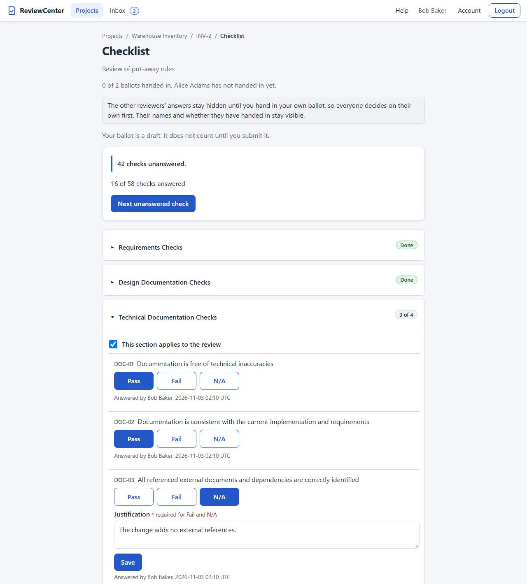
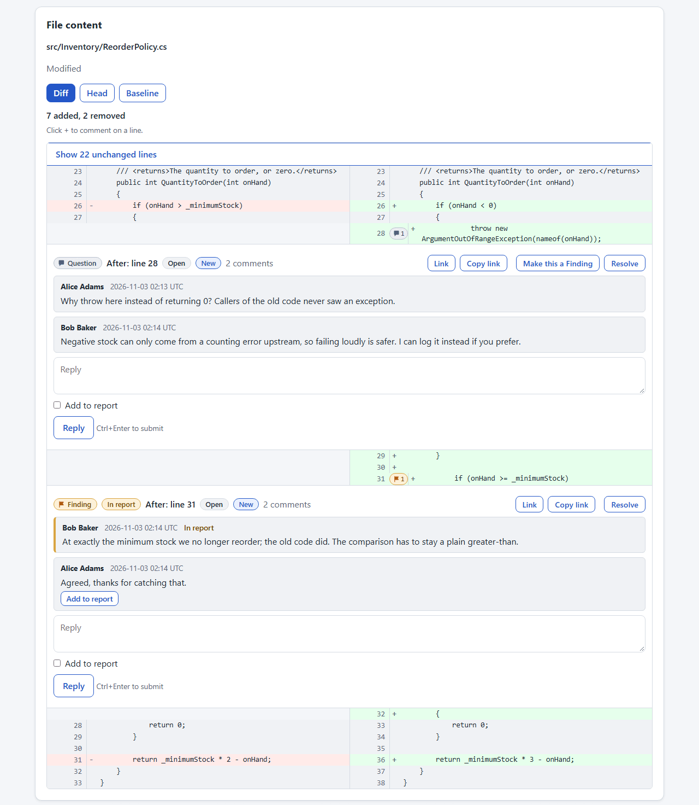
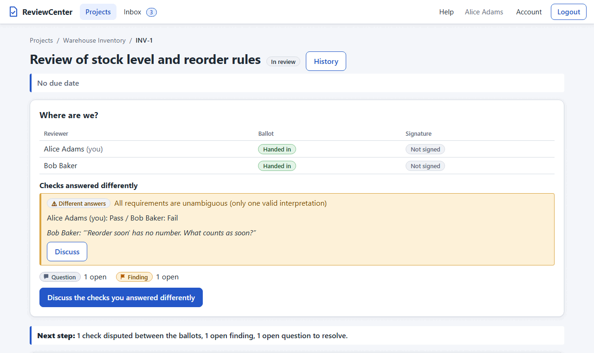
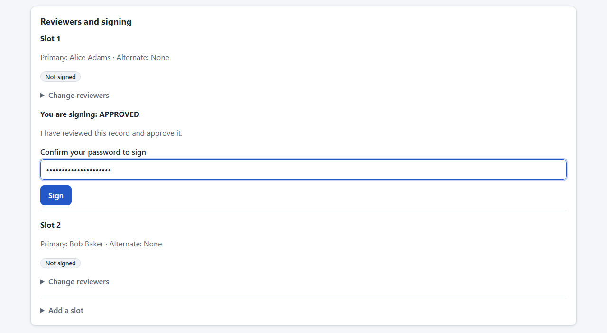
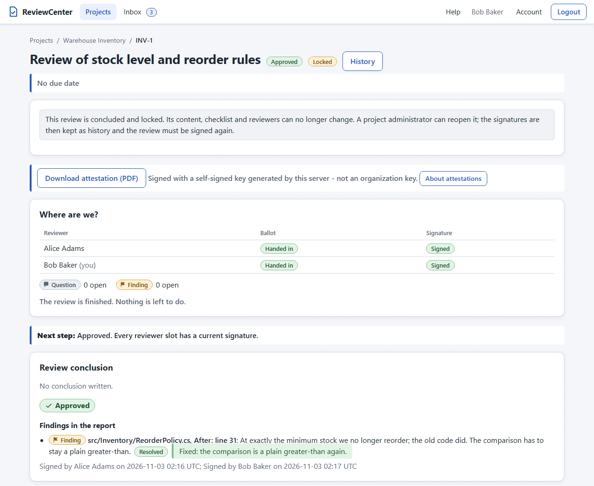

# Your First Review

This chapter walks through one small review from start to finish, so that you see how the pieces fit together before
you read the detailed chapters. It uses three people: **Carol**, who owns the work and creates the review, and two
reviewers, **Alice** and **Bob**. Each step names the chapter that has the details.

## What You Will Do

1. Carol creates the review and two reviewer slots.
2. Alice and Bob answer the checklist, each on their own.
3. They discuss a Question about a line of code, and turn it into a Finding that goes in the report.
4. They reconcile a check that they answered differently.
5. Both sign, and the review is concluded.
6. Carol downloads the signed attestation.

At the end, a short section tells you what happens when the reviewers agree that the work fails.

## Before You Start

You need a running server (see the Installation chapter), a project with Carol, Alice, and Bob as members, and a way
to sign in as each of them (see the Users and Sign-in chapter). A system administrator creates the project and adds the
members (see Projects and Reviews in the Reviewing chapter, and Managing Project Members in the Administration chapter).
Carol can be a system administrator or a project administrator; Alice and Bob can be ordinary members. Use three
browsers or private windows if you play all three roles yourself.

By default a project requires **independent reviewers**: the person who creates a review cannot answer its checklist,
be one of its reviewers, or sign it. That is why Carol needs Alice and Bob (see Review Rules in the Administration
chapter).

## Carol Creates the Review

1. Carol opens the project and presses **+ New review**.
2. She enters an identifier (for example `INV-1`) and a title, chooses the files to review, and presses the create
   button. The chosen files are listed with their sizes first. A review can also be made from a git repository (see
   Reviews from a Repository in the Reviewing chapter).
3. The review page opens. Under the reviewer slots, Carol uses **Add a slot** to give Alice a slot, and again to give
   Bob a second one. A slot has a primary reviewer and, if you want, an alternate who can stand in. Every slot must
   sign, so two slots mean two signatures (see Review Signatures in the Reviewing chapter).
4. The page shows one line with the **Next step**, so nobody has to guess what to do.

Alice and Bob now find the review in their inbox, the **Inbox** tab in the header (see Your Inbox in the Reviewing
chapter).

## Alice and Bob Answer the Ballots

Each reviewer opens the review and the checklist page. Alice and Bob answer the **same checklist** separately, and
neither sees the answers of the other until both have handed in their own ballot. That keeps their judgment
independent.

1. Open a section and choose **Pass**, **Fail**, or **N/A** for each check. A Pass is saved at once; Fail and N/A need
   a short justification. The **Next unanswered check** button takes you to the first check that is still open.
2. A section that does not apply to the review can be switched off, with a reason.
3. When every check is answered, press **Submit ballot**. That hands the ballot in; until then it is a draft that only
   you can see.

In this example Alice and Bob answer all checks with **Pass**, except for one check, where Alice chooses **Pass** and
Bob chooses **Fail** with the justification "The reorder level is not checked for negative stock." Carol cannot
answer or sign, because she created the review.

## Discuss a Question

While reading the files, Alice wonders about a line.

1. In the code of the review page, Alice presses the **+** button next to the line (its tooltip reads "Comment on
   line N"). The form fills in the line number.
2. She keeps the default kind, **Question**, types "Why is the limit 100 here?", and presses the start button.
3. Bob, or anybody else in the project, replies in the thread. A reply is chat: it is part of the discussion but not of
   the signed record.

A Question blocks signing while it is open, but it never makes anyone sign again. See Review Comments in the Reviewing
chapter.

## Make It a Finding

Bob answers that the limit is a mistake. That is worth keeping in the report, so Alice presses **Make this a Finding**
(its tooltip reads "Add to report"). The thread is now a **Finding**, marked **In report**. The person who started a
thread, the owner of a reviewer slot, and the lead of the review (Carol, in this example) may do it. A single reply
that you want in the report can instead be sent with **Add to report** ticked.

A Finding is printed in the attestation together with the way it was resolved. When it is fixed, or accepted as it is,
anybody presses **Resolve** and writes a short note such as "Limit changed to 50 in INV-2" (a note is required for a
Finding). **Make this a Question** takes a Finding out of the report again.

## Reconcile a Dispute

Once Alice and Bob have both handed in, the **Where are we?** panel at the top of the review page shows the answers of
both side by side: "Alice: Pass / Bob: Fail", with a **Different answers** mark. A check on which the ballots differ is
**disputed**, and a disputed check blocks signing.

1. Either reviewer presses **Discuss** next to the check. That starts a thread about the check (see Discussions About
   a Check in the Reviewing chapter).
2. Alice and Bob talk it through in the thread. Here, Alice agrees that the reorder level should be checked.
3. Alice changes her answer to **Fail** with a justification, or Bob changes his to **Pass**. Changing a submitted
   answer turns the ballot back into a draft, so press **Submit ballot** again.
4. When the answers agree, the dispute is gone. Resolve the thread about the check.

Here Bob decides that his concern is covered by the Finding and changes his answer to **Pass**.

## Resolve Everything That Is Open

The **Open threads** line of the **Where are we?** panel counts the Questions and Findings that are still open. Each one
must be resolved before anybody can sign: press **Resolve** on each thread (and add a note to a Finding).

## Sign

Sign last. Signing is bound to the record at that moment, and a later change of an answer or of the report would make
the signatures given so far out of date (see *Sign Last* in the Review Practices chapter).

1. Alice opens the review page. Her slot shows the form "You are signing: APPROVED" with the statement "I have
   reviewed this record and approve it." She types her password and presses **Sign**. If she turned on two-factor
   sign-in, she also types a current code.
2. Bob does the same in his slot.

You do not choose the outcome. It follows from the agreed ballots: **Approved** when nobody agreed on a Fail.

When every slot has signed the same outcome and no thread is open, the review is concluded and **locked**: nothing in
it can be changed unless an administrator reopens it (see Locked Reviews and Reopening in the Reviewing chapter).

## Download the Attestation

A concluded review shows **Download attestation (PDF)** below its title. Carol, or any member of the project, presses
it and gets a PDF with the files, the agreed checklist, the Findings, the conclusion, and the signatures of Alice and
Bob. The PDF is signed by the server, so anybody can open it in a PDF reader that checks signatures and see that it has
not been changed since (see Signed Attestation in the Reviewing chapter). Keep the PDF with your other records.

## What If the Review Is Rejected?

A review can end in a **rejection** too. That is a normal result, not a mistake.

1. If Alice and Bob **agree** on a Fail (the same check failed in both ballots), the outcome is **Rejected**. A single
   Fail that is disputed is not enough; they first reconcile it, as above.
2. A rejection must say why. Until somebody writes the reasons in the **Review conclusion** card, the slots show "A
   rejected review needs a conclusion stating the reasons" instead of the sign form.
3. Each slot signs. The form now says "You are signing: REJECTED".
4. The review is concluded as **Rejected** and locked, and the attestation is available too, with the title **Review
   attestation - REJECTED**.

The files of a review never change, so the usual next step is to fix the work and create a **follow-up review** that
carries over the answers that still hold (see Follow-up Reviews in the Reviewing chapter). If the rejection was a
mistake, an administrator can reopen the review, with a reason (see Reopening a Concluded Review in the Administration
chapter). See Concluding a Review as Rejected in the Reviewing chapter for the details.

## Where to Go Next

- The Reviewing chapter explains every page of this walkthrough in detail.
- The Review Practices chapter suggests how a team can work with ReviewCenter: who reviews what, and when to sign.
- The Administration chapter covers users, projects, members, checklists, and the review rules.
- The Automation and API Tokens chapter shows how to create reviews from a script.
- If your administrator has set up mail, the Help topic **E-mail notifications** (`/help/email-notifications`)
  explains how to get news by e-mail.
