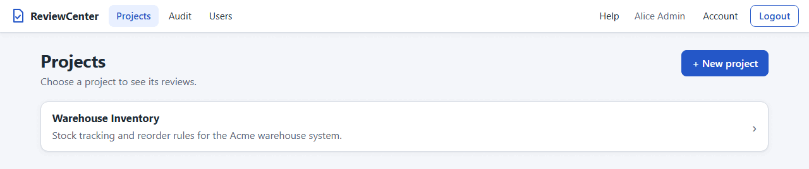
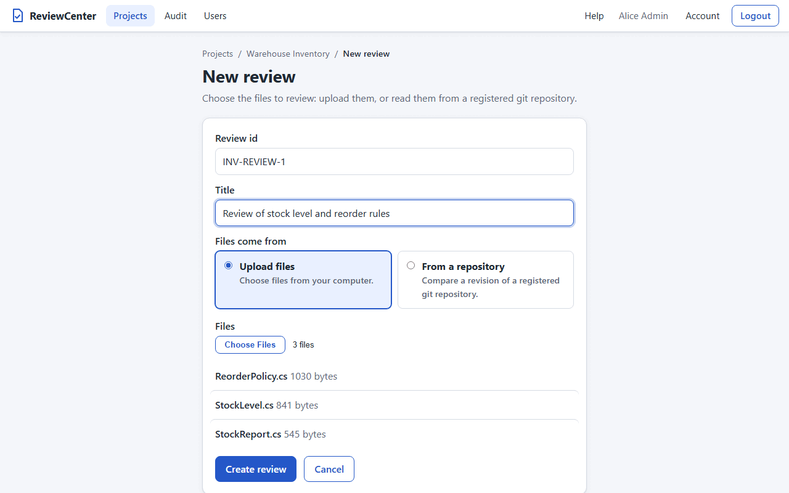
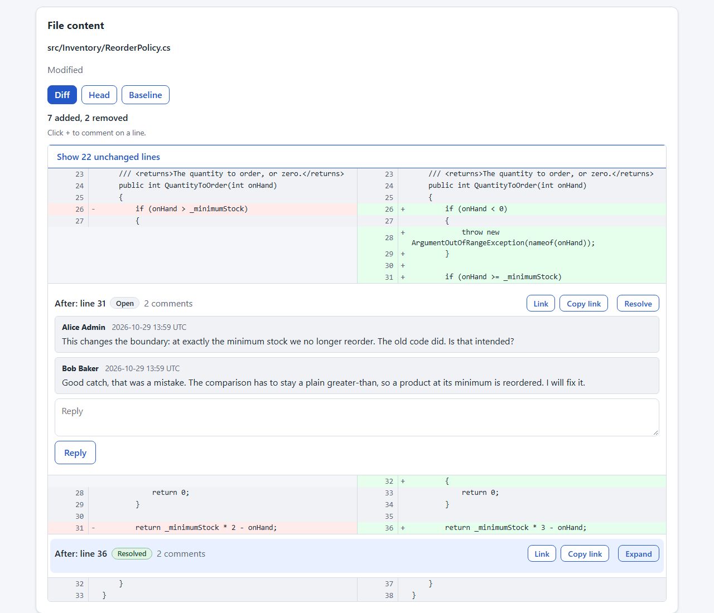
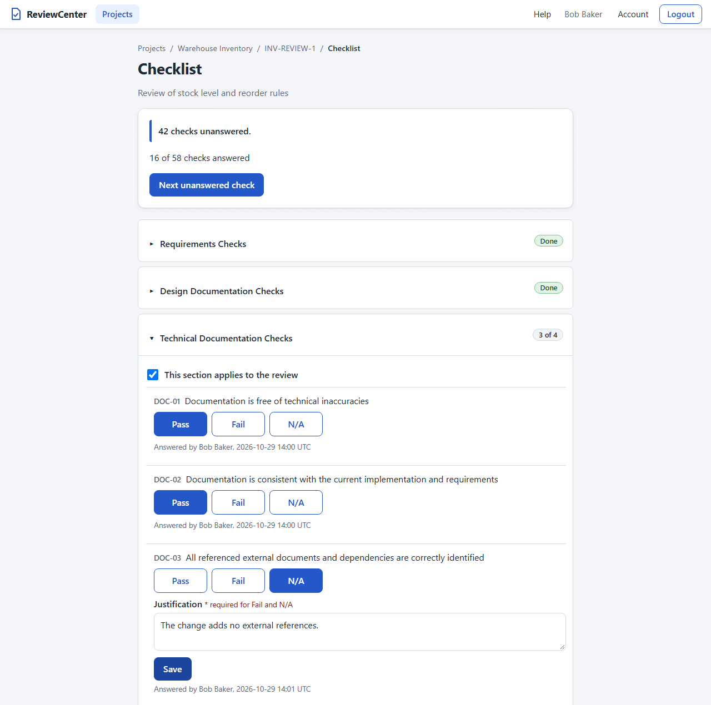
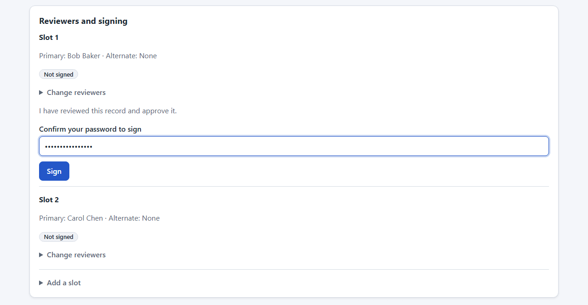
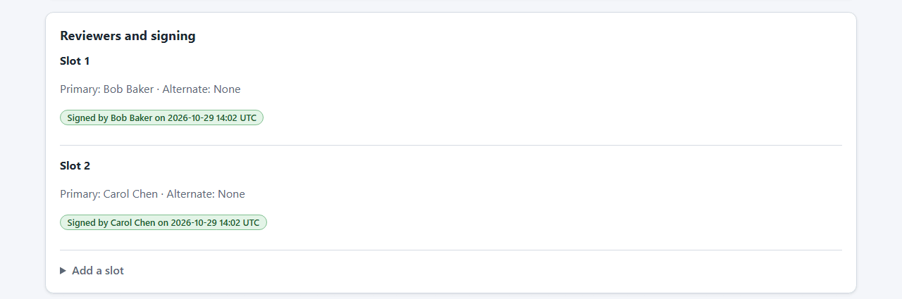
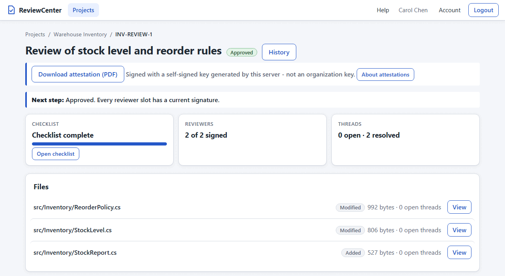

# Reviewing

This chapter describes the daily work of a review: projects and their reviews, planning, comments, the checklist,
the signatures, the lock of a concluded (approved or rejected) review and how an administrator reopens it, and the
signed attestation that proves an approval.

## Projects and Reviews

A project groups the reviews of one body of work. A review is a named set of files whose content is stored
unchanged, together with a fingerprint of that content.

1. Open `/projects` (the Projects link in the header). The list shows the projects you can see: all projects for a
   system administrator, and for anyone else only the projects they are a member of (the page explains when there are
   none). A system administrator creates a project: press **+ New project**. On the form at `/projects/new`, enter
   a project name (up to 100 characters) and an optional description (up to 1000 characters), and press the create
   button. The new project opens, with no members. **Cancel** goes back to the list; select a project to open its page.
   A project that you cannot see is reported as "Project N does not exist."

   
2. A project administrator (or a system administrator) manages the members on the project page, in the **Members**
   section; see Managing Project Members in the Administration chapter. The project page also
   has a **Repositories** button for the project's git repositories (see
   Repositories and Credentials in the Administration chapter).
3. On the project page, press **+ New review**. On the form at `/projects/{id}/reviews/new`, enter a review
   identifier (1 to 100 letters, digits, `.`, `_`, or `-`, starting with a letter or digit; unique within the
   project; the identifier `new` is reserved and is refused) and a title (up to 200 characters), choose the files to
   review, and press the create button. The chosen files are listed with their sizes before you submit. You can also
   enter an optional **Due date** (see [Due Dates](#due-dates)). **Cancel**
   goes back to the project.

   
4. The review page opens. From the top it shows the title, a line that says what to do next, the files with their
   size and open comment threads, and the thread index. Select a file to read
   its content as numbered lines (see [Review Comments](#review-comments)); the page scrolls to the code. Binary
   files, and files that are not valid UTF-8 text, show a notice instead of their content. At the bottom, the
   collapsed "Details" section holds the identifier, the review
   fingerprint, and the SHA-256 hash of each file; open it when you need them.

The review fingerprint is calculated exactly as in the ReviewMark tool (see the "Fingerprinting" section of the
ReviewMark User Guide): each file is hashed with SHA-256, the hashes are sorted, and the sorted hashes are hashed
again. It depends only on the content of the files, not on their names or order, and it is not affected by line
ending conversion because the bytes are never changed.

Error messages (for example a blank name, an identifier already used in the project, or too many files) are shown
on the page, and nothing is created.

### Upload Limits

- At most 200 files per review, 2 MiB per file, and 20 MiB for all files of a review.
- Only the file name of each chosen file is kept (not its folder), so two files with the same name cannot be in the
  same review; the page reports this when you submit.

### Due Dates

A review can have an optional **due date**, the day by which the review should be finished. The date is a calendar day
in **UTC**, not a moment in your time zone: the day changes at midnight UTC, and the pages say "(UTC)" next to the date.

- **At creation**: the form for a new review, the plan page (one date for all the reviews and, if you want, one for each
  set), and the API (see the Automation chapter) take an optional date. At creation the date must be today or later,
  and at most two years ahead; otherwise the review is not created and the page says that the due date is not valid.
  On the plan page a date that is not valid fails only that review.
- **On the review page**: the header shows "Due YYYY-MM-DD (UTC)" or "No due date". When the date is before today and
  the review is not concluded, an **Overdue** badge is shown next to it.
- **Changing it**: a project administrator, a system administrator, or the person who created the review can change the
  date in the header (a date input with **Save**, and **Clear** to remove it). A date in the past is accepted when you
  change it, so you can record that a review is late; it is then shown as overdue. Other members see the date and the
  badge but no form. A personal access token cannot change the date.
- **Concluded reviews**: an approved or rejected review is locked, so its date cannot be changed (the form is not
  shown) until an
  administrator reopens it. It keeps its date as history and is never shown as overdue.
- The date is not part of the signed record: changing it does not make anyone sign again. Every change is
  recorded in the audit trail as `review.due-date-changed` with the old and the new date, and the creation entry names
  the date when one was given.

### Reviews from a Repository

Instead of uploading files you can review what changed in a git repository that belongs to the project (a project
administrator or a system administrator adds it; see Repositories and Credentials in the Administration
chapter).
On the new review form (**+ New review** on the project
page), under **Files come from**, choose
**From a repository** and enter:

- **Repository**: one of the enabled repositories of this project, by name. If there is none, the page says so and
  offers only the upload.
- **Head revision**: a branch, a tag, or a commit (for example `main`, `v2.0`, or a commit id).
- **Baseline revision** (optional): the revision to compare with. Without it every file of the head revision that
  matches the selection counts as Added.
- **Selection**: the files to review, patterns one per line (default `**/*`); see Selecting Files in the
  Administration chapter.
  For example, the two lines `src/**/*.cs` and `!src/**/Generated/**` select the C# files below `src` except those in
  `Generated` folders. The patterns are applied to the files that **changed** between the two revisions, not to every
  file of the head.

When you create the review, the server fetches the repository, resolves both revisions to commits, and stores in the
database, for every changed file that matches the selection, its path, its change kind (**Added**, **Modified**, or
**Deleted**; a rename counts as a delete and an add), and its baseline and head content. After that, nothing is read
from the repository: later commits, a force push, or disabling the repository do not change the review.

- If no changed file matches, no review is created and the page says "Nothing to review: no files matching the
  selection changed between X and Y".
- A revision that git does not know, a repository that cannot be reached, or a file over the size limits is reported
  on the page and nothing is created. The limits are those of an upload (200 files, 2 MiB per file, 20 MiB per
  review) and count the baseline and head content of the changed files.
- Symbolic links and submodules are not reviewed. Those that match the selection are listed once, right after the
  review is created, and are counted in the audit entry.
- A revision such as `HEAD~1` is not accepted; use a branch, a tag, or a commit id.

On the review page, each file shows its change kind. Select a file to read it. For a file of a review that has a
baseline commit the page opens on a **Diff** view, with a **Head** and a **Baseline** button next to it (an **Added**
file has no Baseline button because there was no earlier version, and a **Deleted** file has no Head button). The
Diff view shows "x added, y removed",
then the changed lines side by side: the earlier version (baseline) on the left and the new version (head) on the
right, each with its own line numbers. Removed lines are red with a `-` and added lines green with a `+`; a run of
removed lines sits next to the run of added lines that replaces it, and a cell with nothing opposite is left empty
and gray. Unchanged lines show on both sides. Unchanged lines far from a change are collapsed behind a **Show N
unchanged lines** button, and the page scrolls to the first change when you open the file. On a narrow screen, such as
a phone, each row stacks: the baseline cell above the head cell, with the empty cells hidden. To comment on a line,
point at the line (or tab to it) and click the **+** that appears at the start of its cell (on a touch screen it is
always shown): a form opens under the row saying what you are commenting on, for example
"Comment on line 10 (before)". The **+** in the left cell comments on the baseline with the baseline line number, and
the **+** in the right cell on the head with the head line number; hold Shift while you click another line on the
same side, or fill in "Through line", to comment on a range. **Cancel** closes the form and **Comment on the whole
file instead** keeps your text. Threads appear right under the row of the lines they are about, across the full
width (a resolved thread is one line until you open it), and the thread list names them
"Before: line N" or "After: line N" and jumps to the line when you choose one. **Head** is the numbered view with
comments, and **Baseline** shows the earlier content read-only. A file that is too large to compare line by line
(more than 10,000 lines on either side, or more than 2,000 added and removed lines together) says so and offers Head
and Baseline, as the file has them. A **Deleted** file opens on a Diff view of its removed lines; you can comment on
them or on the whole file. An **Added** file opens on a Diff of all its lines as added (the left side is empty) and
you can comment on any of its lines or on the whole file; every file of an upload, and of a review created without a
baseline revision, shows the numbered lines as before. The
review fingerprint covers the files that
exist at the head (Added and Modified), exactly as for an upload. The Details section shows the repository name, the
baseline and head commits, and the selection.

### Review-Sets in the Repository

A repository can state which files are reviewed together in the `reviews:` list of the `.reviewmark.yaml` file in its
root (the file that ReviewMark reads). ReviewCenter reads only the `id`, `title`, and `paths` of each entry and
ignores every other key. A `paths` list uses the same pattern syntax as the selection above, with `!` to exclude.

```yaml
reviews:
  - id: Core
    title: Review of the Core subsystem
    paths:
      - "src/Core/**/*.cs"
      - "!src/Core/Generated/**"
```

The file is read from the head revision of the repository, so it is the version you are about to review. The limits
are: the file is at most 256 KiB, at most 500 review-sets, an `id` of at most 100 characters, a `title` of at most 200,
at most 100 paths in a review-set, and at most 400 characters in a path. The `id` and `title` are required, must not
contain control characters, and the ids must be different. A file that is not valid YAML, uses YAML aliases, or breaks a
limit is refused with a message that
names the problem, and a review-set without usable paths cannot be planned. A review that is made for a review-set
keeps its `id`, and the record digest that a signature covers includes it, so the next review of the same set can
start from the last signed one.

## Planning Reviews

If the repository has a `.reviewmark.yaml` with review-sets, you do not have to create each review by hand. On the
project page choose **Plan reviews** (it is shown when a project administrator has enabled a repository of the project;
otherwise the page says to ask one). The plan page at `/projects/{id}/plan` finds the review-sets that need a review and
creates the reviews you tick.

1. Choose the **repository** (only the enabled repositories of this project are offered; a single one is already
   chosen) and enter the **head revision**, a branch,
   a tag, or a commit, for example `main`.
1. Under **What to review** choose one of:
   - **Changes since the last signed review of each set** (the default): each set is compared with the head of its
     last signed review. A set that has never been signed is reviewed in full and says so in its note. If that
     earlier head is no longer an ancestor of the new head (for example after a force push), or the patterns of the set
     changed since then, the set is also reviewed in full.
   - **Changes since a branch, tag or commit**: a text box for the baseline revision appears. Every set is compared with
     that revision.
   - **All files of each set**: no baseline; every selected file counts as Added.
1. Choose **Show plan**. Nothing is created yet.

The plan starts with one sentence, for example "3 sets need review, 1 already filed, 9 have nothing to review.", a
muted line with the repository, the head, and the baseline that was used, and a sentence that says what to do next.
Below that:

- **To review**: the sets that need a review, each ticked, with its title, a note about the baseline, and how many
  files changed (added, modified, deleted). Clear the tick of the sets you do not want now. For a long list
  **Select all** and
  **Select none** appear. The button says how many reviews it creates, for example **Create 3 reviews**, and is
  disabled when nothing is ticked.
- **Cannot be planned**: shown only when a set cannot be planned, for example because its patterns are not valid,
  with the reason. Fix the set in `.reviewmark.yaml` and plan again.
- **Already filed**: shown only when a review of a set at this head and baseline exists, with a link to that review. A
  set is not offered twice, so you cannot file the same review again by mistake.
- **Nothing to review**: the sets whose files did not change. It is collapsed; open it to see which they are.

Before you create, you can enter an optional **Due date for all reviews**, and a **Due** date on a row that should have
its own (the row's date wins). The dates are UTC calendar days; see [Due Dates](#due-dates).

Choose **Create N reviews**. The page then lists one result per set: a link to the new review, or the reason it could
not be created. The others are still created. When a set fails because the repository could not be read, the reason is
the fixed sentence "The repository could not be read." A failed set is not created; choose **Plan again** to offer it
once more, or
go back to the project. A new review has the files of the plan, the checklist, and the set identifier, which the review
page shows as **Review set** in the Details. If you change the head revision, the baseline, or the repository, the plan
is cleared, because it no longer matches.

The creator of the reviews is you, as for any review. The reviews use the commits that the plan showed, so a commit
pushed while you read the plan does not change them.

When the plan cannot be made, the page says why in plain English and what to do:

- The project has no repository, or it was disabled: ask an administrator of the project.
- The revision is not known: check the spelling, and push the branch or tag if it is new.
- The head revision has no `.reviewmark.yaml`: add it, or choose another revision; you can still create a review by hand
  on the project page with **+ New review**.
- The configuration is not valid or too large: the message names the problem and the position; fix the file.
- The repository could not be read: try again later, or ask an administrator of the project.

The page never shows text printed by git, the location of the repository, or a credential.

### Limitations of Sign-in

- There is no password reset and no email. A system administrator sets a new password for a user who forgot it. A
  local account can turn on an optional second factor, a one-time code from an authenticator app (see Two-Factor
  Sign-in in the Users and Sign-in chapter); each account decides for itself, and this release does not enforce it by
  a policy, neither for system administrators nor for a project. Only one OpenID Connect provider can be set, an
  account at it is never linked to a local account, and it is not updated when the person changes at the provider (the
  name and the state of the account are those of the first sign-in, and a person who is removed at the provider keeps
  the account here until a system administrator disables it). The sign-in at a provider does not end the session at
  the provider when you log out.
- The lockout counts failures per user name, so anyone who knows a user name can keep that account locked for 5
  minutes at a time by guessing wrongly on purpose, also from an address that the throttle allows. The sign-in
  throttle (see Sign In and Out in the Users and Sign-in chapter) limits how often one address can try, but it does
  not prevent this. This is an
  accepted trade-off of locking by user name.
- Every failed sign-in gives the same answer, and an unknown user costs one password verification. The response time
  can still differ slightly between a known and an unknown user (a failure on a known account also stores the failure
  counter and an audit entry), so timing can in principle reveal which user names exist. This is not mitigated further.
- With `ASPNETCORE_FORWARDEDHEADERS_ENABLED=true` the server trusts `X-Forwarded-For` from any sender and does not
  restrict which proxies it trusts. The proxy must overwrite that header and be the only route to the server;
  otherwise a client can choose its own address and avoid the per-address and per-name limits (the lockout of the user
  name still applies).
- The sign-in throttle is kept in memory in one server process: it starts again when the server restarts, and with
  several server processes each has its own counters. It holds at most 10,000 counters and evicts the oldest when it
  is full, so a flood from very many addresses can push out older counters. Users behind one shared address (an office
  network or a proxy)
  share the limit of that address, and the address is only as reliable as the proxy setup (see Secure Cookie Behind a
  Reverse Proxy in the Deployment chapter). A wrong password at a signature is limited by the lockout of the user name
  only.
- The sign-in state of an open page is re-checked only every `Auth:RevalidationSeconds` seconds (30 by default), so a
  disabled or changed user can still use some actions of an open page for up to that long; see Session Ended on an
  Open Page in the Users and Sign-in chapter. Changing a password does not end the user's other sessions. Opening a
  page that needs a role from an
  already open page is checked against the role you had when the page was opened.

## Your Inbox

The **Inbox** (`/inbox`, linked from the home page and from the **Inbox** tab of the page header) lists the reviews that
wait for you, so you do not have to open
every project to find them. Each row shows the project, the review, a short chip, and a link that opens the review.
A review appears in the inbox only when you are named in it: as the primary or alternate reviewer of a slot, or as the
author of the review. Someone who only wrote a comment in another person's review is not shown it.

| Group | What it lists | Chip |
| ----- | ------------- | ---- |
| To sign | A slot of yours that is unsigned, or must be signed again | "Not signed", "The review changed, sign again" |
| Replies waiting | An open thread whose latest comment is by someone else | "N waiting" |
| Failed checks | Checks of your own review that the submitted ballots agree to be Fail | "N failed" |
| Updates | A review someone else concluded or reopened since you last looked | "Approved", "Rejected", "Reopened" |

Only the first three groups need your action. A failed-checks entry reads "A Fail the reviewers agree on makes the
review reject; a Fail only one reviewer gave is a disagreement to resolve." The three groups also show the due date of
the review, marked "Overdue" when it is
past, and the home page card and the summary line at the top of the inbox count the distinct reviews
in them. The Updates group is for information: it is not counted, and a row goes away once you open the review.
A concluded review needs no one's action any more, so it appears only as an update for the others (a "Rejected" update
for a review that you rejected-concluded). Auditors, who may
only read, are shown no signature to give and no reply waiting. An empty inbox says that nothing needs your action.

The **Inbox** tab in the page header shows a small badge with the same number as the home page card, the number of
reviews that need your action, so you see from any page that something waits. The badge is hidden when the number is
zero and reads **99+** above ninety-nine. The number is read when you open a page and is kept for 30 seconds, so after
you sign or reply the badge can be up to 30 seconds behind; the inbox itself is always current. If the number cannot
be read, the badge is left out and the page works as usual. A user who still has to replace a temporary password sees
no Inbox tab.

A row you have not looked at yet carries a **New** marker. Opening the review marks it seen. **Mark all as read**
(shown when the inbox has rows) marks every listed review as seen at once, also the ones you never opened; it changes
nothing in a review.

The read state is kept for each user and review, so it is yours alone. It is not part of the signed record of a review
and not an entry of the audit trail, so looking at a review never changes whether a signature is current.

## Where Are We?

The top of every review page is the **Where are we?** panel, so that nobody has to read every card to know the standing.
It shows:

- **Reviewers.** One row for each reviewer slot: the person, the state of the ballot (**Not started**, **Draft**, or
  **Handed in**), and the state of the signature (**Signed**, **Not signed**, or **Signed, then the review changed**).
  A review with one slot shows the same table with one row.
- **Disputed checks.** The checks that the handed-in ballots answered differently, each with a **Discuss** button that
  starts the discussion of that check (see [Discussions About a Check](#discussions-about-a-check)). They are shown
  only after you have handed in your own ballot; until then the panel says that this stays hidden until you submit your
  ballot, and it shows no count, no outcome, and no answers of others (see
  [Review Checklist](#review-checklist)).
- **Open threads.** How many Questions and how many Findings are still open, each with its icon and its word.
- **One next step.** A single button that takes you where you are needed, for example to the checklist to hand in your
  ballot, to a disputed check, to an open thread, or to the signing form. A person who has nothing to do sees what the
  review waits for instead.
- **What changed since {name} signed.** For a signature that no longer fits the review, a list that opens under the
  reviewer. It lists the changes after the signature that can alter the signed report, such as a ballot handed in
  again, a conclusion edited, a Finding added, or a Finding resolved with its note, with who did it and when. It
  explains; it does not prove. Whether a signature still fits is decided by comparing the record itself, so a change in
  the list may have left the record as it was, and a reply that was not put in the report is not listed.

## Review Comments

Select a file on the review page to read it as numbered lines and to discuss it in comment threads. The line at the
top of the page says what is left to do: start a discussion, how many open threads are to be resolved, or that all
are resolved (it also counts the unanswered checks of the [Review Checklist](#review-checklist)). The file list shows
the number of open threads of each file.

The thread index lists the threads of all files with the kind (Question or Finding), the file (a thread about a check
shows "Check discussion"), the lines, the state, the number of comments, the
author of the first comment, and the time of the last activity, newest first. Use the All, Open, and Resolved
buttons and the All, Questions, and Findings buttons (which show the totals) to filter it; it starts with Open. Press a
row to show that thread: its file is selected, its lines are highlighted, and the page scrolls to them. The summary line
above shows the number of open questions and open findings.



Every thread is one of two kinds. A **Question** is a conversation: it is chat, it is not part of the signed record, and
it is marked with a speech-bubble icon and the word Question. A **Finding** is something that goes into the report: its
first comment is part of the signed record, and it is marked with an amber flag, the word Finding, and an In report
badge. The kind is never shown by color alone. In the margin of the diff a gray bubble marks a line with questions and
an amber flag a line with findings, each with its number; a line with both shows both.

1. To start a thread, either press the Comment button of a line, which fills in that line, or type a first and a last
   line number yourself (a first line without a last line means that one line), or leave both line fields empty to
   comment on the whole file. The form shows where the comment will go. Choose **Question** (the default) or **Finding
   (goes in the report)**, enter the comment text (1 to 4000
   characters) and press the start button, or press Ctrl+Enter in the text field. When you open the form with a line
   button, the text field is focused, so you can type at once. The author of the comment is you, the signed-in user.
   A review with a single reviewer slot offers the same choice.
2. A thread is listed below the file's code with the lines it covers (the whole file, a line, or a range of lines)
   and its comments in the order they were posted; the form to start a new thread follows it. Lines that have a
   thread are marked. A comment of a Question is shown as a chat bubble; a comment that is part of the report carries an
   In report mark.
3. Any member of the project can reply to a thread (Ctrl+Enter in the reply field sends it as well). A reply is chat
   unless you tick **Add to report** before you send it. Press the
   resolve button to mark a thread resolved, and the reopen
   button to open it again. Resolving a Finding asks for a short note ("fixed in abc123", "ticket #123", "not an
   issue"), which is printed in the report with the Finding; for a Question the note is optional. A resolved thread is
   shown as one line (lines, state, and number of comments); press its
   expand button to read it, reply, or reopen it, and the collapse button to fold it again.
4. **Make this a Finding** (or **Add to report**) turns a Question into a Finding; the person who started the thread,
   the owner of any reviewer slot of the review, and the lead of the review (the creator, or a project or system
   administrator) may press it. **Make this a Question** takes a Finding out of the report again; only the person who
   started the thread and the lead may press it. A reply can be added to the report or removed from it with the button
   next to it by the person who wrote it and by the lead. A resolved Question can become a Finding only when it was
   resolved with a note; otherwise reopen it and resolve it again with a note. An auditor sees the kinds but has no
   buttons, and nobody has them once the review is concluded.

Lines are numbered from 1. Windows (CRLF) and Unix (LF) line endings count the same, a line ending at the very end
of a file does not add a line, and an empty file has no lines. A binary file, or a file that is not valid UTF-8, and
an empty file can be commented on as a whole only. A line number must be a whole number inside the file, and the
first line must not be after the last line. Leading and trailing spaces of the text are removed. A
problem is shown as a message next to the form (or inside the thread for a reply) and nothing you typed is lost.

When a review already has a current signature but is not yet concluded, the comments you post here are **chat** unless
they are part of the report: a new Question, a reply that is not added to the report, a resolve, and a reopen of a
Question do not change what the signatures cover, so they never make anyone sign again and the page asks for no
confirmation. A Finding, a reply added to the report, a promotion or demotion, and the resolution of a Finding with its
note are part of the signed record: the page then names the signers who would have to sign again (demoting a Finding
after signatures names its signers too) and goes on only when you press **Confirm change**. The open threads of both
kinds
still block signing and the approval (see [Review Signatures](#review-signatures)).

Posted comments cannot be edited or deleted, so the record of the discussion stays complete; only a thread's state
changes. While a review is concluded (approved or rejected) it is locked: the comment forms and reply fields are not
shown, the line buttons are
disabled, and no thread can be started, answered, resolved, or reopened (see
[Locked Reviews and Reopening](#locked-reviews-and-reopening)). Comments posted by other people appear when you reload
the page or take an action on it. Comment text is
always shown as plain text; any markup in it is displayed as typed.

Comments of other people that you have not seen yet carry a **New** marker in the summary line, in the thread index,
and in the thread. Your own comments are never marked. The page remembers what you have seen when it is open, so the
markers are gone the next time you open the review; see [Your Inbox](#your-inbox) for the list of what is new
across all reviews.

### Discussions About a Check

A thread can be about one check of the checklist instead of a file. Such a thread has no file and no lines: its anchor
reads `Check {id}`, and the thread index shows "Check discussion" where a file path would be. It is a thread like any
other (a Question by default, a Finding after promotion or when you choose Finding in the form, with replies, a resolve,
and a reopen), and an open one blocks
signing and the conclusion of the review.

The review page lists the threads about checks in a card named **Check discussions**, which is shown only when the
review has one. You can read, reply to, and resolve them there. The reviewer slot owners may start one once they have
submitted their ballot (the only reviewer of a review with a single slot may also do so while the ballot is still a
draft, because there is no other ballot to hide), and so may the review's lead and a system administrator; any other
member is refused. On the checklist page, the **Discuss** button next to a check on which the ballots differ starts one
(see [Review Checklist](#review-checklist)); a viewer who has not handed in a ballot in a review with several slots does
not see the check discussions or how many there are, but the lead and the administrators do.

A thread about a check is not carried into a follow-up review, because the checklist of the follow-up is frozen anew.
Such threads do not need the confirmation of the dropped open threads; the form tells how many are left out.

### Sharing links

Every file, line and thread of a review has a stable link that opens the review page at that place. The address bar
of your browser always holds the link of what you are looking at: choosing a file in the list, or a thread in the thread
index, changes the address without adding entries to the browser history, so the Back button still takes you to the
page you came from. Copy the address and send it to a colleague.

| Link | What it opens |
| ---- | ------------- |
| `/projects/{id}/reviews/{reviewId}` | The review (no file selected) |
| `/projects/{id}/reviews/{reviewId}/files/{path}` | That file, as a diff when it can be compared |
| `/projects/{id}/reviews/{reviewId}/files/{path}?line=12` | The same, scrolled to and highlighting head line 12 |
| `/projects/{id}/reviews/{reviewId}/files/{path}?line=12&side=baseline` | The same for baseline line 12 |
| `/projects/{id}/reviews/{reviewId}/threads/{threadId}` | The thread's file at the thread (a check thread: its card) |

Every thread has a **Link** next to its state, shown as a button; it opens the thread's address. Next to it,
**Copy link** copies the full address to the clipboard and briefly shows "Copied" next to the button (or "Copy failed"
when the browser does not allow it; the **Link** can still be copied with the context menu of your browser). Characters
in a file path that need escaping in an address
(spaces, `#`, `?`, `%`, and letters outside the English alphabet) are escaped for you in the links the page builds.

Reloading a link shows the same file, line or thread, always as the diff when the file has one (the choice between the
Diff, Head and Baseline views is not part of the link). If a link names something that does not exist in this review
(a file that is not in it, a thread of another review, a line the file does not have, or a baseline line of a file that
has no baseline) the page says so in plain words and offers a link back to the file list of the review; nothing else
is lost. If you are not signed in, opening a link takes you to the sign-in page, and signing in brings you back to the
same link. Only the user's own sign-in is needed: there is no separate access for a link, so a person who is not
signed in cannot read anything from it.

Known limits: after you choose a file or thread, the address bar shows its link, but a "Session ended" message that
appears later offers a sign-in link to the address the page was first opened at. A file whose name contains the text
`%2F` is found from its link only while that is the one file whose name matches.

## Review Checklist

Every new review gets a checklist: a copy of the checklist of its project. A project uses the default checklist,
taken from the Continuous Compliance review template (14 sections and 58 checks), until a project administrator
replaces it (see [Checklist Template](administration.md#checklist-template)). The review page shows a Checklist card
with a summary such as "37 of 58
checks answered" and a link to the checklist page; the review page's next-step line also counts the unanswered
checks (for example "12 checklist checks unanswered, 1 open question to resolve." or "1 open finding to resolve.")
and says "Checklist complete and all threads resolved." when nothing is left.

The checklist page tells you what to do next at its top: how many checks are unanswered, the overall progress, and
a "Next unanswered check" button that opens the section of the first unanswered check and brings it into view.
Below that, every section is listed with its progress (for example "3 of 8"); only one section is open at a time,
and the first section with unanswered checks is open when you arrive.



**You answer in the ballot of your reviewer slot.** The checklist is answered by the reviewers of the slots of the
review (the primary and the alternate of a slot share its ballot). A project member who has no slot can add a new slot
for themselves with **Assign me as reviewer** (it always adds a new slot, with you as the primary reviewer and no
alternate, and never takes the place of another reviewer), or see [Review Signatures](#review-signatures) for the other
ways to add a slot, and has to do so before answering. In a review with one slot nothing changes: your answers count at
once, and the answer that completes the
ballot hands it in (a complete draft that no answer produced, such as a follow-up whose checks are all carried, still
shows **Submit ballot**). In a review with several slots your answers are a draft that only you see; when every check
that applies is
answered, the button **Submit ballot** appears, and the ballot counts, for the digest, the progress, and the approval,
only after you press it. Changing a submitted ballot makes it a draft again until you submit it. Where the submitted
ballots differ on a check, the check is disputed and blocks signing until the reviewers agree.

**Other reviewers' answers stay hidden until you hand in yours.** In a review with several slots, the checklist page
tells you only how many ballots are handed in ("2 of 3 ballots handed in."), so that you know who is still to come, and
nothing about what they answered: no answers, no count of checks that are disputed, and no outcome so far. The same
holds on the review page, the project overview, the inbox, and the history of the review, where the details of other
reviewers' answers read "details are hidden until you hand in your own ballot". This is meant to keep your own judgment
independent, and it applies to a project member who holds no slot as well. It does not apply to the lead of the review,
the administrators of the project, the system administrators, and the Auditors, who see everything, and everybody sees
everything once the review is concluded. A review with one slot hides nothing.

**After you hand in, compare.** Under every check on which the submitted ballots differ, the page shows the answers side
by side with the names ("Ann: Pass / Bob: N/A") and a **Different answers** mark. **Discuss** next to it opens a small
form: type what you want to ask or point out and start the discussion, which is a thread about that check on the review
page.

**Submit and sign.** When your ballot is complete, nothing else blocks the signature, and the review has several slots,
the main button is **Submit and sign**. Type your password (and the code of your second factor if you have one) next to
it: your ballot is handed in and then signed in one step. If the signature is refused, for example because of a wrong
password, your ballot stays handed in, and the page says so and links to the review page, where you can sign. If you
sign in with an identity provider, the button hands in your ballot and then takes you to the provider to confirm who you
are, and back. **Submit ballot** stays available if you only want to hand in. A review with one slot keeps its single
step of answering and shows no **Submit and sign** button.

1. Open a section and choose Pass, Fail, or N/A for each check. A Pass is saved at once. For Fail and N/A a
   justification (up to 2000 characters) is required: type it in the box that appears and press Save. A missing
   justification is reported next to the box, and nothing is saved until it is given. You can change an answer at any
   time until the review is concluded; an approved or rejected review is locked and its checklist is read-only (see
   [Locked Reviews and Reopening](#locked-reviews-and-reopening)). Each answer is stored under your user, together
   with the UTC time, and shown as "Answered by" with your
   display name. If you created the review and the project does not let authors answer (the default; see Review Rules
   in the Administration chapter), the page shows the notice "You created this review, so you cannot answer its
   checklist in this project. Another project member has to answer it. You can still start, answer and resolve comment
   threads." and the controls are disabled.
2. If a section does not apply to the review, clear its "This section applies to the review" switch, give the reason
   (required), and press Save reason. Until you save the reason nothing is stored: the section heading says "Reason
   needed" and the section still counts as applying. A section that does not apply counts as done and its checks leave
   the totals.
   Switch it on again to answer its checks; the reason is then cleared.

The checklist is complete when every check of every applicable section is answered. A Fail is a valid answer: it
counts as answered, and its justification records the finding. A Fail does not block signing: when the submitted
ballots agree on a Fail, the review is signed as **Rejected**, with a written conclusion (see
[Review Conclusion Text](#review-conclusion-text)). The files
of a review never change, so the usual way on after a rejection is a new review of the fixed revision (see When a Check
Fails in the
Review Practices chapter). Any later change to the agreed standing of the submitted ballots, such as a disagreement on a
check, makes the
signatures given so far no longer fit, so answer first and sign last (see Sign Last in the same chapter). When handing in
a ballot, or an answer in a review with one slot, would do that, the page first shows a warning next to the check or the
section that names every affected slot and signer. **Confirm change** stores the change; **Cancel** stores nothing, and
the unsaved choice, justification, and reason stay as you typed them (a section you switched on goes back to not
applicable).

The checklist of a review is fixed when the review is created: a later release with a different default checklist, or
a project checklist that is replaced afterwards, does not change reviews that already exist. Checklist
answers are not linked to comment threads. The checklist
page is made for narrow screens too.

### Review Conclusion Text

A review record can also hold a **review conclusion text**: a short plain-text summary of what the review found, the
reasons for its outcome
(up to 4000 characters, line breaks allowed, no formatting). It is written in the **Review conclusion** card of the
review page, by a primary or alternate reviewer of any slot or by the lead of the review (the creator, a project
administrator, or a system administrator), and only while
the review is not concluded; a concluded review is locked and refuses the change (see
[Locked Reviews and Reopening](#locked-reviews-and-reopening)). An auditor, a member who is not a reviewer of the
review, and a personal access token cannot write it. Leaving the text blank clears it. The card shows the saved text
to everyone who can see the review; the form appears only for the people who may write it, and only while the review
is not locked.

The text is part of the record that signatures cover, so a change of it makes the signatures given so far out of
date. When signatures exist, **Save** first shows the same confirmation as a changed checklist answer, which names
every affected slot and signer; **Confirm change** stores the text and **Cancel** stores nothing. If someone else
changed the text while you worked on it, your change is refused ("record changed") and
nothing is overwritten. The audit trail records `review.conclusion-changed` with the old and new length of the text,
never the text itself. A follow-up review starts without a conclusion text; it is not carried over.

### Concluding a Review as Rejected

When the submitted ballots agree on at least one Fail, the review heads for a **Rejected** outcome. A Fail does not
block signing, but a rejection must state its reasons:

1. Answer the checklist and settle every disagreement between the ballots, so that the ballots agree.
2. Resolve every open thread.
3. A reviewer of a slot, or the lead (the creator, a project administrator, or a system administrator), writes the
   reasons in the **Review conclusion** card and presses **Save**. Until
   then the slots show "A rejected review needs a conclusion stating the reasons" instead of the sign form, and the
   project page shows "conclusion needed" as the blocker.
4. Every slot signs. The sign form says "You are signing: REJECTED" and shows the statement "I have reviewed this record
   and reject it.".

When every slot has signed the rejection for the current record, the review is concluded as **Rejected**: the review
page and the project page show a **Rejected** badge, and the review is locked. If the conclusion text is changed after
signatures exist, the signers must sign again. An administrator can reopen a Rejected review
like an Approved one. The signed attestation PDF and the evidence index are for Approved reviews only; see
[Signed Attestation](#signed-attestation). The API field `isApproved` is true for approved reviews only, so a rejected
review is concluded but not approved (see the Automation chapter).

## Follow-up Reviews

When a check failed, the files of the review cannot change, so the fix is reviewed in a new review (the failed review
itself can be concluded as Rejected). A **follow-up
review** is a new review that names the earlier one and takes over what still holds, so the reviewers do not repeat
their work.

1. On the project page, open the form for a new review and choose the files (an upload, or a repository with head
   revision and selection).
2. Under **Follow up on an earlier review**, choose the earlier review. The list offers the earlier reviews of the
   project that can fit the chosen source: for uploaded files the uploaded reviews, for a repository the reviews of
   the same repository. The title is suggested as "Follow-up to {review id}"; you can change it.
3. For uploaded files, the form shows what would be carried over before you create the review: the answers, the
   sections, the open threads, the resolved threads that are not carried, the check discussions that are not carried,
   and the open threads whose file is not in the
   new review. For a repository the files are known only when the review is created, so the form shows no counts.
4. If open threads would be dropped, because their file is not among the new files, tick **I have checked the open
   threads of the earlier review whose files are not in this one**.
   Without it the review is refused with an explanation.
5. Create the review. A refusal, for example when the earlier review does not match the new files, is shown with its
   reason and nothing is created.

**What is carried over.** The Pass and N/A answers of checks whose wording is unchanged, the sections that do not
apply (with the same title), and the open threads on files that are in the new review. On the checklist an answer shows
the badge "Carried from" with a link to the earlier review, and a section shows "Not applicable, carried from review X"
with a link. On the review page a carried thread shows "carried from" with a link. A carried thread keeps its kind and
the report flags of its comments, so a Finding stays a Finding. The
review page also says "Follows X" with the number of answers and threads carried, and the earlier review lists the
reviews that follow it.

Answers are carried from the submitted ballots of the earlier review, and only those the submitted ballots agree on (a
draft ballot carries nothing). When the earlier review is itself a follow-up, what it carried (shown there as carried
answers) is carried on for every check that none of its submitted ballots has answered, so a follow-up that nobody has
started, or that has no reviewer, still passes its carried answers to the next follow-up; where a submitted ballot has
an answer, that ballot decides. An
answer inside a section that is marked not applicable is not carried, because the section is carried as not
applicable instead.

**What is not carried over.** Fail answers, resolved threads, threads about a check, reviewer slots, signatures, and
reopenings. A check that
failed shows "Failed in review X" with the earlier justification, read-only, until it is answered again here. A carried
open thread blocks the conclusion until it is resolved, like any other open thread.

**Signing is unchanged.** The follow-up is signed like any review: every check answered in the submitted ballots, no
open thread, and
the independence rules apply. Carrying an answer does not make you the answerer of it: the answer still names the
person who gave it in the earlier review, so the person who creates the follow-up gets no credit for it and no
exemption from the rules. The earlier review is not changed and stays In review (or keeps its own outcome); its
attestation is not affected. The
attestation of the follow-up names the review it follows.

**A carried Pass is only as good as the unchanged content.** A Pass is carried when the wording of the check is
unchanged, not after anyone checked the new files again. Reviewers should still read the follow-up with the changes in
mind, and answer again a check that the fix may affect, because the changes of the fix can make an earlier Pass wrong.

## Review Signatures

A review is concluded when every reviewer slot has handed in its ballot, the ballots agree, every slot has signed the
current record, and no comment thread is open (the exact rule is in *Signed again, Approved, and Rejected* below). It
is concluded
as **Approved** when the ballots agree on an approved outcome and every slot signed approval, and as **Rejected** when
the ballots agree on at least one Fail and every slot signed rejection. The review page shows an
**Approved**, **Rejected**, or **In review** badge
next to the review title, and a **Reviewers** card with the reviewer slots. The project page shows the stage of each
review (see [The Project Page Overview](#the-project-page-overview)). An Approved or Rejected review is also locked (see
[Locked Reviews and Reopening](#locked-reviews-and-reopening)).

**Reviewer slots.** A slot has a primary reviewer and, optionally, an alternate reviewer, chosen from the enabled
members of the project. Either of the two can sign the slot. A review can have any number of slots, or none; a review
without a slot stays In review. Any member of the project (and any
system administrator) can add a slot (open **Add a slot**,
choose the reviewers and press **Add slot**) and change or remove a slot that is not signed (open **Change
reviewers**, then **Save** or **Remove**). A user can be in only one slot of
a review, and the primary and the alternate must be different users. A slot that has been signed can no longer be
changed or removed, even when the review changed after it; to change the reviewers, add a new slot. A reviewer who is
taken out of a slot that holds a ballot takes the own answers back, and that can change what the signatures of the other
slots cover; the page then names the affected slots and signers in a warning and asks you to confirm, like for a
changed answer. The slots of a
concluded review cannot be changed at all (see [Locked Reviews and Reopening](#locked-reviews-and-reopening)).

**Independent reviewers.** In a project that requires independent reviewers (the default; see Review Rules in the
Administration chapter), the person who created the review cannot be the primary or the alternate reviewer of any
slot of it, and cannot sign it. Adding or changing a slot with the author is refused with "*Name* created this review
and cannot be one of its reviewers while independent reviewers are required.", and the review page leaves the author
out of the lists of people to choose from. The author is also told on the review page: "You created this review, so a
different project member has to review and sign it." A signature attempt by the author is refused with "You created
this review, so you cannot be a reviewer of it. A different project member must review and sign it, or a project
administrator can switch off 'Require independent reviewers'." This also holds for a slot that was filled while the
rule was switched off. The rule is not applied to signatures that already exist, and a review created from the
command line has no recorded author, so nobody is excluded from it. For a review created with an API token the
author is the owner of the token.

Known limitation: the author is the ReviewCenter user who created the review. ReviewCenter does not know who wrote
the reviewed files and does not match the authors of git commits, so a person who wrote the code but did not create
the review in ReviewCenter is not excluded. The rule helps to keep the creator of a review from approving it alone;
it is not proof that the reviewer did not write the code. A project in which one person has to do both can switch the
rule off.

**Who may answer the checklist.** Only a reviewer of a slot of the review can answer a check, change whether a section
applies, or hand in a ballot. Everybody else, a project administrator or system administrator included, is refused with
"You are not a reviewer of this review, so you cannot answer its checklist. Add yourself as a reviewer slot first." In a
project that does not let authors answer the checklist of their own review
(the default), the person who created the review cannot answer a check or change whether a section applies; the
service refuses it with a message that starts "You created this review, so you cannot answer its checklist". The
comment threads are not affected. A review created from the command line has no recorded author.

**The person who reopened cannot sign again.** In a project with that rule (the default), the administrator who reopened
a review cannot sign a slot of it. The review page shows "You reopened this review; another reviewer must sign." instead
of the sign form, and a signature attempt is refused with a message that starts "You reopened this review, so you
cannot sign it again", before the password is checked. A reopen that would leave a slot without anyone who may sign
is refused on the review page with, for example, "Slot 1 would have no one who may sign; ask another administrator or
switch the rule off."

> **These rules apply to all existing projects.** The rules are on by default and apply to ALL existing projects, also
> those created before this version (the stored columns default to on). A project that needs one person to do
> everything switches them off on the project page.

**Signing.** The reviewer of a slot sees a signing form on the slot, if the review can be signed. Signing needs
membership of the project and being the assigned reviewer; a system administrator who is not a member cannot sign. The
form shows which outcome you are signing ("You are signing: APPROVED" or "You are signing: REJECTED") and the
statement of that signature: "I have reviewed this record and approve it." for approval, and "I have reviewed this
record and reject it." for rejection. It asks you to confirm your password.
Enter your password and press **Sign**. A reviewer who has turned on the second factor also types a current code of
the authenticator app (see Two-Factor Sign-in in the Users and Sign-in chapter). The password is checked like at
sign-in, so
wrong passwords count toward the
same lockout, and it is never stored or shown. A reviewer whose account is at an identity provider has no password; the
slot offers **Confirm identity with** the provider instead, which sends the person to the provider to sign in again,
and after that the slot offers **Sign** (see
Sign In with an OpenID Connect Provider in the Users and Sign-in chapter). The outcome is not your choice: it follows
from the agreed ballots. It is **Rejected** when the submitted ballots agree on at least one Fail, and **Approved**
otherwise. A review can be signed only when:

- it has a checklist, and every check of an applicable section is answered;
- your own ballot is submitted (in a review with one slot the answer that completes it does that, or **Submit ballot**
  for a complete draft that no answer produced; the other reviewers may still be
  at work, which allows early signing, and a later disagreement then means your signature no longer fits);
- no check of an applicable section is disputed between the submitted ballots;
- no thread is open; and
- for a Rejected outcome, the review has a written conclusion text (see
  [Review Conclusion Text](#review-conclusion-text)).

A Fail answer does not hold back the signature: it decides the outcome. The number of failed checks is shown for
information only.

While one of these holds back the signature, the slot lists what is left instead of the form (for example "2 threads
are open"). When the only thing missing is the conclusion text, the slot says "A rejected review needs a conclusion
stating the reasons". Each signature records your name, your role in the slot (primary or alternate), the UTC time, the
outcome you signed (Approved or Rejected), and the statement.



**What a signature covers.** A signature is bound to the record as it was when you signed. The record is the content
fingerprint of the files, the wording of every checklist question, the consolidated standing of the submitted ballots
(for every check the agreed answer, or that it is disputed or still open; for every section whether it is agreed to be
not applicable or disputed; and the outcome), and the comments that are included in
the report (a comment is chat, and not part of the record, unless it is included). Drafts, justifications, the
name of the person who answered, the reasons of not applicable sections and the times are not part of it. For a review
from a repository it
also covers the repository, the
baseline and head commits, the selection, and every changed file with its change kind and the hashes of its baseline
and head content, so a signature cannot look current for a different selection or a different change. The
**Record digest** in the Details section (shortened; the full
value is its tooltip) identifies that record. If another reviewer submits the same answer for a check that the
submitted ballots already agree on, the record does not change and the signatures stay current. In general, a change
to the agreed standing, such as a first disagreement, or a change to the report, makes the
signatures given so far no longer fit. Chat, and whether a thread is open or resolved, are not part of the record, so
they never do; an open thread blocks signing instead. If the record
changes while you are signing, the signature is refused and you are asked to review it and try again.

**Signed again, Approved, and Rejected.** A slot shows "Signed by *name* on *date* UTC" while it has a signature of the
current
record, "Signed, then the review changed" when it has signatures but the record has changed since (for example a
changed
answer), and "Not signed" otherwise. A review is **Approved** when it has at least one slot, every slot has submitted
its ballot, the ballots agree on every check with no Fail, every slot is
signed as approved for the current record, and no thread is open. It is **Rejected** when the ballots agree on at least
one Fail, every slot is signed as rejected for the current record, no thread is open, and the review has a conclusion
text. The outcome is part of the record: when a change of the answers turns an approval into a rejection (or the
other way), the signers must sign again. A review whose slots are all signed but
that has an open thread
is neither approved nor rejected and not locked; the thread must be resolved first. While some slots are still
unsigned, a change to the
record makes the signatures given
so far no longer fit, and the reviewers sign the new record again; the earlier signatures stay as history. Before the
page stores such a change it names the affected slots and signers in a warning and asks you to confirm it; see
*When Reviewers Must Sign Again* in the Review Practices chapter. Once the
review is Approved or Rejected it is locked and cannot change any more, unless an administrator reopens it (see
[Locked Reviews and Reopening](#locked-reviews-and-reopening)); it then goes back to In review.



A user who is disabled while a page is open is signed out of that page at its next check (every 30 seconds by
default), and the page is replaced by the Session ended message. Until then the page can still accept actions that are
not re-checked, such as answering checks and adding comments and threads. Signing and changing reviewer slots check
the account again on every action and are refused for a disabled user at once.

Approved and Rejected are computed each time from the record, the signatures, and the open threads; they are not stored
states of the review, and neither
is the lock that follows from them: a review is locked exactly while it is Approved or Rejected. Every
signature is also recorded in the audit trail, which is described in Audit Trail in the Administration chapter. An
Approved
review can be downloaded as a digitally signed PDF; see the section Signed Attestation.

## Locked Reviews and Reopening

A concluded review is **locked**: a review that is Approved or Rejected. The lock is not a separate state: a review is
locked while it has at least one
reviewer slot, every slot has a submitted ballot and the ballots agree, every slot holds a signature of the same
outcome (approved or rejected) for the current record, and no comment thread is open (a rejected review also needs its
conclusion text), which is the same
condition as **Approved** or **Rejected**.
The review page then shows a **Locked** badge next to the Approved or Rejected badge and a notice: "This review is
concluded and locked. Its content, checklist and reviewers can no longer change. A project administrator can reopen
it; the signatures are then kept as history and the review must be signed again." The checklist page shows a similar
notice: "This review is concluded (approved or rejected) and locked, so the checklist is read-only.".

**What is refused.** While a review is locked, ReviewCenter refuses every change of what was concluded, whoever asks
and from wherever:

- starting a comment thread, replying to a thread, resolving a thread, and reopening a thread;
- answering a check, and switching a checklist section between applicable and not applicable (with its reason);
- adding, changing, and removing a reviewer slot;
- writing or changing the review conclusion text; and
- signing (there is nothing left to sign).

The buttons and fields that do this are disabled on the review page, the checklist page and the line comment buttons
of the diff, with an explanation, and a request that gets through anyway (for example from a page that was opened
before the review was concluded) is refused with the message "This review is concluded and locked. A project
administrator must reopen it before it can change." Signing a concluded review is refused with the same message. The
files and the selection of a review are fixed when it is created, so there is nothing to lock there. Everything that
only reads keeps working on a locked review: reading the files, the diff, the threads and the checklist, copying
links, the signed attestation PDF of an Approved review, and the evidence index. Project settings and project members
are not part of a review and are not locked.

A review in which only some of the slots are signed is **not** locked: it can still change, and a change makes the
signatures that were given no longer fit (see [Review Signatures](#review-signatures)). The lock begins with the last
signature.

**Reopening.** The only way out of the lock is an explicit, recorded action, and it works the same for an Approved and a
Rejected review. A project administrator or a system administrator opens the locked review and, in the locked notice at
the top of the page, enters a **Reason for
reopening** (required, 1 to 250 characters) and presses **Reopen review**. Other users do not see the form. An API
token cannot reopen a review: it is a step of the web pages, and a request with a token is refused. A reopen of a
review that is not locked is refused with "The review is not locked, so there is nothing to reopen.", and an empty or
too long reason with "A reason of at most 250 characters is required to reopen a review.". While the project does not
let the person who reopened a review sign it again (the default), a reopen is also refused when a slot would be left
without anyone who may sign, and the administrator who reopens cannot sign the review afterward (see The person who
reopened cannot sign again above).

**What a reopen does.**

- The review is In review again and can change: threads, checklist, reviewers, and the conclusion text work as before.
- The signatures that were given stay in the record as history, but they no longer count, for good. A reopen
  changes the record digest (the number of reopens is part of it), so no earlier signature can become current again,
  not even when the content is changed back to what it was. The slots show "Signed, then the review changed". The
  reviewers
  have to review the review again and sign again; the people of the slots stay, and the checklist and the threads must
  be complete as for any signature.
- The reopen is kept with the review as history, listed on the review page in a **Reopen history** card (who, when in
  UTC, the reason, and the shortened digest of the record that was reopened), oldest first.
- The audit trail gets an entry `review.reopened` with the administrator as the actor and the detail
  `previous digest <digest>; reason: <reason>`. The change and its audit entry are stored together.
- The attestation PDF of a review that was reopened and approved again has a **Reopen history** section. It lists each
  reopen with the time, the person who reopened, the reason and the previous digest. A review that was never
  reopened has no such section. The name of the person who reopened follows the reviewer names setting of the project
  (see Evidence Settings in the Administration chapter).

The review can be concluded and locked again by new signatures, and reopened again; each reopen is one more entry of
the history. A review that was reopened is not in the evidence index until it is approved again.

**The project page shows who is holding a review up.** Every review row of the project page is described in
[The Project Page Overview](#the-project-page-overview). The stored state of a review (`Draft`, the only state in
this release) is not shown, because it has one value and no action changes it yet; a later release is planned to add
more review states.

## The Project Page Overview

The project page (`/projects/{id}`) is where a lead sees all the reviews of a project at once. Every member, an
administrator, and a system administrator see the same table; a member who may only read (an Auditor) sees it without
the **+ New review** and **Plan reviews** controls, with a read-only notice, and a user who is not a member of the
project is told that the
project does not exist.

- **Summary.** Above the table, the counts of reviews in setup, in review, approved ("N approved"), rejected
  ("N rejected"), and overdue.
- **Columns.** *Review* (the identifier, the title, and the creation date; the identifier links to the review, and a
  follow-up names the review it follows), *Stage*, *Signatures*, *Blockers*, *Waiting on*, *Last activity*, and *Due*.
- **Stage.** **Setup** is a review without a reviewer slot. **In review** has slots that are not all signed, or a
  signature that no longer fits the review. **Approved** has every slot signed as approved on the current record and nothing
  that blocks it (every slot has also handed in its ballot). **Rejected** has every slot signed as rejected on the
  current record, no open thread, and a written conclusion; it carries a **Rejected** badge. A review that an
  administrator reopened also shows a **Reopened** badge. The stage is worked out from the signatures, not stored.
- **Signatures.** The signed slots out of the slots needed, such as `2/3`, and, when a signature no longer fits because
  the record changed after it was given, `1 signed, then the review changed`. A review without slots shows a dash.
- **Blockers.** What prevents the review from being concluded: a missing checklist ("No checklist"), the open comment
  threads, the unanswered checklist checks, the checks that the submitted ballots disagree on (disputed, such as
  `1 disputed`), and "conclusion needed" when the ballots agree on a Fail and the review has no conclusion text yet.
  The checks are counted from the consolidated checklist of the submitted ballots; the draft of a reviewer never
  changes them (in a review with one slot the answers count before the hand-in). A dash means nothing blocks the
  review. A Fail answer is not a blocker; it leads to a rejected review. A viewer who has not handed in the own ballot
  in a review with several slots sees no count of disputed checks and no failed-check or outcome text there, only that
  the standing stays hidden until the own ballot is handed in.
- **Waiting on.** The people who still have to sign: the primary reviewer, and a different alternate, of each slot that
  is not signed or signed before the review changed. A disabled account is shown with "(disabled)". A concluded review
  waits on nobody.
- **Last activity.** The time (UTC) of the newest entry of the audit trail of the review, or its creation time.
- **Due.** The due date, with the **Overdue** badge when it is before today in UTC and the review is not concluded (see
  [Due Dates](#due-dates)).

Above the table a filter bar narrows the list by **stage** (setup, in review, approved, or rejected), **Overdue only**,
**Blocked only**, and a text that is
searched in the identifier and the title; **Clear filters** removes them. The headers *Review*, *Stage*,
*Signatures*, *Last activity*, and *Due* sort the table; selecting the sorted header again reverses the order. The table
shows 25 reviews to a page with **Previous** and **Next**. The filters, the sort, and the page are kept in the address
(`?stage=in-review&overdue=1&blocked=1&q=text&sort=due&dir=desc&page=2`; `?stage=rejected` lists the rejected reviews),
so you can bookmark a view or send it to
someone.

## Signed Attestation

When a review is **Approved**, its page shows **Download attestation (PDF)** on a line of its own below the title, with
a note about the key that signs the file. The PDF is made when you press the button and is not stored. It contains the
review (project, review, repository and commits, the content fingerprint and the hash of every file), the checklist
with the consolidated checklist of the submitted ballots (the agreed answer of every check, who gave it, the UTC time of
the answer to the second, and the justification in full; a check that the ballots leave open or disputed is shown as
not answered), the comment threads (a comment is never shortened), the sign-off of every
reviewer slot with the record digest it was bound to, and the state of the audit trail (the number of entries, whether
the chain is intact, and the head hash). The counts of open and resolved threads are exact. The first 100 resolved
threads are listed, each with the start of its first comment (at most 300 characters), and a line says how many more
there are; the full threads are in the review record. A review that was reopened by an administrator also has a
**Reopen history** section (see [Locked Reviews and Reopening](#locked-reviews-and-reopening)). The last section
describes the signing key and what the
signature proves. A review that is not Approved has no button; a direct request to its `attestation.pdf` address is
refused with the message "The review is not complete" (status 409). For a caller who is not signed in (the anonymous API
route, see Evidence Settings in the Administration chapter) a review that is not complete is answered 404, like a
review that does not exist, so that review identifiers cannot be probed; signed-in members still get the 409. If the
review changes
while the PDF is being
prepared (for example an administrator reopens the review), nothing is signed or recorded and the request is also
refused with status 409 ("The review changed while the attestation was being prepared; try again."); press the button
again. Every download is recorded in the audit trail as `attestation.generated`. Only members of the project and system
administrators can download the PDF; for anyone else the address answers 404, as for a project that does not exist. The
one exception is the API route of the PDF in a project whose administrators turned on **Anonymous attestation PDFs**
(see Evidence Settings in the Administration chapter): anyone can then download it without signing in, and the
download is
recorded as `attestation.generated` by `anonymous`.

**A rejected review has no attestation yet.** The signed attestation is for Approved reviews only. The page of a
**Rejected** review shows the note "The review was rejected. A signed attestation of a rejected review is not available
yet." instead of the button. A request for its `attestation.pdf` is refused with that sentence (status 409), and an
anonymous caller gets 404, as for any review that is not complete. The same holds for the evidence index (see the
Automation chapter): a rejected review is never listed in it.



**What the PDF contains follows the evidence settings of the project.** Every attestation PDF of a project, whoever
downloads it, honors the five content switches of the project: the review discussion threads, the reviewer names, the
checklist wording, the file list with hashes, and the git context. A section that a switch turns off is left out, and
the names are replaced by neutral labels such as *Reviewer 1 (primary)* and *Participant 1*. A PDF **always** has a
**Content scope** section, right after the review section, that states which sections were left out and the settings
that were in effect when the PDF was made, so a reader always knows what the PDF does not show. These parts are always
included, whatever the settings: the review and project identifiers, the content fingerprint, the checklist outcomes,
the sign-offs, the record digest, and the note about the signing key. The record digest always covers the full record,
including what was left out of the PDF, and the digital signature is made after the content is chosen, so it is valid
for the reduced PDF too. Names that someone typed into a comment or another free-text field are not removed. Leaving
content out can make the document unsuitable for your regulatory regime; see Evidence Settings in the Administration
chapter.

### What a Verifier Sees

Open the PDF in a PDF reader that checks signatures, for example Adobe Acrobat. The signature panel shows the
certificate (subject, issuer, and thumbprint, which are also printed on the last page of the PDF) and whether the file
has changed since it was signed.

- **Proves**: the PDF has not been changed since it was signed, and it was signed with the key of the certificate that
  is named in it. The signature is a certifying signature that allows no changes, and Adobe Acrobat says so in the
  signature properties.
- **Does not prove who the reviewers are.** The reviewers are identified by the signatures in the review record, which
  ReviewCenter made after asking each reviewer for the password again. The PDF lists them, and the signature vouches
  for that list only as far as the key of the server is trusted.
- **Does not prove when it was signed.** The signing time is the clock of the server. This release uses no time stamp
  authority, so a reader can only say that the time is the one the signer claims.
- **Does not make the review correct.** It shows what the record said at the moment the PDF was made.

A reader reports the signer as **not trusted** unless it trusts the certificate. For a self-signed key it always does;
for an organization certificate it does once the root certificate of the issuing authority is installed on the reader's
machine.

### The Signing Key

The server signs with one key, which an administrator chooses in the `Attestation` section of `appsettings.json` or
with environment variables (a double underscore stands for the colon, for example `Attestation__Provider`):

`Provider` is `SelfSigned`, `CertificateStore` or `File`; the settings marked "Store" apply to `CertificateStore` only,
and the settings marked "File" to `File` only.

| Setting                               | Meaning                                                              |
| ------------------------------------- | -------------------------------------------------------------------- |
| `Attestation:Provider`                | Key source; default `SelfSigned`                                     |
| `Attestation:RequireTrustedKey`       | Refuse unsuitable keys; default false                                |
| `Attestation:ExpiryWarningDays`       | Warn this many days before the end; default 30, 0 for no warning     |
| `Attestation:CertificateThumbprint`   | Store: certificate thumbprint                                        |
| `Attestation:StoreLocation`           | Store: `CurrentUser` or `LocalMachine`                               |
| `Attestation:StoreName`               | Store: store name; default `My`                                      |
| `Attestation:CertificatePath`         | File: PFX/PKCS #12 or PEM certificate file                           |
| `Attestation:PrivateKeyPath`          | File: PEM file with the private key, when it is not in the other     |
| `Attestation:CertificatePassword`     | File: password of the PFX or of the encrypted PEM key (a secret)     |
| `Attestation:CertificatePasswordFile` | File: file holding the password (not with the one above)             |
| `Attestation:SelfSignedFolder`        | Folder of the self-signed key file                                   |

`Attestation:CertificatePassword` is a secret: prefer `Attestation:CertificatePasswordFile`, or the environment
variable, and never write the password into `appsettings.json` in a folder that others can read.

**The self-signed key (default) is for development and test only.** On first use the server creates a key and a
self-signed certificate named "ReviewCenter self-signed attestation key (not an organization key)", and keeps them in
`attestation-selfsigned/attestation-selfsigned.pfx.protected` in the folder of the Data Protection keys (beside the
database, see Repositories and Credentials in the Administration chapter), unless `Attestation:SelfSignedFolder` names
another folder. The file is **protected with the Data Protection key ring** of the server: it is not a readable PFX and
can only be read with the key ring that wrote it, so back it up and restore it together with the key ring (see Back Up
and Restore in the Deployment chapter), and keep the key ring protected. What happens in the unusual cases:

- *An earlier version kept the key in a plaintext `attestation-selfsigned.pfx`.* That file is **not** read or migrated.
  The server logs a warning that tells you to delete it (it never deletes it itself) and creates a new protected key,
  so the signing key changes once. Delete the old file, because whoever can read it can sign as the old key.
- *The key ring that protected the file is lost or is another one.* The server does not start, and the message names
  `attestation-selfsigned.pfx.protected`. Restore the key ring that belongs to it, or delete the file to create a new
  key at the next start. `DataProtection:AllowNewKeyRing` does not change this: it accepts only the loss of stored
  secrets, and the server never deletes or replaces a signing key.
- *The self-signed certificate has expired.* The server moves the file to
  `attestation-selfsigned.pfx.protected.retired-` followed by the thumbprint, creates a new key, and logs a warning.
  PDFs that were signed earlier are not affected: each carries its own certificate.

`reviewcenter --validate --check-config` reports the subject, the thumbprint, and the validity of the key, or that it
"will be created on first start", without creating anything. The review page and the PDF say that the key is
self-signed and not an organization key. If an
administrator supplies a self-signed certificate (through the certificate store or a file), the review page says that
it is a self-signed certificate supplied by the administrator, not an organization key and not
issued by a certificate authority; it says "generated by this server" only for the key that the server creates itself.

**Choose the certificate store for real use.** Set `Attestation:Provider` to `CertificateStore` and
`Attestation:CertificateThumbprint` to the thumbprint of the certificate.

- *Choose a document-signing certificate.* Its key usage must allow digital signatures or non-repudiation. A
  certificate that allows code signing only is not suited to signing a PDF. The server still uses it (the code-signing
  usage is not a reason to refuse a key, also not with `RequireTrustedKey`; the other rules of that setting still
  apply), logs a warning when it finds one at start-up, and prints one line in the
  signing-key section of the PDF: "This certificate is a code-signing certificate. Adobe Acrobat will not trust it for
  document signatures; use a document-signing certificate for production." A certificate without an extended key usage
  is not treated as code signing. The server does not check the certificate chain or revocation for any key; the PDF
  viewer does. A certificate from an internal certificate authority is fine, provided the readers of the PDF trust that
  authority: give them its root certificate.
- *Find the thumbprint.* In PowerShell run `Get-ChildItem Cert:\CurrentUser\My` (or `Cert:\LocalMachine\My`) and copy
  the thumbprint of the certificate, or open the certificate (`certmgr.msc` for the current user, `certlm.msc` for the
  machine) and copy the **Thumbprint** from the **Details** tab. Spaces are ignored.
- *Give the server access to the private key.* The key is used where it is and is never exported. The account that runs
  the server must be allowed to use it: for a certificate in `LocalMachine\My`, grant that account read access to the
  private key (Manage Private Keys in `certlm.msc`); for `CurrentUser\My`, the server must run as the user who owns the
  certificate. A key on a smart card or in a hardware module can be used when it is present.
- *Set `RequireTrustedKey` to `true`* to make the server refuse a self-signed key, a certificate whose key usage does
  not allow digital signatures or non-repudiation, and a certificate that is not valid now. This is all it checks: it
  does **not** check that the
  certificate chains to a trusted root and does **not** check revocation.

**Use a certificate file when there is no certificate store (for example on Linux).** Set `Attestation:Provider` to
`File` and `Attestation:CertificatePath` to a PFX (PKCS #12, `.pfx` or `.p12`) or a PEM file; the server detects the
format from the content (a file with `-----BEGIN` is PEM). The same rules for a document-signing certificate and for
`RequireTrustedKey` apply as for the store.

- *PFX.* Put the certificate, its private key and, optionally, the certificates of the chain in one password-protected
  file. The first certificate with a private key signs; the other certificates of the file are embedded as the chain
  (the signer itself and a self-signed root are left out, because the reader has to trust the root on its own).
- *PEM.* The file holds the certificate, followed by any intermediate certificates. The private key is in the same file
  or in the file named by `Attestation:PrivateKeyPath`. A key that is encrypted (`BEGIN ENCRYPTED PRIVATE KEY`) needs
  the password; a key that is not encrypted does not. A legacy encrypted key (`BEGIN RSA PRIVATE KEY` with
  `Proc-Type: 4,ENCRYPTED`) is not supported: the server says so and tells you to convert it to PKCS #8, for example
  with `openssl pkcs8 -topk8 -in old.key -out new.key`.
- *PFX and `PrivateKeyPath`.* `Attestation:PrivateKeyPath` is for PEM only; for a PFX it is ignored, because the PFX
  holds the key.
- *The key stays in memory.* The server loads the key into memory and writes it nowhere (on macOS, where a PFX cannot
  be loaded without the key store of the user, the default key set is used, so the key may be written there); the bytes
  that it read from the files are cleared after the load.
- *Protect the key.* A key without a password is loaded with a warning. The server decides from the content of the
  file, not from the setting: a password that is set for a PFX that has no encrypted key protects nothing, so such a
  file counts as unprotected. When `DataProtection:RequireEncryptedKeys` is
  `true`, the server refuses it: "The private key in '...' is not protected by a password, and
  DataProtection:RequireEncryptedKeys is set." Set a password with `Attestation:CertificatePassword` (for example from
  the environment variable `Attestation__CertificatePassword`) or, better, `Attestation:CertificatePasswordFile`; the
  contents of that file, trimmed of surrounding white space, are the password. Setting both is refused ("... are both
  set; set only one of them.").
- *Restrict the files (Linux and macOS).* The server warns when the file that holds the private key (the key file
  when `Attestation:PrivateKeyPath` is used with a PEM certificate, otherwise the certificate file) or the password file
  can be accessed by the group or by others, and names the file and its mode. With a separate key file the certificate
  file is not checked, because it holds no secret. Make the files readable by the account that
  runs the server only.

A worked example for Linux, with a PFX and a password file (the account `reviewcenter` runs the server):

```bash
# Put the files where only the service account can read them
sudo install -d -m 700 -o reviewcenter /etc/reviewcenter/attestation
sudo install -m 600 -o reviewcenter signing.pfx /etc/reviewcenter/attestation/signing.pfx
printf '%s\n' "$PFX_PASSWORD" | sudo -u reviewcenter tee /etc/reviewcenter/attestation/password.txt >/dev/null
sudo chmod 600 /etc/reviewcenter/attestation/password.txt

# Settings (environment of the service, or appsettings.json)
Attestation__Provider=File
Attestation__CertificatePath=/etc/reviewcenter/attestation/signing.pfx
Attestation__CertificatePasswordFile=/etc/reviewcenter/attestation/password.txt
```

With a PEM certificate and an encrypted key in a second file, set `Attestation__CertificatePath` to the certificate
file, `Attestation__PrivateKeyPath` to the key file, and the password as above. To make a PFX from PEM files, for
example with OpenSSL, put the certificate and the chain into one file (`cat cert.pem chain.pem > bundle.pem`) and run
`openssl pkcs12 -export -inkey key.pem -in bundle.pem -out signing.pfx`. Check the
setup before the first start with `reviewcenter --validate --check-config`: it describes the certificate (subject,
thumbprint, validity) and any warning, and shows no password and no folder.

**Expiry warnings.** For the certificate store and the file, the server warns at start, in the log and in
`--check-config`, and on the review page next to the download button, when the certificate ends within
`Attestation:ExpiryWarningDays` days (default 30) or has already ended. The message names the thumbprint and the date.
An expired certificate warns also when `RequireTrustedKey` is not set (the server then still signs with it); with
`RequireTrustedKey` the server refuses it. A value of `0` turns the warnings off, and a negative value is refused. The
self-signed key gets no such warning, because the server replaces it when it has ended.

**Replace a certificate before it ends (rotation).** Obtain the new certificate, put it in place of the old file (or in
a new file and change `Attestation:CertificatePath`), and restart the server; a new key is read only at the start.
Check the result with `reviewcenter --validate --check-config`. PDFs that were signed earlier stay verifiable: each
signature is self-contained and embeds the signer certificate, so it does not depend on the file or the store. **Keep
the public part of the retired certificate** (and its issuing chain) with your backups. There is no RFC 3161 time stamp
(see the limitations), so after the certificate has ended, a PDF reader may report the signer of an older PDF as expired
or not trusted, although the document is unchanged. Do not delete the old private key until your retention rules allow
it, and never publish it.

The server checks the key when it starts. A setting that cannot work (an unknown provider, a missing thumbprint, a
certificate that is not in the store, a missing certificate file or password, a wrong password, or `RequireTrustedKey`
with a self-signed key or a certificate without a signing
key usage) stops the start with a message
that names the setting. If the key later becomes unusable (for example the certificate expires while the server runs),
the page shows the problem instead of the button, and a direct request is answered with status 500 ("Attestation
signing key unavailable"). A signed-out request to the address is sent to the sign-in page.

### Limitations of the Attestation

- The default key is self-signed and is not an organization key.
- There is no time stamp authority; the signing time is the server clock. Without one, a reader may report the signer
  of an older PDF as expired once the certificate has ended.
- A certificate file is read at the start only; replace it and restart the server. The File provider does not back up
  the file or the password for you.
- Signing with a key in Azure Key Vault and with an RFC 3161 time stamp authority are planned, not implemented.
- The server does not check the trust chain or the revocation of the certificate; the reader does.
- The PDF uses the standard PDF fonts (Windows-1252 characters), so any other character is shown as a question mark.
- What the PDF contains follows the evidence settings of the project (see
  Evidence Settings in the Administration chapter); a PDF made with content switches off is a reduced document, and its
  **Content scope** section says so.
