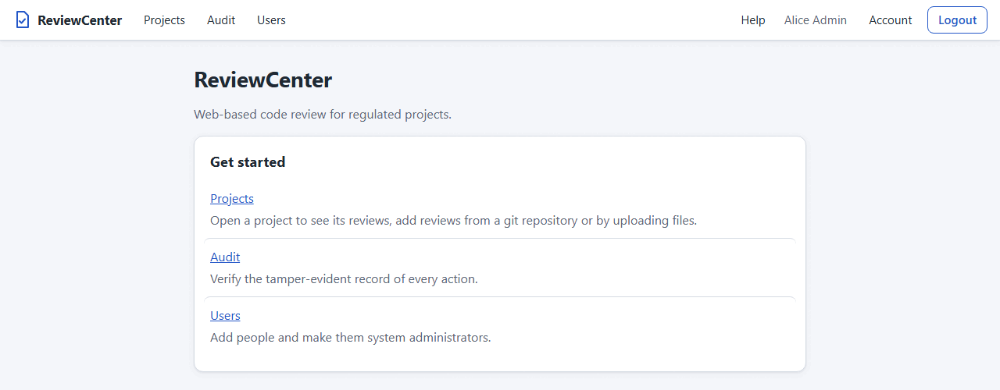
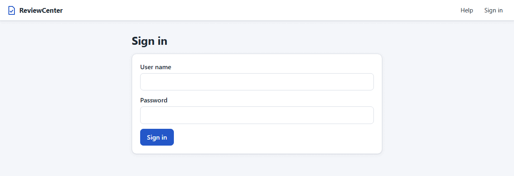
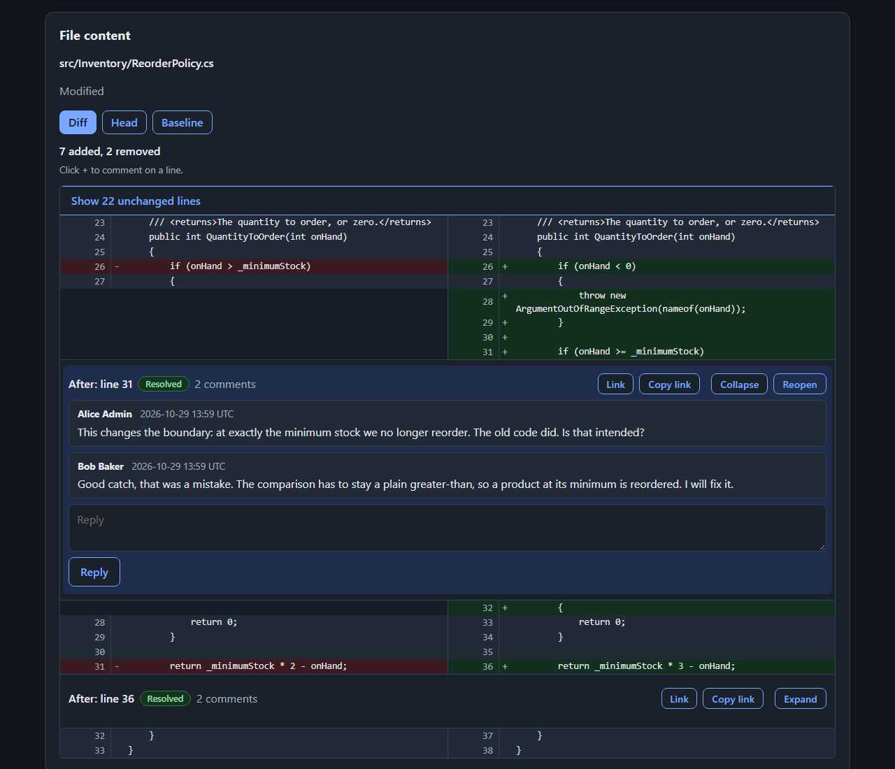
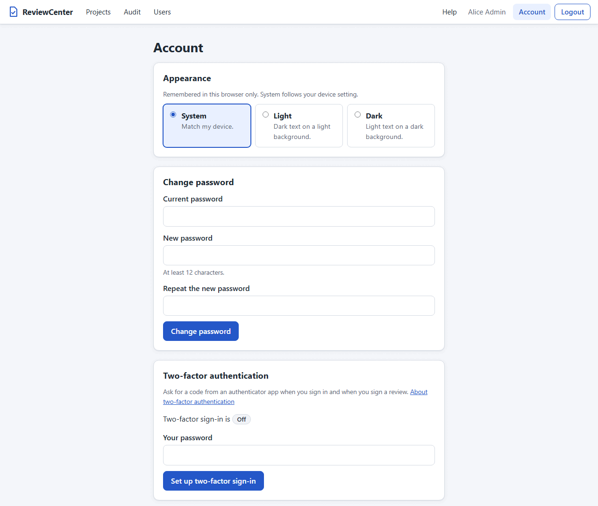

# Users and Sign-in

ReviewCenter keeps its user accounts in its own database. Each user has a user name, a display name (shown next to
comments and answers), and a password, of which only a salted hash is stored. An account of a person who signs in with
an OpenID Connect provider (see Sign In with an OpenID Connect Provider in this chapter) is the exception: it has no
password and is found by the issuer and the subject of the provider. A user is either an ordinary user or a **system
administrator**, who manages users, projects, and project membership; what an ordinary user may do depends on the
projects the user is a member of (see Access and Visibility in the Administration chapter). Every comment, checklist
answer, and change of section applicability is recorded under the signed-in user, who cannot be chosen or typed in.

## Create the First Administrator

A new database has no users, so nobody can sign in yet. Create the first user, who must be a system administrator, on
the command line, with the server stopped or running:

```bash
reviewcenter user add --username admin --display-name "Ada Admin" --system-admin
```

The options are `--username` (3 to 50 letters, digits, `.`, `_`, or `-`; unique regardless of letter case),
`--display-name` (1 to 100 characters), and the switch `--system-admin` (omit it to create an ordinary user). The user
is created in the configured database (see Database in the Administration chapter). The password is never given as
an option, because a
command line is visible to other processes and is kept in shell history. It is read from the first of these that is
available:

1. The `REVIEWCENTER_PASSWORD` environment variable.
2. The first line of standard input, when input is redirected.
3. An interactive prompt that does not show what you type and asks twice.

```bash
# Linux: from the environment
REVIEWCENTER_PASSWORD='a long passphrase' reviewcenter user add --username admin --display-name "Ada Admin" --system-admin
```

```powershell
# Windows PowerShell: from standard input
"a long passphrase" | .\reviewcenter.exe user add --username admin --display-name "Ada Admin" --system-admin
```

The command prints `Created user 'admin' (system administrator).` (or `Created user 'name'.` for an ordinary user) and
never prints the password. Further users are created on the Users page by a system administrator. When the user cannot
be created (the user name is taken, the password is too short, no password was provided, or the database cannot be
used) it prints an error and exits with a non-zero exit code.



## Sign In and Out

Open any page, or `/login`, enter your user name and password, and press Sign in. When an administrator has turned on
sign-in with an OpenID Connect provider, the page also shows a **Sign in with** button for it (see Sign In with an
OpenID Connect Provider). After signing in you are taken to
the page you asked for. A failed sign-in always shows the same message, whatever the reason (unknown user name, wrong
password, disabled account, or locked account), so the message does not reveal which user names exist. After several
failed attempts you are asked to wait a few minutes (see Password Rules and Lockout). The page header
shows your display name, an Account link, and a Logout button (see The Page Frame in the Installation chapter); when
nobody is
signed in it shows a Sign in link instead.



The sign-in is kept in a session cookie that lasts 8 hours of activity by default and is gone when the browser is
closed. Change the length with the `Auth:SessionHours` setting (environment variable `Auth__SessionHours`), a number
of hours above 0; the server does not start when the value is not valid. Disabling a user or changing the role of a
user takes effect the next time that user loads a page, and on a page that is already open at its next check (see
Session Ended on an Open Page).

| Setting                    | Environment variable        | Meaning                                       |
| -------------------------- | --------------------------- | --------------------------------------------- |
| `Auth:SessionHours`        | `Auth__SessionHours`        | Hours of sign-in session (default 8; > 0)     |
| `Auth:RevalidationSeconds` | `Auth__RevalidationSeconds` | Seconds between open-page checks (default 30) |

The sign-in throttle (see Password Rules and Lockout) is set with the following settings; the server does not start
when a value is not valid.

| Setting                                   | Environment variable                        |
| ----------------------------------------- | ------------------------------------------- |
| `Identity:Throttle:MaxFailuresPerName`    | `Identity__Throttle__MaxFailuresPerName`    |
| `Identity:Throttle:MaxFailuresPerAddress` | `Identity__Throttle__MaxFailuresPerAddress` |
| `Identity:Throttle:WindowSeconds`         | `Identity__Throttle__WindowSeconds`         |

`MaxFailuresPerName` is the attempts per address and user name (default 5; above 0), `MaxFailuresPerAddress` the
attempts per address over all names (default 20; not below the per-name value), and `WindowSeconds` the length of the
window (default 300; 1 to 86400).

## Session Ended on an Open Page

A page that you leave open checks every 30 seconds by default that you are still allowed to use it. Change the
interval with the `Auth:RevalidationSeconds` setting (environment variable `Auth__RevalidationSeconds`), a number of
seconds that is at least 5; the server does not start when the value is lower. The check ends your session when your
user was disabled or removed, or when your user name, display name, or role was changed. When that happens the page
content is replaced by a **Session ended** message with a link to sign in again, and the page no longer shows data or
accepts actions. If the check cannot be completed, for example because the database cannot be read, the session is
treated as ended too, so a user who cannot be verified is never kept signed in.

Some things to know:

- The check is periodic, so for up to one interval after a change the open page still shows its content and accepts
  actions that are not re-checked, such as answering a checklist check or adding a comment. Signing a review and
  every action on the Users page check the account again each time and are refused at once. Once the page itself has
  ended, every action that changes something (for example creating a project or review, or resolving a thread) is
  refused with a message and saves nothing.
- The page header, which shows your display name, keeps the old name until you navigate to another page or reload.
  Anything you typed on the page that ended is lost, because the page content is replaced.
- Use the link in the message to sign in again, and you return to the page you were on.

## Password Rules and Lockout

- A password has 12 to 128 characters. There are no other composition rules, so a long phrase is a good password.
  Spaces are part of the password.
- After 5 failed sign-ins in a row for a user name, that user name is locked for 5 minutes, even for the right
  password. A successful sign-in before that resets the count. A system administrator can end a lockout at once with
  **Unlock** on the Users page (see Manage Users in the Administration chapter).
- The server also limits the sign-in attempts of one client address, whatever the user name. By default an address
  may try one user name 5 times and all user names 20 times in 5 minutes; after that the login page says "Too many
  sign-in attempts. Try again in a few minutes." and refuses even the right password until the time has passed. The
  message is the same whether or not the user name exists. A successful sign-in gives its attempts back, but only to
  the window that was counted.

## Sign In with an OpenID Connect Provider

An administrator can let people sign in with the account they already have at an identity provider (Microsoft Entra ID,
Keycloak, Okta, Google, or any other provider that follows OpenID Connect). It is off by default. When it is on, the
sign-in page shows a **Sign in with** button with the name of the provider next to the form for local accounts, and
both ways work side by side.

**Turn it on.** Register ReviewCenter at the provider as a confidential web client that uses the authorization code
flow. Give the provider the redirect address `https://<your server>/signin-oidc` (the address that people use to reach
ReviewCenter, followed by `/signin-oidc`). Then set the following and restart the server. The environment variable of
a setting has two underscores in place of each colon (for example `Identity__Oidc__ClientId`). The server does not
start when a value is not valid, and the message names the setting but never its value.

| Setting                              | Meaning                                         |
| ------------------------------------ | ----------------------------------------------- |
| `Identity:Oidc:Enabled`              | `true` to turn it on (default `false`)          |
| `Identity:Oidc:Authority`            | Address of the provider                         |
| `Identity:Oidc:ClientId`             | The client id of ReviewCenter                   |
| `Identity:Oidc:ClientSecret`         | The client secret (give this or the file below) |
| `Identity:Oidc:ClientSecretFile`     | Path of a file that holds the client secret     |
| `Identity:Oidc:Scopes`               | Scopes (default `openid profile email`)         |
| `Identity:Oidc:DisplayName`          | Name on the button (default OpenID Connect)     |
| `Identity:Oidc:UsernameClaim`        | Claim for the user name (`preferred_username`)  |
| `Identity:Oidc:RequireEmailVerified` | Refuse an e-mail that is not verified (off)     |
| `Identity:Oidc:ReauthMaxAgeSeconds`  | How recent a login for a signature must be      |

Keep the client secret in the environment, in a secret store, or in a file that only the service can read, never in a
file in a repository (for example the environment variable `Identity__Oidc__ClientSecret`, or a file named by
`Identity:Oidc:ClientSecretFile`). The client secret is **required** when the sign-in is on:
ReviewCenter is a confidential client, so a public client that relies on PKCE alone is not supported, and the server
does not start when the secret is missing, empty, or only white space. Give the secret in one form only: when both
`ClientSecret` and `ClientSecretFile` are set, the server does not start. With `ClientSecretFile`, the server reads
the file as UTF-8 text and removes the line break and the spaces around the secret; the file may be at most 8 KB, and
the server does not start when it is missing, cannot be read, or is empty. The message names the setting (and the path
of the file) and never shows the secret. A recipe is in the Identity Providers chapter. The address of the
provider must use `https`; `http` is accepted only for a provider on the same machine (`localhost`) so that it can be
tried. `ReauthMaxAgeSeconds` is the age that the login at the provider may have when a signature is confirmed (default
120; 10 to 900).

The provider must also send the moment of the login (`auth_time`) for a signature to be confirmed. Step-by-step
recipes for Microsoft Entra ID, AD FS, Okta and Keycloak, a comparison of what each provider sends, and a list of
failures with their causes are in the Identity Providers chapter.

**What happens at the first sign-in.** ReviewCenter identifies the person by the **issuer and the subject** that the
provider gives, and by nothing else. A name or an e-mail address is never used to find an account, and an account at a
provider is **never linked to a local account**, even when the user names are the same. The first time, ReviewCenter
creates an account that is enabled, is not a system administrator, and has no project, so the person sees nothing until
a project administrator adds them to a project (see Managing Project Members in the Administration chapter) or a
system
administrator changes their role. The display name is the `name` claim of the provider (else the user name), cleaned;
the user name is made from the claim that you chose (else the part of the e-mail address before the `@`, else the
subject) and is made unique with a number if it is already taken. The Users page marks these accounts
with **OIDC**. A system administrator can disable such an account like any other, and a disabled account cannot sign in.

**No password.** An account of a provider has no password: the password sign-in is refused for it, the Account page says
that the password is managed by the provider, and the Users page offers no password action for it. The provider
decides how the person proves who they are, including multi-factor sign-in.

**Sign out.** Logout ends the session of ReviewCenter only. The session at the provider stays, so signing in with the
button again may not ask for anything.

**Signatures.** A person who signs in with a provider confirms a signature by signing in at the provider again, since
there is no password to type. On the review page, **Confirm identity with** the provider takes the person to the
provider, which asks for a fresh login. ReviewCenter accepts it only when the login was made just now (within the
setting above), by the same person as the account (the same subject at the same issuer), and then offers the signature
for this reviewer slot. The confirmation is used up by one signature and cannot be used for another slot, another
review, or another person. When anything is missing or does not match, nothing is signed. A token of the API still
cannot sign.

A confirmation fails closed when the provider does not report a usable sign-in time (`auth_time` is missing, is not a
whole number of seconds, or is out of range), or reports a login that is not recent enough. The review page then says
so instead of the general message, so an administrator knows what to fix (for the first cause it names `auth_time` and
asks an administrator to check that the provider sends it as a whole number of seconds since 1970); see the Identity
Providers chapter.

**When it fails.** Every failure at the sign-in page gives one general message (the provider failed or refused, the
account is disabled, the answer could not be checked), so the page does not tell an attacker which. The cause is
recorded as a short class in the audit trail (see Recorded Actions in the Administration chapter). The callback is
limited per
client address only (by default 20 callbacks in 5 minutes, the address limit of the password sign-in; see Password
Rules and Lockout); it has no limit per name, so bad callbacks from one shared address cannot lock out other people
behind it before the address limit is reached, and a callback that succeeds gives its attempt back. A return address
that is not on this server is replaced by the
home page.

**What is never logged.** ReviewCenter does not log or store the tokens, the claims, or the client secret of the
provider.

## Account

Open `/account` (the Account link in the header) to choose how ReviewCenter looks, to change your password, and to
manage your API tokens.

The **Appearance** card offers **System**, **Light**, and **Dark**. **System** is the default and follows the light or
dark setting of your device; **Light** and **Dark** always use that theme. The choice applies as soon as you select
it and is remembered in this browser only: it is not an account setting, so another browser or device starts with
**System** again.



To change your password, enter the current password and the new
password, and press the change button. If your account has a second factor (see
[Two-Factor Sign-in](#two-factor-sign-in)), the form also asks for a current code of your authenticator app or a
recovery code, and the password alone is not enough. A wrong current password or a wrong code counts as a failed
sign-in for the lockout. The fields are cleared afterwards. If you signed in with a temporary password (an account
that a project administrator created for you, or a password that a system administrator set for you), the page shows
only this form, asks for the temporary password as the
current one, and sends you to the sign-in page with a notice when the password is changed; see
Managing Project Members in the Administration chapter.

The **API tokens** card creates and revokes the personal access tokens that let a script or tool use the API as you
(see the Automation and API Tokens chapter):

1. Type what the token is for (1 to 100 characters), choose the expiry (**30 days**, **90 days**, or **365 days**;
   90 is selected at first), and press **Create token**.
2. The value of the token, which starts with `rcpat_`, is shown **once**, in a box with **Copy** and **Done**
   buttons. Copy it before you press **Done** or leave the page: it cannot be shown again.
3. The list shows each token with its name, a short identifier, its state (**Active**, **Expired**, or **Revoked**),
   when it was created and expires, and when it was last used (to within five minutes; **never** until it is used).
   The value is never listed.
4. **Revoke** stops a token at once. An expired or revoked token has no button.

A user has at most 20 active tokens; expired and revoked tokens do not count. The card has an **About API tokens**
button that opens the Help topic.

The **Two-factor authentication** card, for an account with a ReviewCenter password, turns on a second factor; see
[Two-Factor Sign-in](#two-factor-sign-in).

## Two-Factor Sign-in

A local account can have a **second factor** in addition to the password: a 6-digit code from an authenticator app
(any app that makes time-based one-time passwords, RFC 6238, such as the apps of Microsoft, Google, or a password
manager). It is optional, and every person decides for their own account. A stolen, guessed, or phished password then
no longer opens the account or signs a review. An account at an OpenID Connect provider has no password and no second
factor here; the provider protects it (see
[Sign In with an OpenID Connect Provider](#sign-in-with-an-openid-connect-provider)). The code is 6 digits of SHA-1,
changes every 30 seconds, and is accepted one step before and after the current one to allow for a clock that is a
little off.

| Setting                 | Environment variable      | Meaning                                                   |
| ----------------------- | ------------------------- | --------------------------------------------------------- |
| `Identity:Totp:Enabled` | `Identity__Totp__Enabled` | `true` (default) offers the second factor; `false` is off |
| `Identity:Totp:Issuer`  | `Identity__Totp__Issuer`  | Name shown in the app (default `ReviewCenter`; up to 64)  |

The server does not start when the issuer is not valid (it must not contain a colon or a control character).

> **Security warning.** With `Identity:Totp:Enabled` set to `false`, nobody is asked for a code at sign-in or at a
> signature, **also not the accounts that have a second factor**: they are protected by the password alone until the
> setting is `true` again. The stored secrets are kept, so turning the feature on again restores the protection.
> Do not leave the feature off on a server that people use for approvals.

**Turn it on.** Open the Account page, find the **Two-factor authentication** card, type your password, and press
**Set up two-factor sign-in**. The card shows a secret key as text and an `otpauth://` address (there is no QR code
yet): type the key into the authenticator app, or let the app read the address. Type the 6-digit code that the app
shows and press **Turn on**. A setup that is not confirmed within 15 minutes ends, and **Cancel** gives it up. After
the code is confirmed, the card shows **10 recovery codes**, once. Save them apart from your password (a password
manager or a printout) and press **I have saved them**; they cannot be shown again.



**Sign in.** Type the user name and the password as always. Instead of opening your session, ReviewCenter then shows a
second page that asks for a code. Type the current code of the app and press **Sign in**. A code works only once. The
second step must be completed within 5 minutes and in the same browser, from the same address; after that, or when
the answer is not valid, you start again from the first page. Nothing is known about you until the code is right: no
session exists after the password alone. A wrong code gives one general message, whether it is wrong, expired, or was
already used.

**Lockout and throttle.** A wrong code counts like a wrong password: both share the same count, so 5 wrong attempts in
a row lock the account for 5 minutes (see Password Rules and Lockout), and the second step is limited per client
address like the first. A right password between wrong codes does not reset the count; a completed sign-in does.

**If you lose the phone.** On the second page type one of the **recovery codes** in place of the 6-digit code (they
look like `abcd-efgh-jkmn-pqrs`; capitals, spaces, and hyphens do not matter). Each recovery code works once and is
recorded when used. Afterwards turn the second factor off and set it up again, or press **Get new recovery codes** (it
needs the password and a code of the app); the old codes then stop working. The card shows how many you have left. A
recovery code is for getting in and never signs a review.

**Signing a review.** A reviewer with a second factor types the password **and** a current code in the signing form.
The password is checked first. A code works only once, also across the sign-in and the signing, so when you used the
code of the current 30 second period to sign in you must **wait for the next code** before you sign; the form then
says only that the password or the code is incorrect. Wrong codes count toward the lockout. A reviewer without a second
factor, and a reviewer at an identity provider, sign as before.

**Change your password.** With a second factor on, the form on the Account page that changes your password also asks
for a current code (or a recovery code). A code works only once, also across the sign-in and this form, so after you
signed in with the code of the current period, wait for the next code. A missing or wrong code is refused with one
general message, counts toward the lockout like a wrong password, and changes nothing; the count is cleared only when
the password and the code are both right. A person with a temporary password, and an account without a second factor,
change the password as before.

**Turn it off.** In the **Turn off two-factor sign-in** section of the card, type your password and a current code (or
a recovery code) and press **Turn off**. The secret and the recovery codes are deleted.

**Administrator reset.** A system administrator sees a **TOTP** badge on the Users page and can press **Reset
two-factor** for a person who has neither the phone nor a recovery code. That removes the second factor and the
recovery codes; the person signs in with the password alone and can set it up again. A project administrator cannot do
this, and neither can an API token. The reset works also while the feature is off. Setting a new password for a person
(see Manage Users in the Administration chapter) does **not** turn the second factor off: the person still
needs a code
at the next sign-in.

**Good to know.**

- Turning it off or an administrator reset does **not** sign anybody out: sessions that are already open stay valid.
  A sign-in that was waiting for its code is ended.
- While the feature is off (`Identity:Totp:Enabled` is `false`), no code is asked for anywhere, also not when you
  change your password; the stored secrets are kept.
- The sign-in with an identity provider and the API tokens are not affected: a token never needs a code, and it still
  cannot sign.
- The secret of a person is stored encrypted with the Data Protection key ring of the server (the
  `DataProtection:KeysPath` folder; see How the Token Is Protected in the Administration chapter). Back it up
  separately from the database. If the keys are lost, the codes of the app can no longer be checked: the
  recovery codes still work, and an administrator can reset the account.
- Recovery codes are stored only as hashes. Setting up, turning off, a reset, new recovery codes, the use of a
  recovery code, and wrong codes are recorded in the audit trail (see Recorded Actions in the Administration
  chapter), never
  the secrets or the codes.
- The Help topic **Two-factor sign-in** (`/help/two-factor`) explains the same steps to the users.

**Planned.** Enforcement, so that a second factor is required for system administrators or by a policy of a project,
is planned and not part of this release: today the choice is the person's own. A QR code for the setup is planned too.
